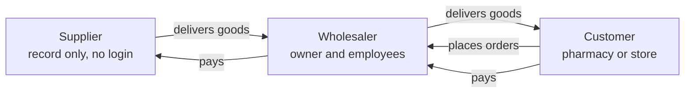
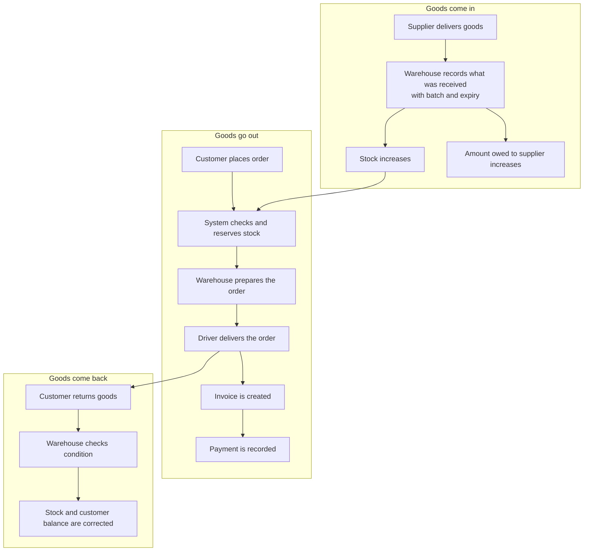

# Overview

## What we are building

A web platform that a wholesaler uses to run daily operations: products, stock, customers, suppliers, receiving goods, orders, warehouse preparation, delivery, invoices, payments, and returns.

The first industries are pharmaceuticals and cosmetics.

**Main principle: operational simplicity over enterprise complexity.** The system does everything it can work out by itself. People only confirm real-world actions (for example "I prepared this order") or make real decisions (for example "use this batch").

## The three parties

| Name | Who they are | In the app? |
|---|---|---|
| **Wholesaler** | The business that uses the platform, holds the stock, and sells to pharmacies and stores | Yes. The owner and employees log in |
| **Customer** | A pharmacy or cosmetics store that buys from the wholesaler | Yes. Each customer has a login |
| **Supplier** | A company that supplies goods to the wholesaler | No. Only a record that employees enter |

## Roles inside the wholesaler

| Role | Main job in the app |
|---|---|
| Owner | Everything, including settings and employees |
| Manager | Daily control: customers, products, orders, delivery trips |
| Sales | Create customers and place orders for them |
| Warehouse | Receive goods, prepare orders, handle stock |
| Accountant | Invoices, payments, balances |
| Driver | Deliver orders and report the result |

## The whole business in one picture

## Modules

1. Dashboard
2. Customer management
3. Product management
4. Inventory management
5. Supplier management
6. Purchasing and goods receiving
7. Order management
8. Warehouse preparation
9. Delivery management
10. Invoice management
11. Payment management
12. Returns management
13. Employee management
14. Basic reports and activity history

## What we are not building in the first version

- More than one warehouse
- GPS, live driver tracking, automatic route planning
- Supplier login or supplier portal
- Different prices for different customers
- Customer credit limits
- Marketplace or sales to end consumers
- Pharmacy point-of-sale
- Purchase order workflow with suppliers
- Egyptian tax or e-invoicing integration
- Real payment gateway integration
- Full accounting

## Glossary

| Term | Meaning |
|---|---|
| On hand | Units physically in the warehouse |
| Reserved | Units promised to orders that have not left the warehouse yet |
| Available | Units a customer can still order. Available = On hand − Reserved |
| Batch | One lot of a product, with its own batch number and expiry date |
| FEFO | "First expired, first out": use the batch that expires soonest |
| Stock movement | One recorded change to stock, with a reason. Stock is never edited directly |
| Receiving | Recording goods that a supplier delivered |
| Preparation | Picking and packing an order in the warehouse |
| Trip | One driver's outing, covering one or more orders |
| Stop | One customer delivery inside a trip |
| Balance | What a customer owes the wholesaler, or what the wholesaler owes a supplier |
