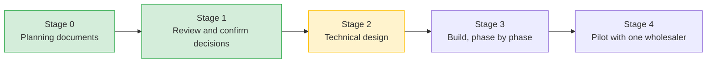
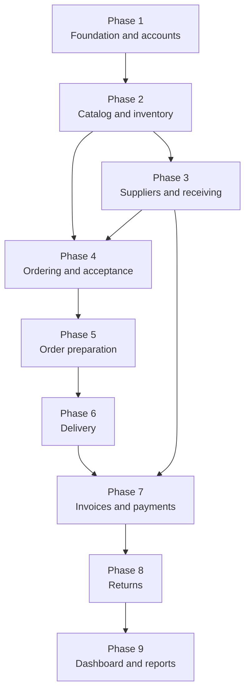
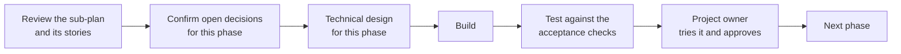

# Master plan

## How we work

1. **Plan before code.** Each phase has a sub-plan, user stories, and workflow diagrams. The project owner approves them before any code for that phase is written.
2. **One complete flow at a time.** Each phase delivers its part of the database, the backend, and the screens together. We do not build one whole layer first.
3. **Every phase ends with something a person can use.** At the end of a phase, a real user can do a real job in the app.
4. **Decisions are tracked.** Nothing marked ASSUMED or OPEN in [Decisions](02-decisions.md) is treated as final.

## Stages of the project

| Stage | What happens | Output |
|---|---|---|
| 0. Planning documents | Write overview, decisions, stories, journeys, workflows, sub-plans | This repository. Done |
| 1. Review | The project owner reads the documents and confirms or changes each assumption | Decisions list with no unreviewed assumptions. Done |
| 2. Technical design | Database tables, API actions, project structure, security | A technical design document. **We are here**: all four parts are written: [database](technical/01-database-design.md), [API](technical/02-api-design.md), [project structure](technical/03-project-structure.md), and [security](technical/04-security.md). They wait for review |
| 3. Build | Build phases 1 to 9 below, one at a time | Working app |
| 4. Pilot | One real wholesaler uses the app | Feedback and fixes |

## Build phases

An arrow means "must be finished first".

| Phase | Sub-plan | A person can now… |
|---|---|---|
| 1 | [Foundation and accounts](sub-plans/01-foundation-and-accounts.md) | Log in. The owner can add employees and customers |
| 2 | [Catalog and inventory](sub-plans/02-catalog-and-inventory.md) | Create products and see stock per batch |
| 3 | [Suppliers and receiving](sub-plans/03-suppliers-and-receiving.md) | Record goods from a supplier and see stock go up |
| 4 | [Customer ordering and acceptance](sub-plans/04-customer-ordering.md) | A pharmacy can browse and order. The stock manager accepts or rejects |
| 5 | [Order preparation](sub-plans/05-order-preparation.md) | The stock manager can prepare an order and choose batches |
| 6 | [Delivery](sub-plans/06-delivery.md) | The delivery manager can assign orders, and a delivery person can deliver and record payment |
| 7 | [Invoices and payments](sub-plans/07-invoices-and-payments.md) | The accountant can confirm payments and follow balances |
| 8 | [Returns](sub-plans/08-returns.md) | An employee can record a customer return |
| 9 | [Dashboard and reports](sub-plans/09-dashboard-and-reports.md) | The owner can see the state of the business on one screen |

After phase 7, the full main journey works from start to finish: goods in, order, acceptance, preparation, delivery, invoice, payment.

## How one phase runs

## What must be confirmed before building starts

These affect the foundation. The project owner has confirmed all of them:

| ID | Decision |
|---|---|
| C-48 | The wholesaler creates customer accounts |
| C-49 | No throwaway prototype. We build the real app one flow at a time |
| C-51 | Arabic and English, working on phones |
| C-52 | Many wholesalers on one platform, each with separate data |
| C-53 | TypeScript and PostgreSQL |

Nothing is open in the decisions list. Small questions that belong to one phase are listed in that phase's sub-plan and answered when the phase begins.
