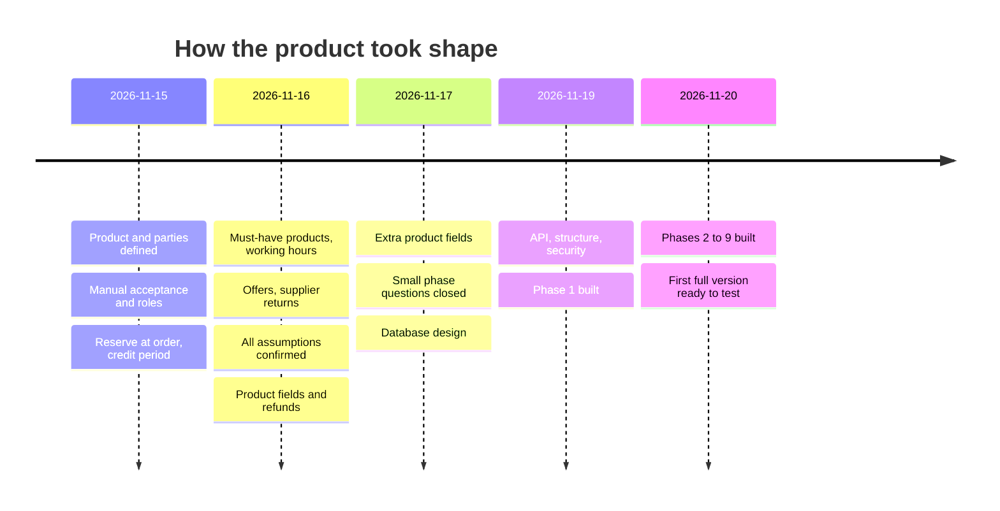

# Decision journal

This journal tells the story of the product: **what** we decided, **why**, **what else we considered**, and **what it costs us**. Read it to understand why the product works the way it does.

It does not replace [Decisions](02-decisions.md). That file is the short list of rules with their IDs, such as C-24. This journal explains the thinking behind the most important ones, in the order they happened.

## How to read an entry

Each entry has the same parts:

- **Context:** the situation or question.
- **Decision:** what we chose.
- **Why:** the reason.
- **Alternatives:** what else we considered.
- **Trade-off:** what we gave up, or what it costs.

## Timeline

---

## Part 1 — What the product is

### J-01 · A platform for wholesalers, not a marketplace
*2026-11-15 · C-01, C-02, C-03*

- **Context:** Pharmacies and cosmetics stores in Egypt order from wholesalers by phone and WhatsApp. Orders, stock, and money are tracked on paper or in spreadsheets.
- **Decision:** Cosmo is a tool for the **wholesaler**. The wholesaler's customers (pharmacies and stores) log in and order. Suppliers are only records with no login.
- **Why:** The wholesaler has the problem and is the one who pays. Customers get a simple way to order. Suppliers keep working the way they do today.
- **Alternatives:** A marketplace where many wholesalers compete for the same pharmacies. Rejected, because it is a different business with different risks.
- **Trade-off:** Each wholesaler must bring their own customers onto the app.

### J-02 · Three names, used everywhere
*2026-11-15*

- **Context:** Early on, the word "distributor" caused confusion about who is who.
- **Decision:** We use only three names: **Wholesaler** (the business using the app), **Customer** (pharmacy or store), and **Supplier** (where the wholesaler buys).
- **Why:** Clear names prevent wrong designs. One word for each party, in every document and screen.
- **Trade-off:** None.

### J-03 · Many wholesalers on one platform, fully separated
*2026-11-16 · C-52, C-86*

- **Decision:** One platform serves many wholesalers. Each has fully separate data and its own login link, for example `/login/nour-pharma`.
- **Why:** One system is cheaper to run and update than one copy per wholesaler.
- **Alternatives:** A separate installation for each wholesaler. This is safer by nature, but costly to run.
- **Trade-off:** Keeping wholesalers apart becomes the most important security rule. We protect it twice: in the code, and in PostgreSQL row level security. Tests try to break it on every change.

---

## Part 2 — How orders work

### J-04 · Orders are accepted by a person, not automatically
*2026-11-15 · C-24*

- **Context:** The first plan accepted every order automatically if stock was available.
- **Decision:** The stock manager (or the owner) accepts or rejects each order. A rejection needs a reason, and the customer sees it.
- **Why:** The wholesaler wants control, for example over customers with unpaid invoices or unusual orders.
- **Alternatives:** Automatic acceptance. Faster, but it removes the wholesaler's judgement.
- **Trade-off:** An order can wait. This is why we added J-07.

### J-05 · Stock is reserved the moment the order is placed
*2026-11-15 · C-25, C-54*

- **Context:** The concern was two customers getting the same last boxes.
- **Decision:** Placing an order reserves the stock at once, before acceptance. On-hand stock goes down only when the goods leave on a trip.
- **Why:** Available stock drops immediately, so nobody is ever promised the same units.
- **Alternatives:** Reserve at acceptance. Rejected, because two orders could be placed for the same units while both wait.
- **Trade-off:** Stock is held while orders wait for acceptance or for the customer's answer.

### J-06 · Reduce instead of reject, with "must have" products
*2026-11-16 · C-38, C-39*

- **Context:** If one product is short, rejecting the whole order is bad for everyone. But a pharmacy often orders *because of* one product.
- **Decision:** The stock manager can reduce a quantity or remove a product, with a reason, but never increase it. The customer marks important products as **must have**. A must-have change waits for the customer to accept or cancel. Other changes continue, and the customer is informed.
- **Why:** One simple mark covers both cases: "go ahead without asking" and "ask me first".
- **Alternatives:** A separate "wait or don't wait" choice per order. Rejected as more confusing.
- **Trade-off:** One extra order status, "Waiting for customer".

### J-07 · Waiting orders are reported after 5 working hours, never cancelled
*2026-11-15 to 2026-11-16 · C-35, C-37*

- **Decision:** An order waiting more than 5 **working** hours is reported to the owner once. The app never cancels it automatically. The owner can cancel it with a reason, and the customer is told.
- **Why:** Cancelling a pharmacy's order automatically damages the relationship. Counting only working hours stops alerts in the middle of the night.
- **Trade-off:** Working hours must be set, so the owner has one more setting.

### J-08 · Customers can order while the warehouse is closed
*2026-11-16 · C-37*

- **Decision:** The owner sets working hours. Customers see "Open now" or "Closed now, opens at 9:00", and they can still order. They are told the order will be reviewed when the warehouse opens.
- **Why:** Pharmacies often order at night after counting their shelves.

---

## Part 3 — Money

### J-09 · Credit per customer, starting from the invoice date
*2026-11-15 · C-26, C-33, C-36*

- **Decision:** Each customer has a "credit allowed" switch and a credit period (default one month). Overdue invoices are shown, but the customer is **not** blocked automatically.
- **Why:** The owner knows their customers and decides case by case.
- **Alternatives:** Credit limits and automatic blocking. Rejected for the first version (C-07).

### J-10 · Payments count only after the accountant confirms them
*2026-11-15 · C-27*

- **Decision:** The delivery person records what they collected. It waits until the accountant confirms that the money really arrived, or rejects it with a reason.
- **Why:** It separates the person holding the cash from the person who checks it.
- **Trade-off:** There is one more step every day for the accountant.

### J-11 · Invoice timing is a setting
*2026-11-16 · C-58*

- **Decision:** The owner chooses when invoices are created: on acceptance, on preparation, or on delivery. The default is on delivery.
- **Why:** Wholesalers really differ here. On delivery, the invoice always matches what the customer received.
- **Trade-off:** Earlier timings need invoice corrections when quantities change. The code updates the invoice automatically.

### J-12 · Returns reduce the unpaid part first
*2026-11-16 · C-63, C-69*

- **Decision:** A return first reduces what is still unpaid on its invoice. Anything left over is paid back or kept as credit, which the wholesaler and the customer choose together. For goods bought with a bonus offer, the credit per unit is the amount paid divided by all units, free ones included.
- **Why:** The customer never gets back more than they paid, and no cash moves when it does not need to.

### J-13 · Items refused at the door are a return
*2026-11-16 · C-47*

- **Decision:** There is no "partially delivered" status. Refused items become a return with a reason, and the credit is taken off the invoice at once.
- **Why:** There is one way to handle goods coming back, whether at the door or later.

---

## Part 4 — Keeping it simple

### J-14 · Few settings, open for more later
*2026-11-16 · C-40*

- **Decision:** The app works one clear way, with few owner settings: working hours, default credit period, invoice timing, near-expiry period, supplier return approval, minimum order value, and extra product fields. A new setting can be added later without redesign.
- **Why:** Every setting adds cases to build, test, and explain. A setting used wrongly causes confusion.
- **Rule we follow:** Add a setting only where real wholesalers work differently.

### J-15 · Owner approval for supplier returns is optional
*2026-11-16 · C-65*

- **Decision:** One switch, off by default. When it is on, supplier returns wait for the owner, and the goods are held so they cannot be sold.
- **Why:** Small owners trust their stock manager, and larger owners want control. The switch affects only one screen, so the risk is low.

### J-16 · Owners add their own product fields, up to 20
*2026-11-17 · C-66, C-71*

- **Decision:** There are fixed fields for medicines and cosmetics, plus up to 20 extra fields the owner adds. Extra fields only store and show information. They never change stock, prices, or rules.
- **Why:** This gives flexibility without a developer, while keeping the product form short.

### J-17 · Notifications inside the app only; SMS later
*2026-11-16 to 2026-11-19 · C-46, C-87, C-92*

- **Decision:** No SMS, WhatsApp, or email in the first version. A forgotten customer password is reset by the owner or a sales employee, who sends a temporary password by WhatsApp from their own phone. A forgotten owner password is reset by the platform team. Reset by SMS code is planned, and the design keeps room for it.
- **Why:** No outside service and no monthly cost at the start.
- **Trade-off:** A customer who forgets the password must wait for a person.

---

## Part 5 — Technology

### J-18 · Next.js, Express, TypeScript, PostgreSQL
*2026-11-15 to 2026-11-19 · C-23, C-53, C-89*

- **Decision:** A Next.js website, an Express backend, TypeScript on both sides, PostgreSQL as the database, and all three in one repository.
- **Why:** Stock and money need strict transactions and row locks, which PostgreSQL does well. TypeScript catches mistakes before the code runs. One repository keeps the frontend and backend in step.

### J-19 · Stock is a ledger
*2026-11-17 · C-09*

- **Decision:** Every stock change is a new row in `stock_movements`, and rows are never edited. The current numbers are kept next to the ledger and updated in the same transaction.
- **Why:** Any stock number can be explained line by line, and a wrong number can be rebuilt.

### J-20 · The backend never trusts the client
*2026-11-19*

- **Decision:** The app sends only choices: products, quantities, and marks. The backend calculates every price, discount, and total from the database.
- **Why:** Anyone can change what a phone sends.

### J-21 · Sessions in the database, not tokens
*2026-11-19 · C-90, C-91*

- **Decision:** Logins are stored as sessions in the database and sent in a secure cookie.
- **Why:** When the owner deactivates someone, that person is logged out at once.

---

## Part 6 — How we work

### J-22 · Plan everything before code
*2026-11-15 to 2026-11-19*

- **Decision:** We wrote the overview, decisions, user stories, journeys, workflows, sub-plans, and the technical design first. We discussed each change before updating the plan.
- **Why:** It is cheaper to change a document than code.
- **Result:** 92 confirmed decisions before the first line of code.

### J-23 · Build phase by phase, one complete flow at a time
*2026-11-19 to 2026-11-20 · C-49*

- **Decision:** Nine phases, each with its database changes, backend, screens, and tests. There is no throwaway prototype.
- **Result:** All nine phases are built, with 79 automatic tests, and each main flow was tried in a phone-sized browser.

### J-24 · Next: the owner tests, then the pilot
*2026-11-20 · open*

- **Decision:** The project owner tries every phase and reports what is wrong or missing. After the fixes, the app goes to a test server and then to a pilot with one real wholesaler.
- **Still to decide:** where to host the app, and how the owner tests: on a computer, or on a test server.

### J-25 · Git branches: a `main` branch for the official version
*2026-11-20 · proposed, not decided*

- **Context:** All code is on one branch, `ccr-ee54ff6e-jcr3p3`. There is no `main` branch.
- **Proposal:** Create `main` from the current code and make it GitHub's default. Each new task gets its own branch and is merged into `main` through a pull request. Deploy only from `main`.
- **Why:** There is one known, working version, and new work cannot break it before review. Hosting services can deploy automatically when `main` changes.
- **Note:** Git treats all branches the same. "main" is a team agreement, not a technical rule.

---

## How to add an entry

When an important decision is made:

1. Add it to [Decisions](02-decisions.md) with its ID.
2. If the reason matters for the future, add an entry here with the date, the IDs, and the parts above.
3. If a decision changes, do not delete the old entry. Add a new one that says what changed and why.
