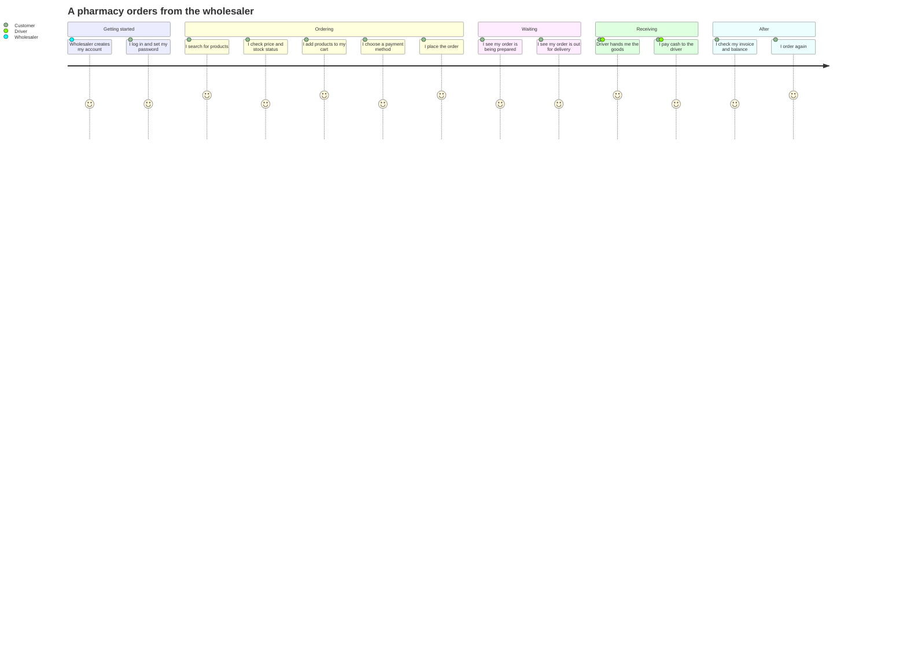
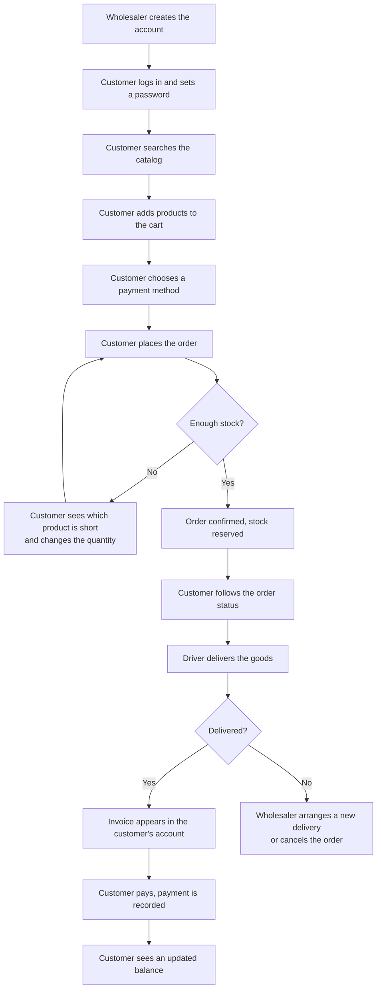

# Customer journey

This follows one pharmacy from its first day on the platform to a paid order. The numbers in the journey diagram are a satisfaction score from 1 (painful) to 5 (easy). They show where the experience must be especially good.

## The journey

## Step by step

## What the customer sees at each order status

| Order status | What the customer sees | What the customer can do |
|---|---|---|
| Placed | "Order received" | Cancel the order |
| Preparing | "Being prepared" | Nothing. Contact the wholesaler to cancel |
| Ready | "Ready for delivery" | Nothing |
| Out for delivery | "On the way" | Nothing |
| Delivered | "Delivered" | See the invoice |
| Partially delivered | "Delivered in part", with the quantities | See the invoice |
| Delivery failed | "Delivery was not completed" | Contact the wholesaler |
| Cancelled | "Cancelled" | Order again |

## Moments that can go wrong

| Moment | Problem | How the plan handles it |
|---|---|---|
| Placing the order | A product ran out while the cart was open | The customer is told which product and how many are available (A-07) |
| Preparation | The warehouse finds less than ordered | The order continues with the smaller quantity, and the customer sees it (A-08) |
| Delivery | Nobody is at the pharmacy | The driver reports a failed delivery. The order is delivered again or cancelled (A-19) |
| After delivery | A product is damaged or wrong | The customer contacts the wholesaler, who records a return and a credit (A-09, A-22) |

## Related stories

[Customer stories](../user-stories/customer.md): CUS-01 to CUS-12.
