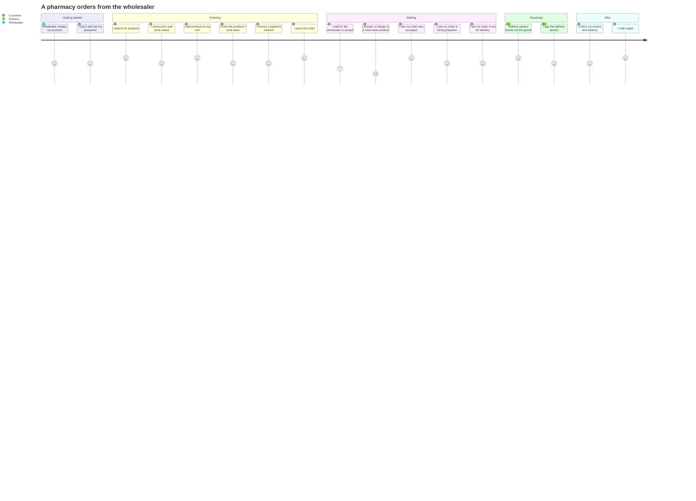
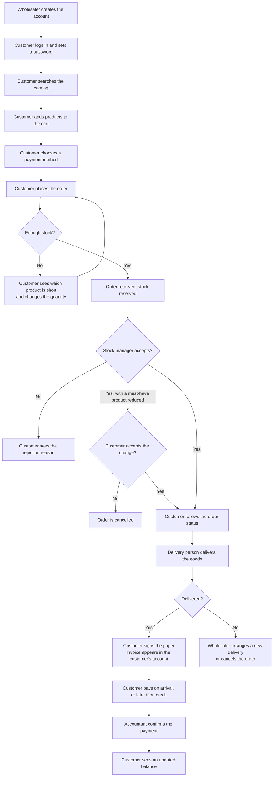

# Customer journey

This follows one pharmacy from its first day on the platform to a paid order. The numbers in the journey diagram are a satisfaction score from 1 (painful) to 5 (easy). They show where the experience must be especially good.

## The journey

## Step by step

## What the customer sees at each order status

| Order status | What the customer sees | What the customer can do |
|---|---|---|
| Placed | "Waiting for acceptance" | Cancel the order |
| Accepted | "Accepted" | Cancel the order |
| Rejected | "Rejected", with the reason | Order again |
| Waiting for customer | "Waiting for your answer", with the change and the reason | Accept the change or cancel the order |
| Preparing | "Being prepared" | Nothing. Contact the wholesaler to cancel |
| Ready | "Ready for delivery" | Nothing |
| Out for delivery | "On the way" | Nothing |
| Delivered | "Delivered" | See the invoice, and any return for items refused at the door |
| Delivery failed | "Delivery was not completed" | Contact the wholesaler |
| Cancelled | "Cancelled", with the reason if the wholesaler cancelled | Order again |

## Moments that can go wrong

| Moment | Problem | How the plan handles it |
|---|---|---|
| Placing the order | A product ran out while the cart was open | The customer is told which product and how many are available (C-54) |
| Acceptance | The wholesaler rejects the order | The customer sees the reason and can order again (C-24) |
| Acceptance | The warehouse is closed | The customer sees "Closed now" and is told the order will be reviewed when it opens (C-37) |
| Acceptance | Nobody answers the order | After 5 working hours the owner is alerted. The order is never cancelled automatically (C-35) |
| Acceptance or preparation | A normal product is short | The order continues with the smaller quantity, and the customer sees the reason (C-38) |
| Acceptance or preparation | A must-have product is short | The order waits. The customer accepts the change or cancels (C-39) |
| Delivery | The customer refuses some items | The items are recorded as a return, and the customer pays only for what they kept (C-47) |
| Delivery | Nobody is at the pharmacy | The delivery person reports a failed delivery. The order is delivered again or cancelled (C-61) |
| Payment | The accountant cannot find the transfer | The payment is rejected with a reason, and the invoice stays unpaid (C-27) |
| After delivery | A product is damaged or wrong | The customer contacts the wholesaler, who records a return and a credit (C-60, C-62) |

## Related stories

[Customer stories](../user-stories/customer.md): CUS-01 to CUS-16.
