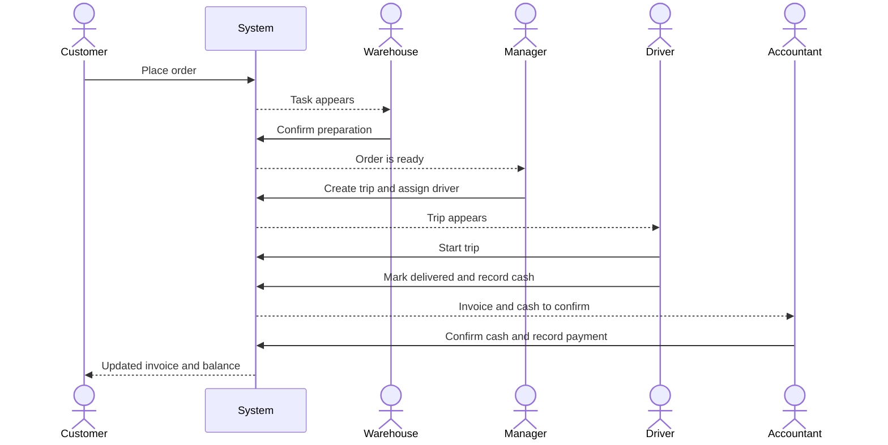
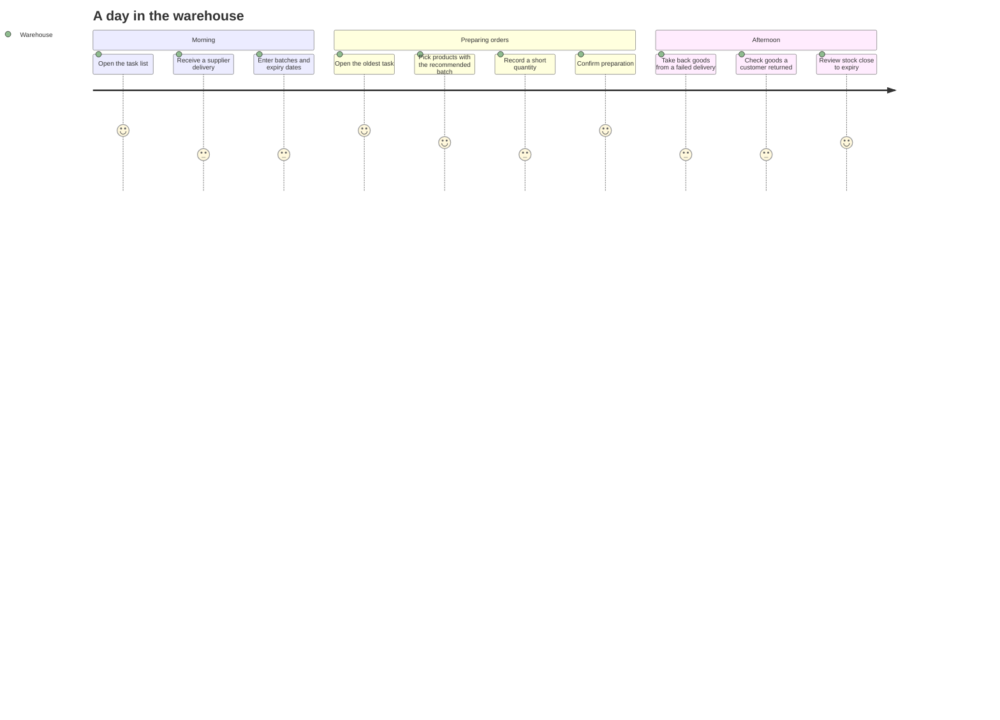
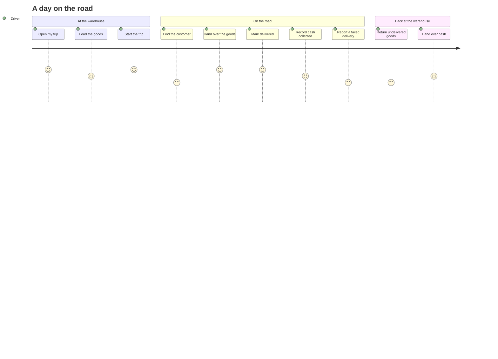
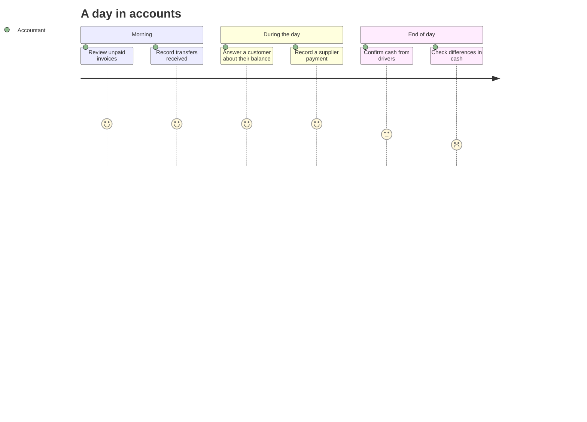
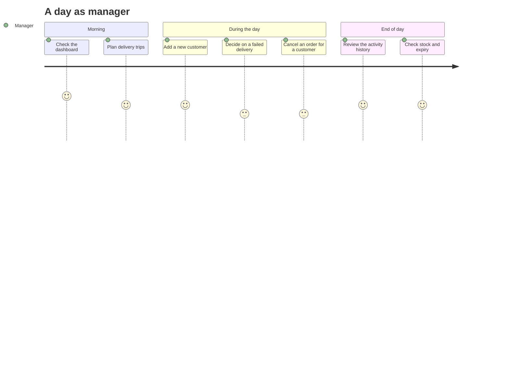
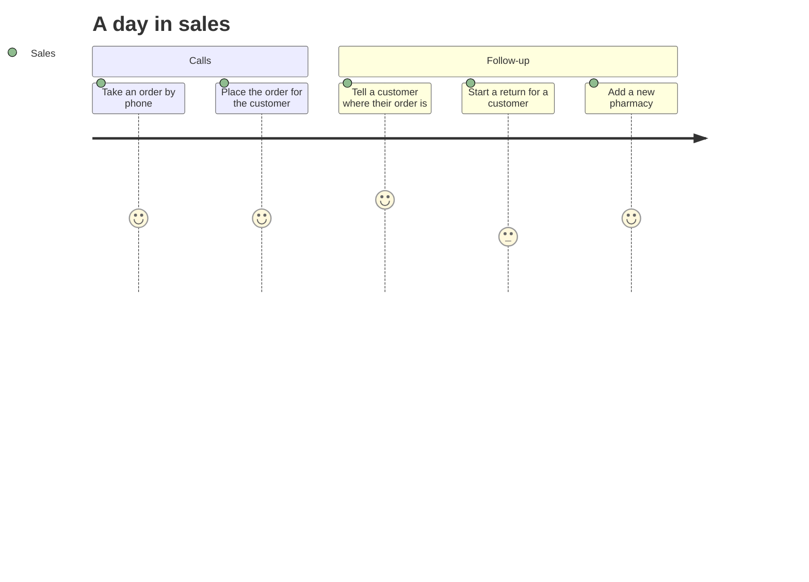

# Employee journeys

A typical day for each role inside the wholesaler.

## How the roles hand work to each other

One order passes through several people. Each person only does their own real-world action. The system does the rest.

## Warehouse employee

Receiving and entering batches score lowest because they involve the most typing. Barcode scanning and remembering the last cost price should reduce that work.

## Driver

## Accountant

Cash differences are the hardest moment. The app must show clearly what the driver recorded against what the accountant received.

## Manager

## Sales employee

## Related stories

- [Warehouse](../user-stories/warehouse.md)
- [Driver](../user-stories/driver.md)
- [Accountant](../user-stories/accountant.md)
- [Owner and manager](../user-stories/owner-and-manager.md)
- [Sales](../user-stories/sales.md)
