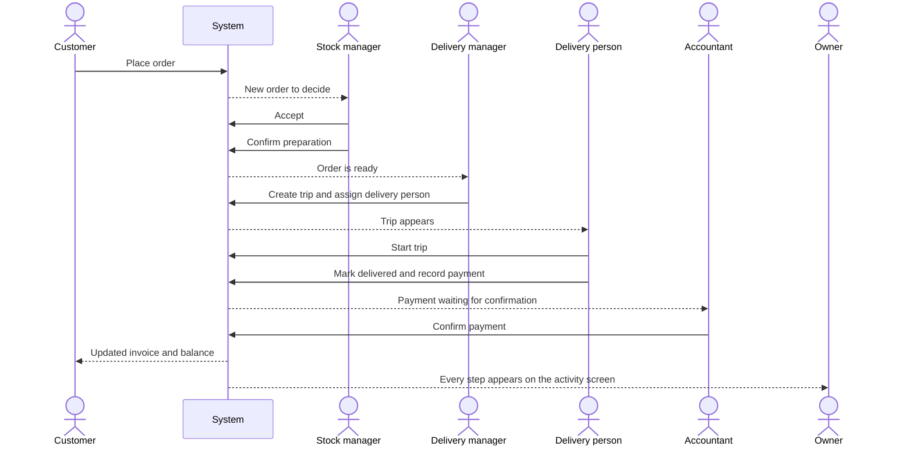
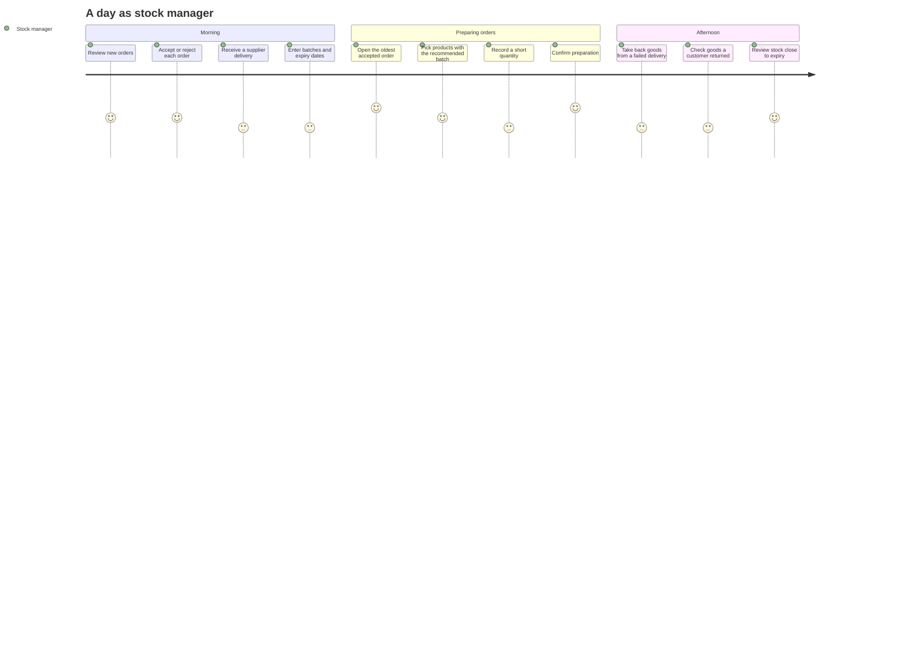
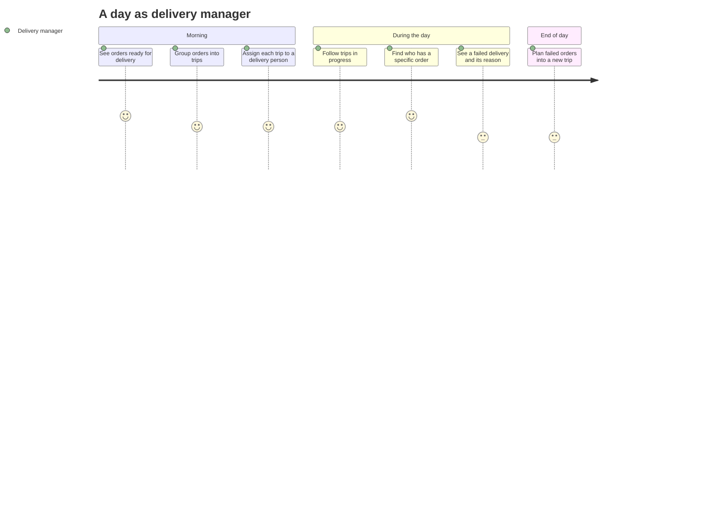
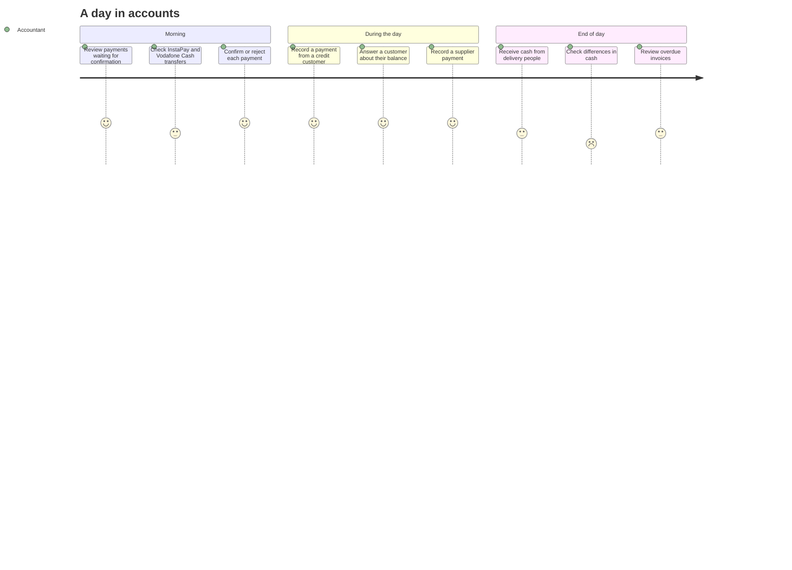
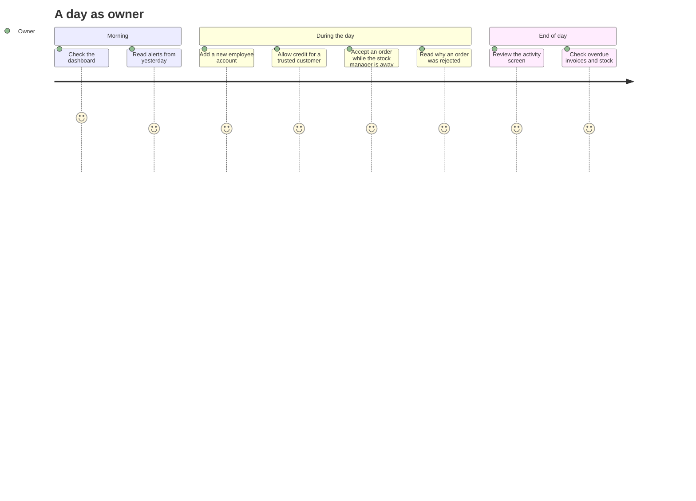
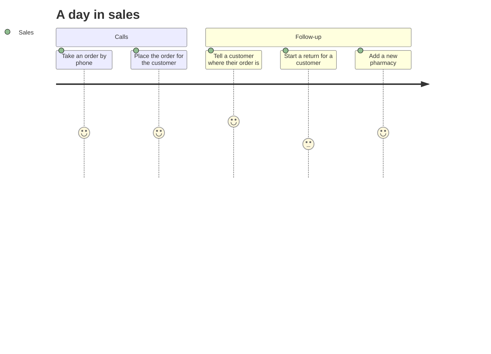

# Employee journeys

A typical day for each role inside the wholesaler.

## How the roles hand work to each other

One order passes through several people. Each person only does their own decision or real-world action. The system does the rest.

## Stock manager

Receiving and entering batches score lowest because they involve the most typing. Barcode scanning and remembering the last cost price should reduce that work.

The stock manager has the most tasks of any role. If the wholesaler grows, this is the first role to split into two.

## Delivery manager

## Delivery person

## Accountant

Cash differences are the hardest moment. The app must show clearly what the delivery person recorded against what the accountant received.

## Owner

## Sales employee

## Related stories

- [Owner](../user-stories/owner.md)
- [Sales](../user-stories/sales.md)
- [Stock manager](../user-stories/stock-manager.md)
- [Delivery manager](../user-stories/delivery-manager.md)
- [Delivery](../user-stories/delivery.md)
- [Accountant](../user-stories/accountant.md)
