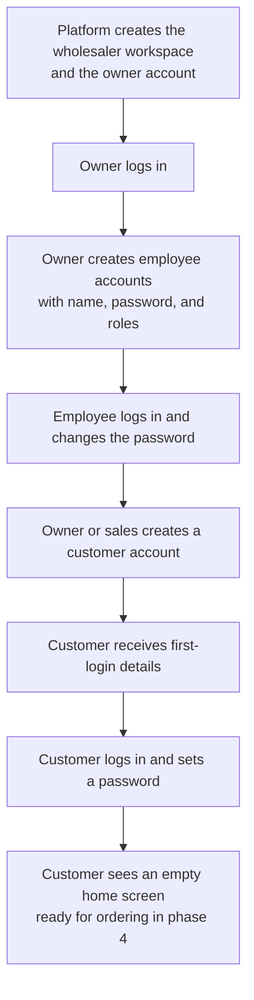

# Sub-plan 1 — Foundation and accounts

## Goal

People can log in, and the owner can set up the business: employees, roles, and customer accounts. Nothing else works without this.

## What a person can do at the end

- The owner logs in and creates employee accounts with a name, a password, and one or more roles.
- An employee logs in and must change the password.
- The owner or a sales employee creates a customer account.
- The owner allows credit for a customer and sets the credit period.
- A customer logs in for the first time, sets a password, and can reset it later.
- Each person sees only the menu items for their role.

## In scope

- The project itself: Next.js frontend, Express backend, database (C-23, C-53)
- Wholesaler workspace, with data separated per wholesaler (C-52)
- Login, logout, first-login password, password reset
- Employee accounts created by the owner, with a forced password change at first login (C-29)
- The six roles, and more than one role per employee (C-22, C-31)
- Customer accounts, including the "credit allowed" switch and the credit period (C-48, C-26)
- App layout and navigation in Arabic and English, working on phones (C-51)
- Activity recording with the employee's name, used by every later phase (C-30)
- Settings area with working hours, built so that more settings can be added later (C-37, C-40)
- Notifications inside the app, built so that other channels can be added later (C-46)

## Not in scope

- Customers registering themselves
- Fine-grained permissions beyond the six roles
- Any business screens (products, orders, and so on)

## Stories

OWN-01, OWN-02 (settings screen only), OWN-03, OWN-04, OWN-05, SAL-01, CUS-01, CUS-02

## Flow

## Depends on

Nothing. This is the first phase.

## Decisions this phase depends on

| ID | Decision |
|---|---|
| C-48 | The wholesaler creates customer accounts |
| C-51 | Arabic and English, working on phones |
| C-52 | Many wholesalers on one platform, each with separate data |
| C-53 | TypeScript and PostgreSQL |
| C-64 | Role permissions, as shown in the user stories table |

Also to decide here: how the customer receives their first-login details (SMS, WhatsApp message sent by the employee, or a printed note), and whether login uses a phone number or an email address.

## Done when

- Every story's acceptance checks pass.
- A user from one wholesaler cannot see any data of another wholesaler.
- A deactivated employee or customer cannot log in.
- The project owner has tried it and approved.
