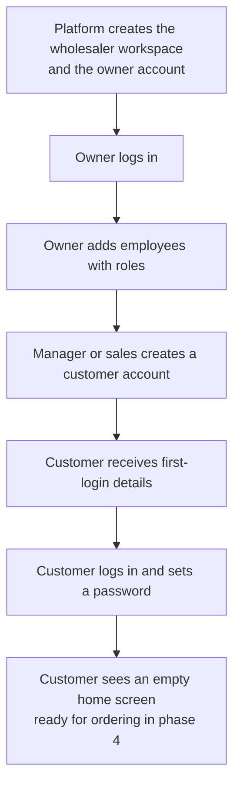

# Sub-plan 1 — Foundation and accounts

## Goal

People can log in, and the owner can set up the business: employees, roles, and customer accounts. Nothing else works without this.

## What a person can do at the end

- The owner logs in and adds employees with roles.
- A manager or sales employee creates a customer account.
- A customer logs in for the first time, sets a password, and can reset it later.
- Each person sees only the menu items for their role.

## In scope

- The project itself: Next.js frontend, Express backend, database (C-23, A-20)
- Wholesaler workspace, with data separated per wholesaler (A-12)
- Login, logout, first-login password, password reset
- Employees and the six roles (C-22)
- Customer accounts, including the "credit allowed" switch (A-01, A-14)
- App layout and navigation in Arabic and English, working on phones (A-11)
- Activity history recording, used by every later phase

## Not in scope

- Customers registering themselves
- Fine-grained permissions beyond the six roles
- Any business screens (products, orders, and so on)

## Stories

MGR-01, MGR-02 (settings screen only), MGR-03, MGR-04, SAL-01, CUS-01, CUS-02

## Flow

## Depends on

Nothing. This is the first phase.

## Decisions to confirm before this phase

| ID | Question |
|---|---|
| A-01 | The wholesaler creates customer accounts |
| A-11 | Arabic and English, working on phones |
| A-12 | Many wholesalers on one platform, each with separate data |
| A-20 | TypeScript and PostgreSQL |
| O-07 | Role permissions (first proposal is in the user stories) |

Also to decide here: how the customer receives their first-login details (SMS, WhatsApp message sent by the employee, or a printed note), and whether login uses a phone number or an email address.

## Done when

- Every story's acceptance checks pass.
- A user from one wholesaler cannot see any data of another wholesaler.
- A deactivated employee or customer cannot log in.
- The project owner has tried it and approved.
