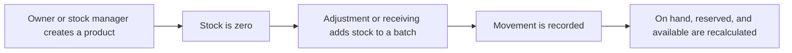

# Sub-plan 2 — Catalog and inventory

## Goal

The wholesaler has a product catalog and can see stock per product and per batch. Stock changes only through recorded movements.

## What a person can do at the end

- The owner creates and edits products and prices. The stock manager can edit products but not prices.
- The stock manager sees on hand, reserved, and available for each product, and the batches behind it.
- The stock manager corrects stock with a reason, and the owner gets an alert.
- The stock manager records damaged, lost, or expired stock.

## In scope

- Products with common fields, medicine fields, and cosmetic fields, and an active or inactive status (C-66)
- A "keep cold" mark for fridge products (C-68)
- Batch and expiry tracking, switched on per product (C-13)
- Stock per batch: on hand, reserved, available (C-08)
- Stock movements as the only way stock changes (C-09)
- Manual adjustments with a reason (C-10)
- Damaged, lost, and expired stock
- List of stock close to expiry and expired stock, with a near-expiry period of six months by default (C-55, C-45)
- Offers on products: percent discount or bonus units, with optional dates (C-41)
- Barcode search

## Not in scope

- Receiving from suppliers (phase 3). In this phase, opening stock is entered with an adjustment
- Reservation by orders (phase 4)
- Unit conversion (C-50)
- Customer-specific prices (C-06)
- Product variants. Each shade or size is its own product (C-67)
- Controlled medicines with special records (C-70)

## Stories

OWN-06, OWN-07, OWN-13 (creating offers; they affect orders from phase 4), STK-14, STK-15, STK-16

## Workflow

[Inventory movements](../workflows/07-inventory-movements.md) and [Product fields](../workflows/10-product-fields.md)

## Depends on

Phase 1 (login and roles).

## Decisions this phase depends on

| ID | Decision |
|---|---|
| C-66 | Product fields for medicines and cosmetics |
| C-67 | Each shade or size is its own product |
| C-50 | One selling unit per product, no conversion |
| C-55 | Expired batches cannot be sold |

## Done when

- Every story's acceptance checks pass.
- On hand is never negative, and reserved is never more than on hand.
- Every stock change shows who did it, when, and why.
- The project owner has tried it and approved.
