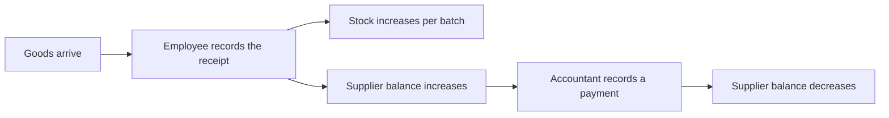

# Sub-plan 3 — Suppliers and receiving

## Goal

The wholesaler records goods delivered by suppliers. Stock goes up, and the amount owed to the supplier goes up.

## What a person can do at the end

- An employee keeps a list of suppliers.
- The stock manager records a delivery with quantities, cost prices, batches, and expiry dates.
- The accountant sees what is owed to each supplier and records payments.

## In scope

- Supplier records: name, contact, phone, address (C-03)
- Receipts: supplier, products, quantities, cost price, batch, expiry, supplier invoice number (C-04)
- Stock increase and stock movements on confirmation
- Supplier balance, calculated from receipts and payments
- Supplier payments, including partial payments

## Not in scope

- Purchase orders (C-04)
- Supplier login (C-03)
- Returns to suppliers (O-02)
- Comparing supplier prices

## Stories

STK-01, STK-02, ACC-09, ACC-10

## Workflow

[Receiving goods from a supplier](../workflows/02-receiving-from-supplier.md)

## Depends on

Phase 2 (products, batches, stock movements).

## Decisions to confirm before this phase

| ID | Question |
|---|---|
| O-03 | Is the supplier's invoice always recorded with the receipt, or can it arrive later? |
| O-02 | Are returns to suppliers needed in the first version? |

Also to decide here: whether a new cost price on a receipt changes the product's cost price automatically.

## Done when

- Every story's acceptance checks pass.
- A confirmed receipt increases stock and the supplier balance together, or neither.
- A supplier's balance equals its receipts minus its payments.
- The project owner has tried it and approved.
