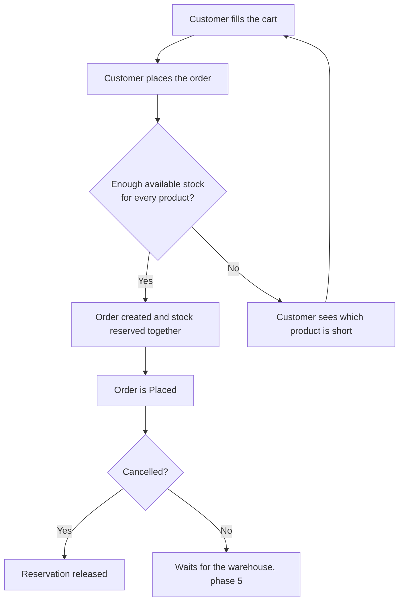

# Sub-plan 4 — Customer ordering

## Goal

A customer can browse the catalog and place an order. The system checks and reserves stock automatically.

## What a person can do at the end

- A customer searches the catalog, fills a cart, chooses a payment method, and places an order.
- A sales employee places an order for a customer.
- The customer follows the order and can cancel it before preparation starts.
- A manager sees all orders and can cancel one.

## In scope

- Customer catalog with search and filters
- Cart and checkout
- Payment method choice, with credit only for allowed customers (C-16, A-14)
- Stock check and automatic reservation in one step (C-11, A-07)
- Order list and order detail for customers and employees
- Cancellation and release of reservation (C-12, A-06)
- Orders placed by sales staff (A-13)

## Not in scope

- Preparation, delivery, and invoices (phases 5 to 7). In this phase an order stops at Placed
- Backorders or waiting lists
- Discounts and bonus units, unless O-01 is decided
- Editing an order after it is placed. The customer cancels and orders again

## Stories

CUS-03 to CUS-09, SAL-02 to SAL-04, MGR-08

## Workflow

[Order lifecycle](../workflows/01-order-lifecycle.md)

## The hardest part

Two customers can order the last units of the same product at the same moment. Only one may succeed. This phase must be built and tested so that available stock can never go below zero.

## Depends on

Phase 1 (customer accounts), phase 2 (products and stock), phase 3 (so that there is real stock to sell).

## Decisions to confirm before this phase

| ID | Question |
|---|---|
| O-01 | Discounts and bonus units |
| A-03 | Orders are accepted automatically |
| A-06 | Who can cancel, and until when |
| A-07 | No ordering above available stock |
| A-13 | Sales staff can order for a customer |
| A-14 | "Credit allowed" switch per customer |
| A-18 | Customers see "in stock" or "out of stock" only |

Also to decide here: whether there is a minimum order value.

## Done when

- Every story's acceptance checks pass.
- Two orders placed at the same time can never reserve more than the available stock.
- Placing the same order twice by accident creates one order.
- Cancelling returns the available quantity to its earlier value.
- The project owner has tried it and approved.
