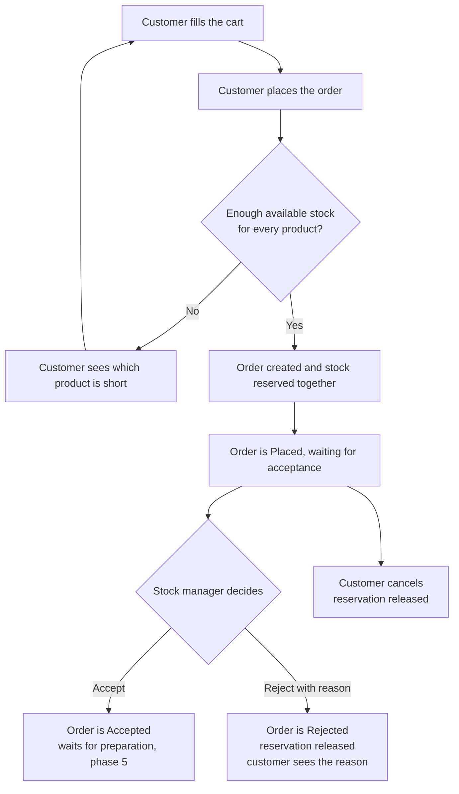

# Sub-plan 4 — Customer ordering and acceptance

## Goal

A customer can browse the catalog and place an order. The system reserves the stock at once, and the stock manager accepts or rejects the order.

## What a person can do at the end

- A customer searches the catalog, fills a cart, chooses a payment method, and places an order.
- A sales employee places an order for a customer.
- The stock manager sees each new order and accepts it, or rejects it with a reason.
- The customer sees whether the order was accepted or rejected, and why.
- The customer can cancel before preparation starts. The stock manager or owner can cancel later.

## In scope

- Customer catalog with search and filters
- Cart and checkout
- Payment method choice, with credit only for allowed customers (C-16, C-26)
- Stock check and automatic reservation at the moment of ordering (C-11, C-25, A-07)
- Manual acceptance and rejection with a reason (C-24)
- Order list and order detail for customers and employees
- Cancellation and release of reservation (C-12, A-06)
- Orders placed by sales staff (C-32)
- Alerts to the owner for rejected and cancelled orders (C-30)

## Not in scope

- Preparation, delivery, and invoices (phases 5 to 7). In this phase an order stops at Accepted
- Backorders or waiting lists
- Discounts and bonus units, unless O-01 is decided
- Editing an order after it is placed. The customer cancels and orders again

## Stories

CUS-03 to CUS-10, SAL-02 to SAL-04, STK-03 to STK-05, STK-17, OWN-08

## Workflow

[Order lifecycle](../workflows/01-order-lifecycle.md)

## The hardest part

Two customers can order the last units of the same product at the same moment. Only one may succeed. This phase must be built and tested so that available stock can never go below zero.

## Depends on

Phase 1 (customer accounts), phase 2 (products and stock), phase 3 (so that there is real stock to sell).

## Decisions to confirm before this phase

| ID | Question |
|---|---|
| O-01 | Discounts and bonus units |
| O-11 | What happens when an order waits too long for acceptance |
| A-06 | Who can cancel, and until when |
| A-07 | No ordering above available stock |
| A-18 | Customers see "in stock" or "out of stock" only |

Also to decide here: whether there is a minimum order value, and whether the stock manager can change quantities when accepting instead of rejecting the whole order.

## Done when

- Every story's acceptance checks pass.
- Two orders placed at the same time can never reserve more than the available stock.
- Placing the same order twice by accident creates one order.
- Rejecting or cancelling returns the available quantity to its earlier value.
- A rejected order always has a reason, and the customer can read it.
- The project owner has tried it and approved.
