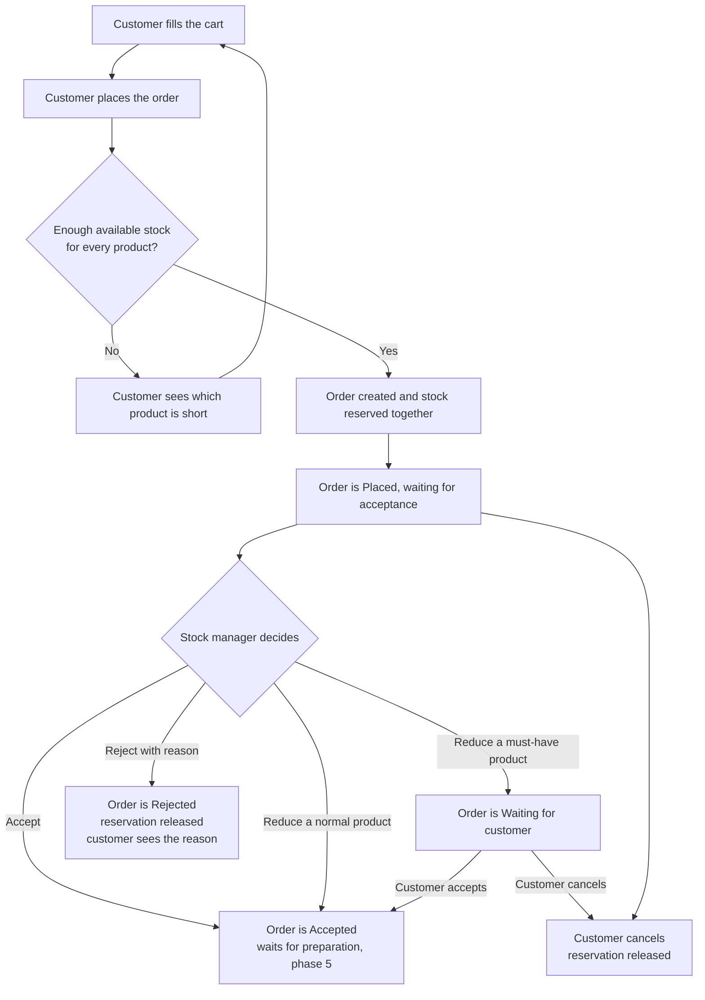

# Sub-plan 4 — Customer ordering and acceptance

## Goal

A customer can browse the catalog and place an order. The system reserves the stock at once, and the stock manager accepts or rejects the order.

## What a person can do at the end

- A customer searches the catalog, fills a cart, chooses a payment method, and places an order.
- A sales employee places an order for a customer.
- The customer sees whether the warehouse is open, and can order also when it is closed.
- The customer marks "must have" products in the cart.
- The stock manager sees each new order and accepts it, accepts it with a smaller quantity, or rejects it with a reason.
- The customer answers a change to a must-have product: accept it or cancel the order.
- The customer sees whether the order was accepted or rejected, and why.
- The customer can cancel before preparation starts. The stock manager or owner can cancel later.

## In scope

- Customer catalog with search and filters
- Cart and checkout
- Payment method choice, with credit only for allowed customers (C-16, C-26)
- Stock check and automatic reservation at the moment of ordering (C-11, C-25, C-54)
- Manual acceptance and rejection with a reason (C-24)
- Order list and order detail for customers and employees
- Cancellation and release of reservation (C-12, C-57)
- Orders placed by sales staff (C-32)
- Alerts to the owner for rejected and cancelled orders (C-30)
- Report to the owner when an order waits more than 5 working hours for acceptance (C-35)
- Working hours shown to the customer, and ordering while closed (C-37)
- Reducing a quantity or removing a product at acceptance, with a reason (C-38)
- "Must have" marks and the "Waiting for customer" status (C-39)
- Discounts and bonus units on order lines (C-41)
- Notifications to the customer inside the app (C-46)

## Not in scope

- Preparation, delivery, and invoices (phases 5 to 7). In this phase an order stops at Accepted
- Backorders or waiting lists
- Different offers for different customers (C-06)
- Editing an order after it is placed. The customer cancels and orders again

## Stories

CUS-03 to CUS-10, CUS-14 to CUS-16, SAL-02 to SAL-04, STK-03 to STK-05, STK-17, STK-18, OWN-08

## Workflow

[Order lifecycle](../workflows/01-order-lifecycle.md)

## The hardest part

Two customers can order the last units of the same product at the same moment. Only one may succeed. This phase must be built and tested so that available stock can never go below zero.

## Depends on

Phase 1 (customer accounts), phase 2 (products and stock), phase 3 (so that there is real stock to sell).

## Decisions this phase depends on

| ID | Decision |
|---|---|
| C-57 | Who can cancel, and until when |
| C-54 | No ordering above available stock |
| C-56 | Customers see "in stock" or "out of stock" only |

Also to decide here: whether there is a minimum order value.

## Done when

- Every story's acceptance checks pass.
- Two orders placed at the same time can never reserve more than the available stock.
- Placing the same order twice by accident creates one order.
- Rejecting or cancelling returns the available quantity to its earlier value.
- A rejected, changed, or cancelled order always has a reason, and the customer can read it.
- A quantity can be reduced but never increased by an employee.
- The 5 hours are counted only inside working hours.
- An order total with a discount or bonus units is always calculated the same way on the cart, the order, and later the invoice.
- The project owner has tried it and approved.
