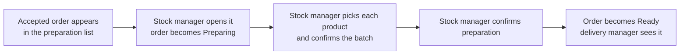

# Sub-plan 5 — Order preparation

## Goal

The stock manager prepares accepted orders from a simple list, chooses the real batches, and confirms with one action.

## What a person can do at the end

- The stock manager sees accepted orders in a preparation list.
- The stock manager picks each product with a recommended batch and can choose another.
- The stock manager records a smaller quantity when stock is missing.
- One confirmation makes the order Ready and sends it to the delivery manager.

## In scope

- Preparation list, oldest first
- Batch recommendation by soonest expiry (C-14)
- Batch selection and override, with the override recorded
- Filling one order line from more than one batch
- Barcode scanning while picking
- Preparing less than ordered, with a reason, and waiting for the customer when the product is "must have" (C-38, C-39)
- Picking bonus units together with paid units (C-41)
- Moving the order from Accepted to Preparing to Ready

## Not in scope

- A separate warehouse worker role (C-34)
- Shelf locations inside the warehouse
- Packing slips beyond a simple printed list
- Stock deduction. On hand changes when the trip starts (C-25)

## Stories

STK-06 to STK-11

## Workflow

[Order preparation](../workflows/03-order-preparation.md)

## Depends on

Phase 4 (accepted orders with reserved stock), phase 2 (batches).

## Decisions this phase depends on

| ID | Decision |
|---|---|
| C-55 | Expired batches cannot be picked |

Also to decide here: whether two stock managers can work on the same order.

## Done when

- Every story's acceptance checks pass.
- An expired batch can never be selected.
- A batch can never be picked for more than its on-hand quantity.
- Every prepared order shows which batches were used, so a recall can be traced.
- The project owner has tried it and approved.
