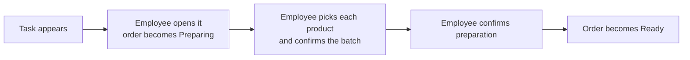

# Sub-plan 5 — Warehouse preparation

## Goal

Warehouse staff prepare orders from a simple task list, choose the real batches, and confirm with one action.

## What a person can do at the end

- A warehouse employee sees new orders as tasks without anyone assigning them.
- The employee picks each product with a recommended batch and can choose another.
- The employee records a smaller quantity when stock is missing.
- One confirmation makes the order Ready.

## In scope

- Task list, oldest first
- Batch recommendation by soonest expiry (C-14)
- Batch selection and override, with the override recorded
- Filling one order line from more than one batch
- Barcode scanning while picking
- Preparing less than ordered, with a reason (A-08)
- Moving the order from Placed to Preparing to Ready

## Not in scope

- Assigning tasks to specific employees
- Shelf locations inside the warehouse
- Packing slips beyond a simple printed list
- Stock deduction. On hand changes when the trip starts (A-04)

## Stories

WH-03 to WH-08

## Workflow

[Warehouse preparation](../workflows/03-warehouse-preparation.md)

## Depends on

Phase 4 (orders with reserved stock), phase 2 (batches).

## Decisions to confirm before this phase

| ID | Question |
|---|---|
| A-04 | On hand decreases when the trip starts, not at preparation |
| A-08 | Preparing less than ordered is allowed, and the order continues |
| A-17 | Expired batches cannot be picked |
| O-06 | Near-expiry warning threshold |

Also to decide here: whether the customer is told when their order was prepared with a smaller quantity, and whether two employees can work on the same task.

## Done when

- Every story's acceptance checks pass.
- An expired batch can never be selected.
- A batch can never be picked for more than its on-hand quantity.
- Every prepared order shows which batches were used, so a recall can be traced.
- The project owner has tried it and approved.
