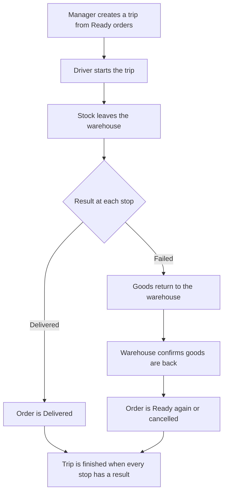

# Sub-plan 6 — Delivery

## Goal

Ready orders are grouped into trips, and drivers deliver them and report the result from a phone.

## What a person can do at the end

- A manager groups ready orders into a trip, assigns a driver, and arranges the stops.
- A driver sees the trip on a phone, starts it, and reports each stop as delivered, failed, or partially delivered.
- The driver records cash collected.
- The warehouse confirms goods that came back from failed stops.

## In scope

- Trips and stops (C-20)
- Driver's phone view, limited to the driver's own trips
- Starting a trip, which moves stock out of the warehouse (A-04)
- Stop results and failure reasons (C-21)
- Cash collected per stop (A-16)
- Goods coming back after a failed delivery (A-19)
- A printed or on-screen delivery note listing the goods

## Not in scope

- GPS, live tracking, and automatic route planning
- Delivery fees
- Outside delivery companies
- Confirming cash handover and closing the trip (phase 7)

## Stories

MGR-09, DRV-01 to DRV-08, WH-09

## Workflow

[Delivery](../workflows/04-delivery.md)

## The hardest part

Drivers work on phones with weak connections. A tap must never be lost and must never count twice. The plan for this is made in the technical design.

## Depends on

Phase 5 (orders that are Ready).

## Decisions to confirm before this phase

| ID | Question |
|---|---|
| O-04 | Proof of delivery: signature, photo, or nothing |
| O-10 | Items refused at the door: partial delivery or return |
| A-04 | Stock leaves when the trip starts |
| A-19 | Failed delivery: goods come back, then deliver again or cancel |
| A-21 | A manager or warehouse employee creates trips |

Also to decide here: whether a driver can change the order of stops during the trip.

## Done when

- Every story's acceptance checks pass.
- After a trip with failed stops, stock in the system matches the shelf.
- A driver cannot see another driver's trips.
- Reporting the same stop twice has no extra effect.
- The project owner has tried it on a phone and approved.
