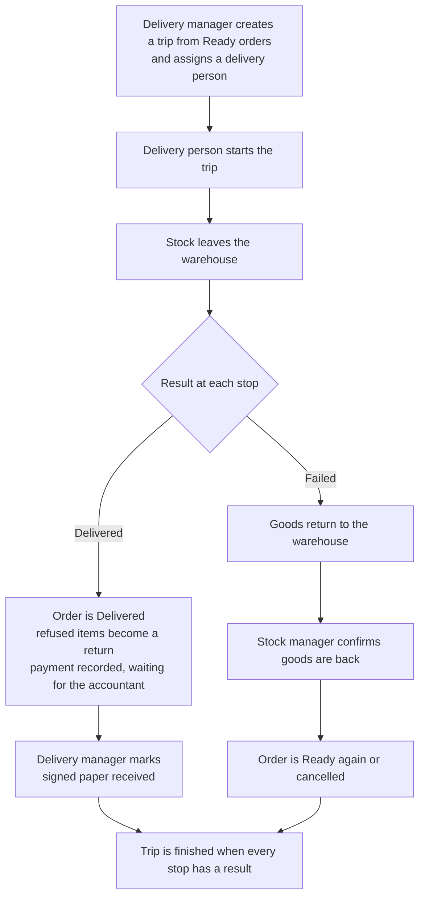

# Sub-plan 6 — Delivery

## Goal

The delivery manager assigns ready orders to delivery people. Delivery people deliver them, report the result, and record the payment they collected, all from a phone.

## What a person can do at the end

- The delivery manager groups ready orders into a trip, assigns a delivery person, and arranges the stops.
- The delivery manager always sees who has which order.
- A delivery person sees the trip on a phone, starts it, and reports each stop as delivered or failed.
- The delivery person records items the customer refused at the door, with a reason.
- The delivery manager marks the signed paper as received for each delivered order.
- The delivery person records the payment collected by cash, InstaPay, or Vodafone Cash.
- The stock manager confirms goods that came back from failed stops.

## In scope

- Trips and stops (C-20)
- Assigning each trip to one delivery person (C-28)
- Delivery manager's view of all trips and their progress
- Delivery person's phone view, limited to their own trips
- Starting a trip, which moves stock out of the warehouse (C-25)
- Stop results and failure reasons (C-21)
- Items refused at the door, recorded as a return with a reason (C-47)
- Signed delivery paper, confirmed by the delivery manager, with a list of missing papers (C-44)
- Payment recorded at the door, saved as waiting for confirmation (C-27)
- Goods coming back after a failed delivery (C-61)
- A printed or on-screen delivery note listing the goods

## Not in scope

- GPS, live tracking, and automatic route planning
- Delivery fees
- Outside delivery companies
- The accountant confirming payments and closing the trip (phase 7)
- The credit and stock check for refused items. In this phase they are only recorded. The full return is built in phase 8

## Stories

DM-01 to DM-06, DEL-01 to DEL-08, STK-12

## Workflow

[Delivery](../workflows/04-delivery.md)

## The hardest part

Delivery people work on phones with weak connections. A tap must never be lost and must never count twice. The plan for this is made in the technical design.

## Depends on

Phase 5 (orders that are Ready).

## Decisions this phase depends on

| ID | Decision |
|---|---|
| C-61 | Failed delivery: goods come back, then deliver again or cancel |

Also to decide here: whether a delivery person can change the order of stops during the trip.

## Done when

- Every story's acceptance checks pass.
- After a trip with failed stops, stock in the system matches the shelf.
- A delivery person cannot see another delivery person's trips.
- The delivery manager can find the delivery person for any order that has left the warehouse.
- Reporting the same stop twice has no extra effect.
- The project owner has tried it on a phone and approved.
