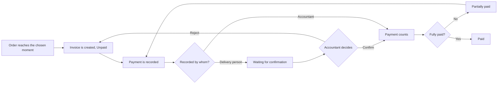

# Sub-plan 7 — Invoices and payments

## Goal

Every order gets an invoice at the moment the owner has chosen. Every payment is recorded against an invoice, and only payments the accountant has confirmed count. Balances are always explainable.

After this phase, the full main journey works: goods in, order, acceptance, preparation, delivery, invoice, payment.

## What a person can do at the end

- The system creates the invoice automatically at the chosen moment.
- The accountant confirms or rejects payments recorded by delivery people.
- The accountant records payments made to the office, including partial payments.
- The accountant sees overdue credit invoices.
- The customer sees their invoices, due dates, payments, and balance.
- Anyone allowed can print an invoice.

## In scope

- Invoice creation by setting: on accepted, on prepared, or on delivered (C-58)
- Invoice status calculated from confirmed payments (C-17)
- Discounts and bonus units on invoice lines (C-41)
- Payments with method, date, and reference (C-15, C-16)
- Confirming or rejecting payments from delivery, with a reason for rejection (C-27)
- Cash handover after a trip and closing the trip
- One payment per invoice (C-59)
- Cancelling a wrong payment with a reason
- Credit period per customer, due dates from the invoice date, and overdue marking (C-26, C-33, C-36)
- Customer balance and statement
- Invoice printing in Arabic and English
- Invoice cancellation when an order is cancelled

## Not in scope

- Tax and e-invoicing (C-18)
- Payment gateways (C-15)
- Credit limits (C-07)
- Blocking customers automatically when they are overdue (C-33)
- Full accounting, such as a general ledger
- Return credits (phase 8)

## Stories

ACC-01 to ACC-08, ACC-12, CUS-11, CUS-12

## Workflow

[Invoices and payments](../workflows/05-invoices-and-payments.md)

## Depends on

Phase 6 (delivery results and payments recorded at the door), phase 4 (orders), phase 3 (supplier balances already exist).

## Decisions this phase depends on

| ID | Decision |
|---|---|
| C-58 | Invoice timing as a setting, default on delivered |
| C-59 | One payment belongs to one invoice |

Also to decide here: the invoice number format, what the printed invoice must show, and whether a customer can pay before delivery.

## Done when

- Every story's acceptance checks pass.
- A customer's balance always equals invoices minus confirmed payments.
- A payment waiting for confirmation or rejected never reduces a balance.
- An invoice keeps the price from the time of the order, even after a price change.
- Changing the invoice timing setting works for new orders without breaking old ones.
- The project owner has tried all three invoice timings and chosen one.
