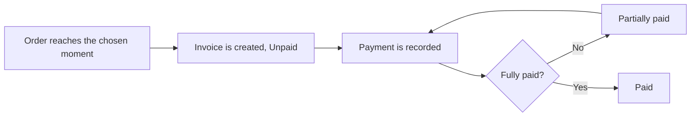

# Sub-plan 7 — Invoices and payments

## Goal

Every order gets an invoice at the moment the wholesaler has chosen, and every payment is recorded against an invoice. Balances are always explainable.

After this phase, the full main journey works: goods in, order, preparation, delivery, invoice, payment.

## What a person can do at the end

- The system creates the invoice automatically at the chosen moment.
- The accountant records full and partial payments.
- The accountant confirms cash handed over by drivers.
- The customer sees their invoices, payments, and balance.
- Anyone allowed can print an invoice.

## In scope

- Invoice creation by setting: on order placed, on prepared, or on delivered (A-05)
- Invoice status calculated from payments (C-17)
- Payments with method, date, and reference (C-15, C-16)
- One payment per invoice (A-15)
- Cancelling a wrong payment with a reason
- Driver cash confirmation and closing the trip (A-16)
- Customer balance and statement
- Invoice printing in Arabic and English
- Invoice cancellation when an order is cancelled

## Not in scope

- Tax and e-invoicing (C-18)
- Payment gateways (C-15)
- Credit limits (C-07)
- Full accounting, such as a general ledger
- Return credits (phase 8)

## Stories

ACC-01 to ACC-05, ACC-08, ACC-10, CUS-10, CUS-11

## Workflow

[Invoices and payments](../workflows/05-invoices-and-payments.md)

## Depends on

Phase 6 (delivery results and cash collected), phase 4 (orders), phase 3 (supplier balances already exist).

## Decisions to confirm before this phase

| ID | Question |
|---|---|
| A-05 | Invoice timing as a setting, default on delivered |
| A-15 | One payment belongs to one invoice |
| A-16 | Driver records cash, accountant confirms |
| O-01 | Discounts and bonus units on invoices |

Also to decide here: the invoice number format, what the printed invoice must show, and whether a customer can pay before delivery.

## Done when

- Every story's acceptance checks pass.
- A customer's balance always equals invoices minus payments.
- An invoice keeps the price from the time of the order, even after a price change.
- Changing the invoice timing setting works for new orders without breaking old ones.
- The project owner has tried all three invoice timings and chosen one.
