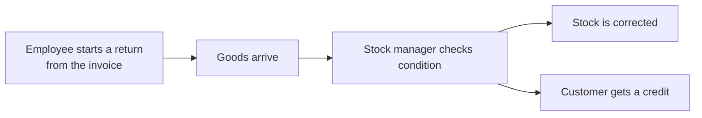

# Sub-plan 8 — Returns

## Goal

When a customer sends goods back, the wholesaler records it once, and both the stock and the customer's balance are corrected.

## What a person can do at the end

- An employee starts a return from the original invoice.
- Items refused at the door become a return automatically, with the credit applied at once.
- The stock manager confirms the goods arrived and decides whether they can be sold again.
- The customer gets a credit on their balance and can see the return.

## In scope

- Returns linked to an invoice (C-19)
- Returns created from items refused at the door (C-47)
- Credit for goods bought with a bonus offer (C-63)
- Money back for a return on a paid invoice, recorded by the accountant (C-69)
- Return reasons
- Condition check per product: sellable or damaged (C-60)
- Stock movements for returned goods, into the original batch
- Credit on the customer's balance (C-60)
- Limit: cannot return more than was invoiced, minus earlier returns

## Not in scope

- Returns to suppliers. They are built in phase 3 (C-42)
- Customers creating returns themselves (C-62)
- Exchange of one product for another. This is a return plus a new order

## Stories

SAL-05, STK-13, ACC-11, ACC-13, CUS-13

## Workflow

[Customer returns](../workflows/06-returns.md)

## Depends on

Phase 7 (invoices and balances), phase 5 (which batch was sent to the customer).

## Decisions this phase depends on

| ID | Decision |
|---|---|
| C-60 | Sellable or damaged, and credit on the balance |
| C-62 | Only employees create returns |
| C-69 | Credit first, then money back or credit when the invoice is paid |
| C-63 | Credit for returned goods bought with a bonus offer |

Also to decide here: whether returns have a time limit, and who approves a return of high value.

## Done when

- Every story's acceptance checks pass.
- A return can never exceed the invoiced quantity.
- Damaged goods never become available for sale.
- The customer's statement shows the return credit.
- The project owner has tried it and approved.
