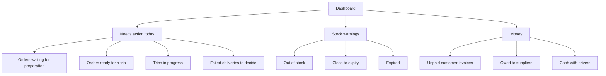

# Sub-plan 9 — Dashboard and reports

## Goal

The owner and manager see the state of the business on one screen, and can look up who did what.

This phase comes last because it only shows data that the earlier phases create.

## What a person can do at the end

- A manager opens the dashboard and sees what needs attention today.
- A manager searches the activity history.
- The owner and accountant open a few simple reports.

## In scope

- Dashboard: orders to prepare, orders ready, trips in progress, failed deliveries, out-of-stock products, stock close to expiry, unpaid invoices, amount owed to suppliers
- Activity history screen with filters by employee, date, and type
- Reports: sales by period, product, and customer; stock value; customer balances; supplier balances; stock close to expiry
- Each role sees a home screen that fits its job

## Not in scope

- Custom report builder
- Charts beyond a few simple ones
- Export to accounting software
- Forecasting

## Stories

MGR-10, MGR-11, MGR-12

## What the dashboard shows

Every number on the dashboard opens the list behind it.

## Depends on

Phases 1 to 8.

## Decisions to confirm before this phase

| ID | Question |
|---|---|
| O-07 | Which role sees which report |
| O-08 | Notifications by SMS, WhatsApp, or email |

Also to decide here: which reports the wholesaler really uses every week. Only those are built.

## Done when

- Every story's acceptance checks pass.
- Every dashboard number matches the list it opens.
- Activity history entries cannot be changed or deleted.
- The project owner has tried it and approved.
