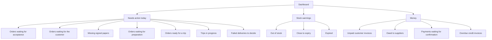

# Sub-plan 9 — Dashboard and reports

## Goal

The owner sees the state of the business on one screen, knows who did what, and gets an alert when something important happens.

This phase comes last because it only shows data that the earlier phases create.

## What a person can do at the end

- The owner opens the dashboard and sees what needs attention today.
- The owner opens the activity screen and sees every action with the employee's name.
- The owner gets an alert for important events.
- The owner, accountant, and stock manager open the reports for their work.

## In scope

- Dashboard: orders waiting for acceptance, orders waiting for the customer, missing signed papers, orders to prepare, orders ready, trips in progress, failed deliveries, out-of-stock products, stock close to expiry, payments waiting for confirmation, overdue invoices, unpaid invoices, amount owed to suppliers
- Activity screen with filters by employee, date, and type (C-30)
- Alerts inside the app for a rejected order, a cancelled order, a stock correction, a rejected payment, an order or a customer answer waiting more than 5 working hours, and a missing signed paper (C-30, C-35, C-39, C-44)
- Reports: sales by period, product, and customer; stock value; customer balances; supplier balances; stock close to expiry
- Each role sees a home screen that fits its job

## Not in scope

- Custom report builder
- Charts beyond a few simple ones
- Export to accounting software
- Forecasting

## Stories

OWN-09, OWN-10, OWN-11, OWN-12

## What the dashboard shows

Every number on the dashboard opens the list behind it.

## Depends on

Phases 1 to 8.

## Decisions to confirm before this phase

| ID | Question |
|---|---|
| A-23 | Which role sees which report |

Also to decide here: which reports the wholesaler really uses every week. Only those are built.

## Done when

- Every story's acceptance checks pass.
- Every dashboard number matches the list it opens.
- Activity entries cannot be changed or deleted.
- Each important event creates exactly one alert for the owner.
- The project owner has tried it and approved.
