# Database design

This document turns the business plan into database tables. It is the first part of the technical design stage.

The database is **PostgreSQL** (C-53). Labels such as (C-25) point to [Decisions](../02-decisions.md). The business view of the same data is in the [Data map](../workflows/08-data-map.md).

## How to read this document

Each section has a **diagram** and an **explanation**.

In the diagrams:

- A box is a **table**. Each line inside the box is a **column**: first its type, then its name.
- **PK** (primary key) is the column that identifies each row. Every table uses a column called `id`.
- **FK** (foreign key) is a column that points to a row in another table. For example, `customer_id` in `orders` points to one row in `customers`.
- **UK** (unique key) means two rows can never have the same value.
- The lines between boxes show how tables connect:

| Line | Meaning | Example |
|---|---|---|
| `\|\|--o{` | One to many | One customer has many orders |
| `\|\|--\|{` | One to one or more | One order has at least one order line |
| `\|\|--o\|` | One to zero or one | One order has zero or one invoice |
| `\|\|--\|\|` | Exactly one to exactly one | One wholesaler has exactly one settings row |

Column types used:

| Type | Meaning |
|---|---|
| uuid | A long random identifier, for example `3f2b…`. Used for every `id` |
| text | Words of any length |
| int | A whole number, for example a quantity |
| numeric | An exact decimal number, used for money and percentages |
| bool | Yes or no |
| date | A day, for example an expiry date |
| time | A time of day, for example an opening time |
| timestamptz | A date and time, saved with the time zone |
| enum | One value from a fixed list, for example an order status |
| jsonb | A small structured note, used only where the shape can change |

## The ten main ideas

These ideas are used in every table. If you understand them, you understand the whole design.

### 1. Every row belongs to one wholesaler (C-52)

Many wholesalers share one database. Almost every table has a `wholesaler_id` column, and every query filters by it. This is the rule that keeps one wholesaler from ever seeing another wholesaler's data.

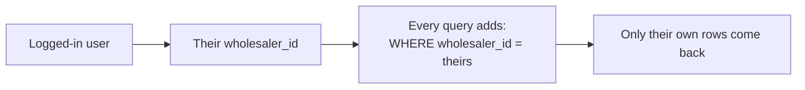

PostgreSQL can also enforce this rule itself with a feature called **row level security**. Then even a mistake in the code cannot show another wholesaler's rows.

### 2. Every id is a uuid

A uuid is a random identifier that is safe to create anywhere, even on a delivery person's phone before it reaches the server. This helps when the phone has a weak connection (see idea 8). People never see these ids. They see readable numbers such as `ORD-2026-00015` or `INV-2026-00001`.

### 3. Money is always `numeric`, never a decimal "float"

`numeric(12,2)` stores money exactly, with two digits after the decimal point. A float type can turn 0.1 + 0.2 into 0.30000000000000004, which is not acceptable for invoices.

### 4. Nothing important is deleted

Products, customers, employees, suppliers, and extra fields are switched off with `is_active = false`. Payments and returns are cancelled with a reason. The row stays, so the history always explains itself (C-10).

### 5. Stock is a ledger, with summaries kept next to it (C-09)

`stock_movements` is the **ledger**. Every change to stock adds one row there, and rows are never changed or deleted.

Reading every movement each time someone opens the catalog would be slow. So the current numbers are also kept in two **summary** tables: `batches` and `product_stock`. The summary and the movement are always written **in the same transaction**, so they can never disagree. If a summary is ever wrong, it can be rebuilt from the ledger.

### 6. Orders and invoices keep their own copy of prices

When an order is placed, each order line saves the price and offer of that moment. A later price change does not touch old orders or invoices (OWN-07).

### 7. Every status change is recorded

Tables with a status, such as `orders`, also have a history table. Each row says what the status was, what it became, who changed it, when, and why.

### 8. Pressing a button twice never counts twice

Actions that create something important, such as placing an order or recording a payment, carry an `idempotency_key`. This is a unique code made by the app when the button is pressed. If the same request arrives twice, because of a double tap or a weak connection, the database refuses the second copy (CUS-07, DEL-04).

### 9. Summaries on money documents are calculated, not typed

An invoice's paid amount and status come from its confirmed payments. A customer's balance comes from invoices, payments, returns, and refunds. Nobody types these numbers in.

### 10. Every important action is written to the activity log (C-30)

The activity log is append-only. Rows are added and never changed. The owner's activity screen and alerts are built from it.

## The whole picture

This diagram shows only the tables and how they connect. The sections below show the columns.

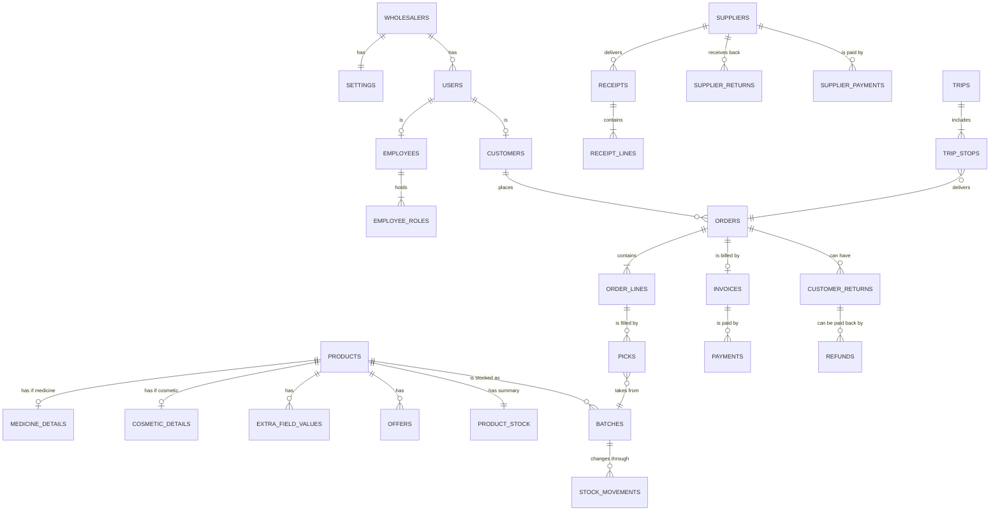

The tables are grouped into nine areas:

| Area | Tables | Built in phase |
|---|---|---|
| 1. Wholesaler, settings, and people | 10 tables | 1 |
| 2. Product catalog | 10 tables | 2 |
| 3. Stock | 3 tables | 2 |
| 4. Suppliers | 7 tables | 3 |
| 5. Orders | 5 tables | 4 and 5 |
| 6. Delivery | 2 tables | 6 |
| 7. Invoices and payments | 5 tables | 7 |
| 8. Customer returns | 2 tables, plus refunds from area 7 | 8 |
| 9. Activity and notifications | 3 tables | 1, used by every phase |

---

## Area 1 — Wholesaler, settings, and people

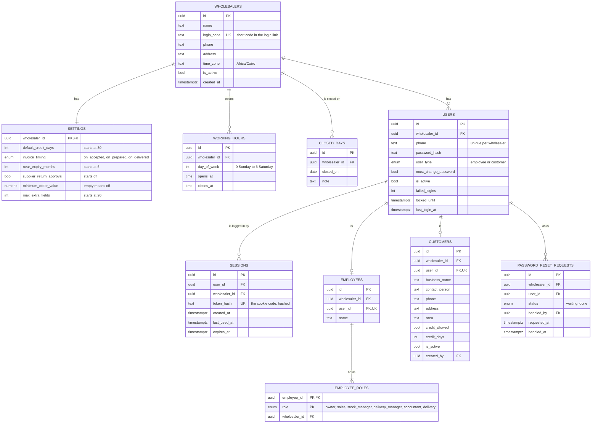

**wholesalers** — One row per wholesale business. `login_code` is a short code in the wholesaler's own login link, for example `cosmo.app/ahmed-pharma`. It tells the app which wholesaler a phone number belongs to.

`time_zone` is used to work out "open now" from the working hours. `is_active` lets the platform team stop a wholesaler.

**settings** — Exactly one row per wholesaler, with one column per setting (C-40). Each setting has a clear type and a default, so it cannot hold a wrong value. A new setting in the future is one new column with a default. Old wholesalers simply get the default.

**working_hours** — One row per open day, with the opening and closing time (C-37). A day with no row is a closed day. **closed_days** holds the "closed today" switch and holidays.

**users** — Everyone who logs in, employee or customer. Login is by phone number and password (C-72). The password is never stored. Only a `password_hash` is stored, which is a one-way scrambled version that cannot be turned back into the password. `must_change_password` forces a new password at first login (C-29, C-48).

**sessions** — One row per logged-in device. Deleting the rows logs the person out at once. Only a hash of the cookie code is stored, so a copy of the database cannot be used to log in. See [Security](04-security.md) (C-90).

**employees** and **employee_roles** — One employee can have several roles (C-31), so roles are in their own table with one row per role.

**customers** — The pharmacy or store. `credit_allowed` and `credit_days` are the credit switch and credit period (C-26). New customers copy `credit_days` from the settings.

**password_reset_requests** — Customers who tapped "forgot password" (C-87).

---

## Area 2 — Product catalog

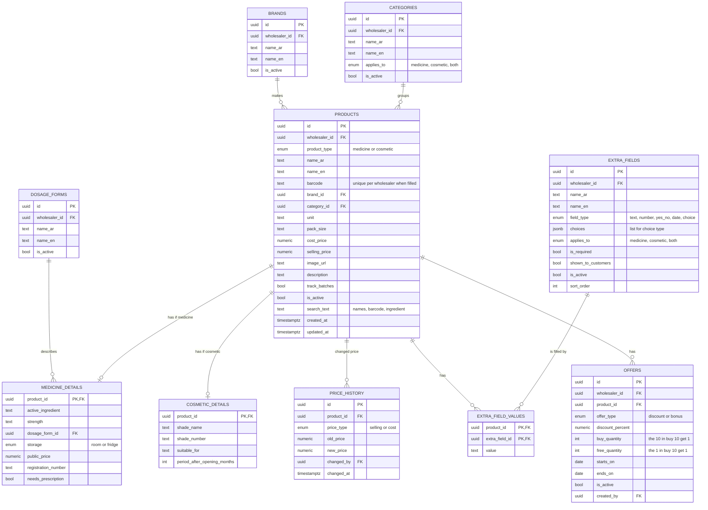

**categories, brands, dosage_forms** — The lists that the owner and stock manager manage (C-74). Products choose from them, so "Panadol" and "panadol " never become two brands.

**products** — The fields every product has (C-66). Each shade or size is its own row (C-67).

**medicine_details** and **cosmetic_details** — The extra fields per product type, in their own tables. A medicine has one `medicine_details` row and no `cosmetic_details` row. This keeps the `products` table short and clear, without many empty columns. A product with `storage = fridge` shows the "keep cold" mark (C-68).

**extra_fields** and **extra_field_values** — The fields the owner adds (C-71). `extra_fields` describes the field. `extra_field_values` holds one value per product per field. The value is saved as text and checked against `field_type` by the app. The limit of 20 is in `settings.max_extra_fields`.

**price_history** — Every change of selling price or cost price, with who and when (OWN-07, C-75).

**offers** — A discount or bonus units on a product (C-41). Only one offer per product can be active at the same time. A discount uses `discount_percent`. Bonus units use `buy_quantity` and `free_quantity`.

**search_text** (a column on products) — The names, barcode, and active ingredient in one text, with Arabic spellings made the same (أ إ آ become ا). It is updated whenever a product changes, and a trigram index makes search fast in Arabic and English.

---

## Area 3 — Stock

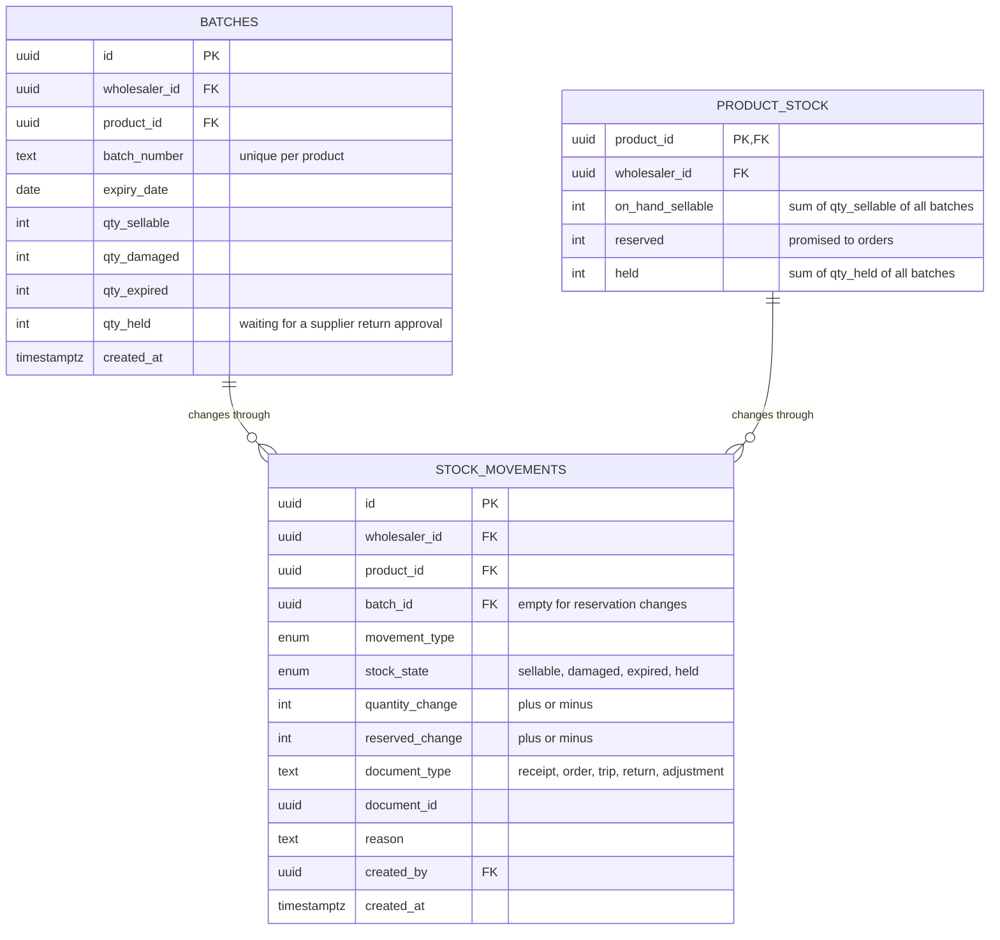

This is the most important area. Stock must always be right.

**batches** — One row per lot of a product. A product without batch tracking still has exactly one batch, with no batch number and no expiry date. This way every product works the same way.

Each batch splits its physical quantity into four states:

| Column | Meaning | Can be sold? |
|---|---|---|
| qty_sellable | Good stock on the shelf | Yes |
| qty_damaged | Damaged stock, kept until it is thrown away or returned to the supplier | No |
| qty_expired | Stock past its expiry date | No |
| qty_held | Stock waiting for the owner to approve a supplier return (C-65) | No |

On hand for a batch is the sum of all four. Every night, the system moves the sellable quantity of batches that expired that day into `qty_expired`, with a movement row. So expired stock is never counted as available (C-55).

**product_stock** — One row per product with the numbers the catalog needs:

> **Available = on_hand_sellable − reserved**

Reservation is per product, not per batch, because the batch is chosen later during preparation (C-14).

**stock_movements** — The ledger (C-09). Each row is one change. The types are:

| movement_type | What happened | quantity_change | reserved_change |
|---|---|---|---|
| receipt | Goods received from a supplier | + | |
| order_reserved | Order placed | | + |
| order_released | Order rejected or cancelled, or quantity reduced | | − |
| trip_started | Goods left the warehouse | − | − |
| delivery_failed_back | Goods came back after a failed delivery | + | + if delivered again |
| customer_return | Returned goods checked | + (sellable or damaged) | |
| supplier_return | Goods sent back to a supplier | − | |
| damaged | Stock marked damaged | − sellable, + damaged | |
| expired | Nightly expiry job | − sellable, + expired | |
| held / unheld | Supplier return waiting or rejected | − sellable, + held, or back | |
| adjustment | Correction after a count, with a reason | + or − | |

### How two customers can never take the same units

Placing an order runs in one **transaction**. A transaction is a group of steps that either all succeed or all fail.

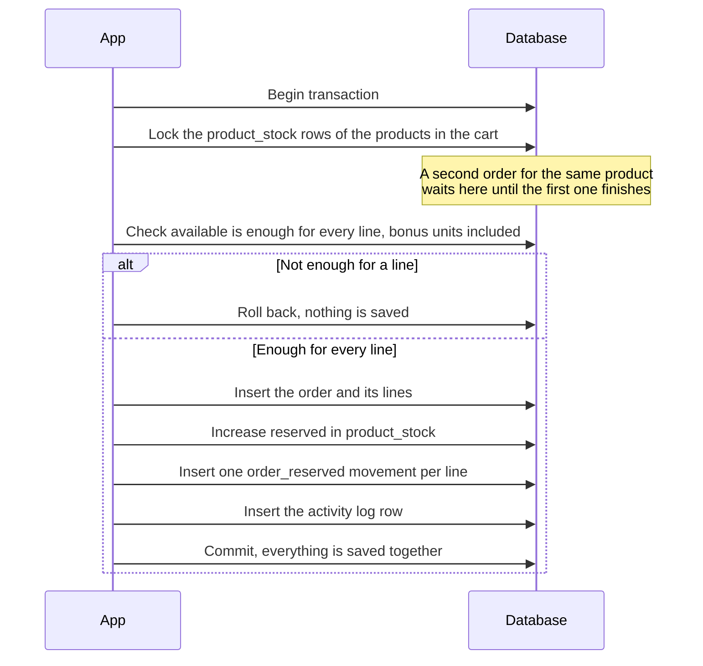

The lock is the key. The second customer waits a fraction of a second, then sees the new available number and gets a clear message if it is not enough (C-54).

The database also refuses any wrong number by itself, with **check constraints**:

- Every quantity in `batches` is zero or more.
- `reserved` is never more than `on_hand_sellable`.
- `on_hand_sellable`, `reserved`, and `held` are zero or more.

So even a bug in the code cannot make stock negative.

---

## Area 4 — Suppliers

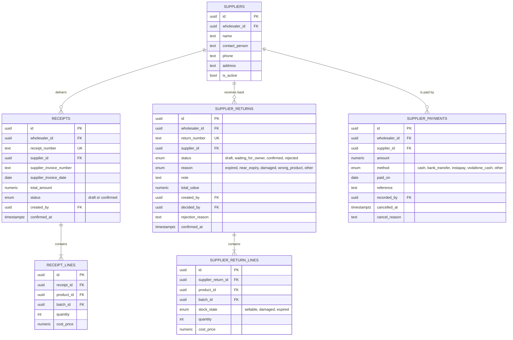

**receipts** and **receipt_lines** — Goods and the supplier's invoice, recorded in one step (C-43). A receipt is a draft while the stock manager types it. Confirming it adds stock and creates movements in one transaction. A confirmed receipt cannot be edited (C-09).

**supplier_returns** and **supplier_return_lines** — Goods sent back (C-42). `stock_state` says whether the units come from sellable, damaged, or expired stock. When owner approval is on, the status is `waiting_for_owner` and the units are moved to `qty_held` until the owner decides (C-65).

**document_counters** — Gives readable numbers per wholesaler and year, such as `REC-2026-00001` for receipts and `SRT-2026-00001` for supplier returns. The row is locked while a number is taken, so numbers never repeat.

**supplier_payments** — Money paid to a supplier. A wrong payment is cancelled with a reason, never deleted.

**The supplier's balance** is not stored. It is calculated:

> Balance = confirmed receipts − confirmed supplier returns − payments that are not cancelled

---

## Area 5 — Orders

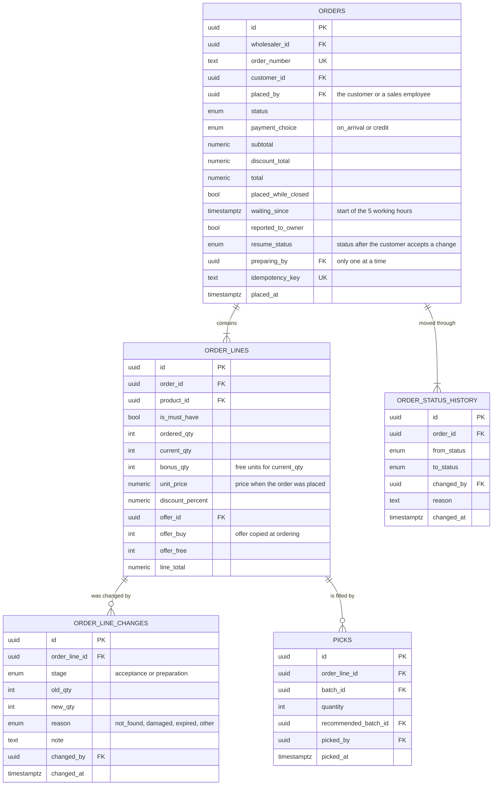

**orders** — One row per order. The `status` values are the ones in the [Order lifecycle](../workflows/01-order-lifecycle.md):

`placed`, `waiting_for_customer`, `accepted`, `rejected`, `preparing`, `ready`, `out_for_delivery`, `delivered`, `delivery_failed`, `cancelled`

Some columns support specific decisions:

| Column | Why it exists |
|---|---|
| placed_by | Shows whether the customer or a sales employee placed it (C-32) |
| placed_while_closed | Shows the customer the "we will review it when we open" message (C-37) |
| waiting_since | The start of the 5 working hours, for an order waiting for acceptance or for the customer (C-35, C-39) |
| reported_to_owner | Makes sure the owner gets exactly one alert per waiting order |
| preparing_by | The one stock manager preparing it. Another person cannot open it (C-77) |
| idempotency_key | Pressing "place order" twice makes one order (CUS-07) |

A small job runs every few minutes. It counts working hours since `waiting_since`, using `working_hours` and `closed_days`, and alerts the owner after 5 hours.

**order_lines** — One row per product in the order.

- `ordered_qty` is what the customer asked for. `current_qty` is what will be sent now. They differ when the stock manager reduces a line (C-38).
- `current_qty` can only go down. A check in the database refuses `current_qty > ordered_qty`.
- `bonus_qty` is recalculated whenever `current_qty` changes (C-41).
- `unit_price`, `discount_percent`, and `offer_id` are copied at the moment of ordering (idea 6).
- `is_must_have` is the customer's mark (C-39).

**order_line_changes** — Every reduction, with the old and new quantity, the stage, and the reason. The customer sees these (CUS-09).

**order_status_history** — Every status change, who did it, and the reason. A rejection or cancellation reason is saved here, and the customer sees it (C-24).

**picks** — Which batch was really taken for each line (C-14). One line can be filled from several batches. `recommended_batch_id` keeps what the system suggested, so a changed choice is visible. This table answers the recall question: which pharmacies received batch X?

---

## Area 6 — Delivery

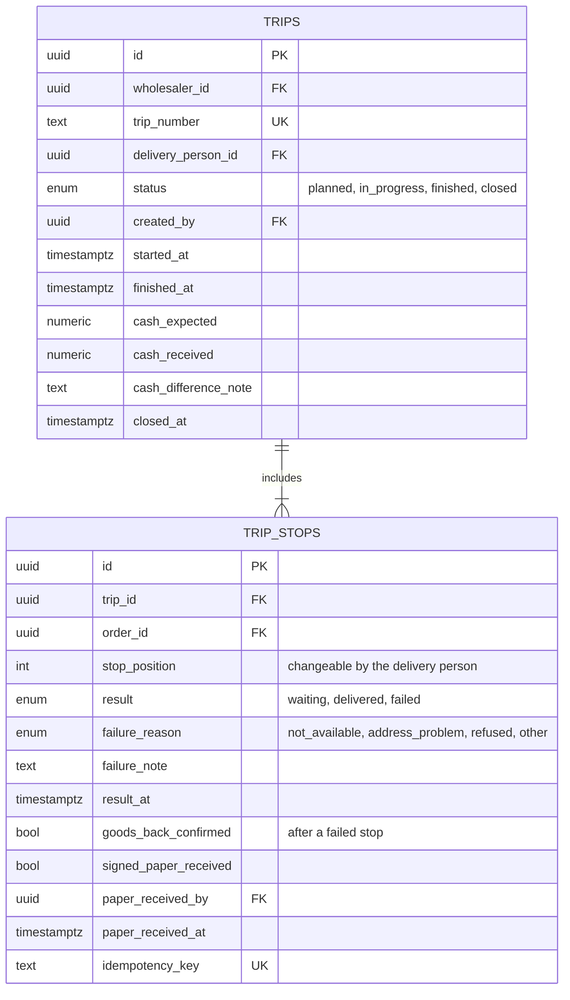

**trips** — One delivery person's outing (C-20, C-28). The cash columns support the cash handover to the accountant (ACC-03). A trip becomes `closed` only when every payment is checked and every signed paper is received (C-44).

**trip_stops** — One order inside a trip.

- `stop_position` is the order of visits. The delivery person can change it, and the change goes to the activity log (C-81).
- `result` has only three values. "Partially delivered" no longer exists (C-47). Refused items become a customer return.
- `signed_paper_received` is the check the delivery manager ticks (C-44). Nothing is uploaded.
- An order can be in only one active trip. The database enforces this with a unique rule on `order_id` for stops whose trip is not finished.

---

## Area 7 — Invoices and payments

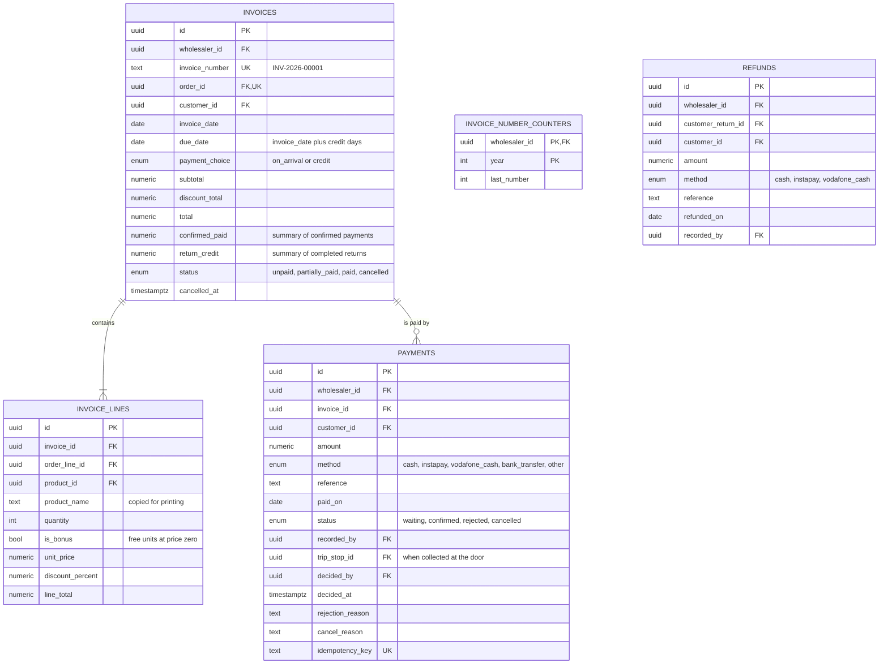

**invoices** — One invoice per order (C-59), created at the moment chosen in the settings (C-58). It copies the totals from the order, so a later change does not move it.

- `due_date` = `invoice_date` + the customer's `credit_days` (C-36). An invoice is **overdue** when today is after `due_date` and it is not paid. This is calculated when needed, not stored (C-33).
- `confirmed_paid` and `return_credit` are summaries, updated in the same transaction as the payment or return (idea 5).
- `status` follows from them:

| Rule | Status |
|---|---|
| confirmed_paid + return_credit = 0 | unpaid |
| between 0 and total | partially_paid |
| equal to total | paid |

**invoice_lines** — What the printed invoice shows (C-79). Bonus units are a separate line with `is_bonus = true` and price zero (C-41).

**invoice_number_counters** — Makes numbers like `INV-2026-00001` that never skip or repeat (C-78). The row is locked while a number is taken, so two invoices can never get the same number.

**payments** — Every payment from a customer.

- A payment recorded by a delivery person starts as `waiting`. Only `confirmed` payments count (C-27).
- A payment recorded by the accountant is `confirmed` at once.
- `trip_stop_id` links a door payment to its trip, for the cash handover.
- A check in the database refuses an amount larger than what is left on the invoice.

**refunds** — Money paid back for a return on a paid invoice (C-69). Only the accountant records it.

### The customer's balance

The balance is not stored. It is calculated:

> Balance = invoices that are not cancelled − confirmed payments − return credits + refunds

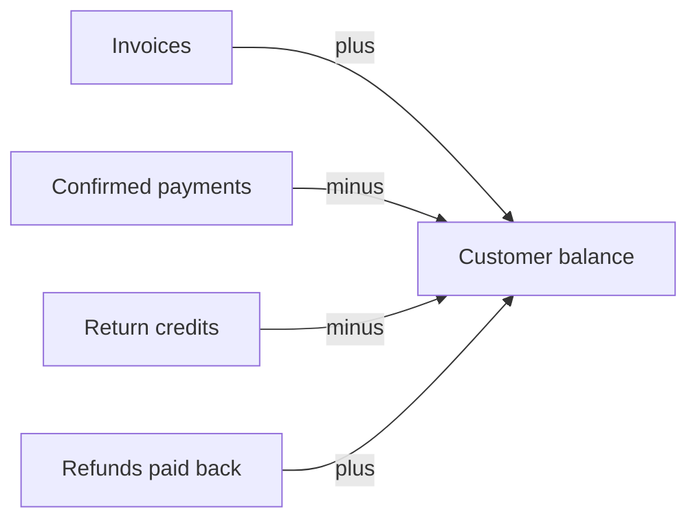

The customer statement (ACC-06) is these same rows, in date order, with a running total.

---

## Area 8 — Customer returns and refunds

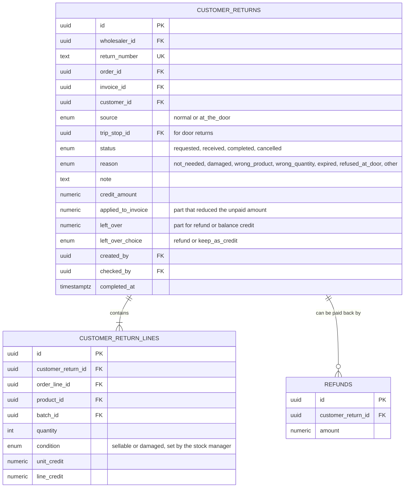

**customer_returns** — One return. `source = at_the_door` is a return created by the delivery person for refused items (C-47). Its credit is applied at once.

The money columns follow the refund rule (C-69):

| Column | Meaning |
|---|---|
| credit_amount | The total value of the returned goods |
| applied_to_invoice | The part that reduced what was still unpaid |
| left_over | What is left after that |
| left_over_choice | Money back (a row in `refunds`) or kept as a credit on the balance |

**customer_return_lines** — One product and batch per line. The batch comes from `picks`, so goods go back to the batch they came from.

- `unit_credit` for goods with bonus units is the amount paid for the line divided by all its units, including the free ones (C-63).
- A database check, together with the app, makes sure the returned quantity is never more than what was delivered minus earlier returns.

---

## Area 9 — Activity and notifications

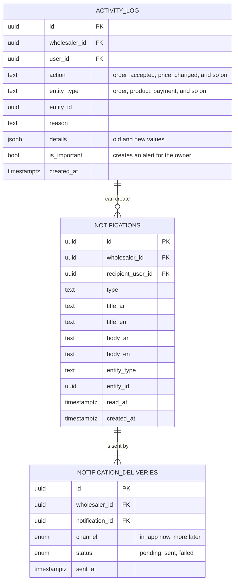

**activity_log** — Every important action, with who, when, and why (C-30). The database user of the app is allowed to add rows but not to change or delete them, so nobody can hide an action. `details` keeps the old and new values, for example the old and new price.

**notifications** — One message to one person: an alert for the owner (OWN-11) or a message for a customer (CUS-16). Each message is saved in Arabic and English (C-51).

**notification_deliveries** — How the message is sent. Today the only channel is `in_app` (C-46). Adding SMS or WhatsApp later means adding a new channel value and a sender. No other table changes.

---

## Example: what one action writes

**The stock manager accepts an order and reduces a must-have product from 10 to 6.**

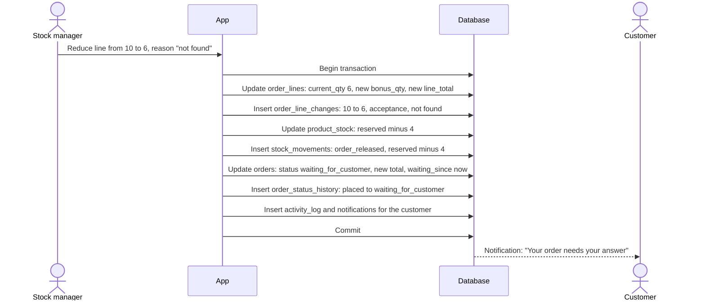

Every step is saved together or not at all.

## Indexes

An **index** is like the index at the back of a book. It lets the database find rows without reading the whole table. The main ones:

| Table | Index on | Used for |
|---|---|---|
| Every table | wholesaler_id together with the main search column | Fast filtering per wholesaler |
| users | wholesaler_id, phone (unique) | Login |
| products | wholesaler_id, barcode (unique when filled) | Barcode scan |
| products | search_text, with a trigram index | Catalog search in Arabic and English |
| batches | product_id, expiry_date | Batch recommendation and near-expiry list |
| orders | wholesaler_id, status, placed_at | Lists of orders to accept, prepare, and deliver |
| orders | customer_id, placed_at | The customer's own orders |
| stock_movements | product_id, created_at | Stock history of a product |
| invoices | customer_id, status, due_date | Unpaid and overdue invoices |
| payments | status, wholesaler_id | Payments waiting for the accountant |
| activity_log | wholesaler_id, created_at, user_id | Activity screen with filters |
| notifications | recipient_user_id, read_at | Unread notifications |

## Counts

| Area | Tables |
|---|---|
| 1. Wholesaler, settings, and people | wholesalers, settings, working_hours, closed_days, users, employees, employee_roles, customers, password_reset_requests, sessions |
| 2. Product catalog | categories, brands, dosage_forms, products, medicine_details, cosmetic_details, extra_fields, extra_field_values, price_history, offers |
| 3. Stock | batches, product_stock, stock_movements |
| 4. Suppliers | suppliers, receipts, receipt_lines, supplier_returns, supplier_return_lines, supplier_payments, document_counters |
| 5. Orders | orders, order_lines, order_line_changes, order_status_history, picks |
| 6. Delivery | trips, trip_stops |
| 7. Invoices and payments | invoices, invoice_lines, invoice_number_counters, payments, refunds |
| 8. Customer returns | customer_returns, customer_return_lines |
| 9. Activity and notifications | activity_log, notifications, notification_deliveries |

In total there are **47 tables**. Refunds are shown in areas 7 and 8 because they belong to both, but it is one table.

## Points to confirm

These came up while designing the tables. The project owner confirmed all three (C-86 to C-88).

| ID | Question | Suggestion |
|---|---|---|
| C-86 | Login by phone needs to know the wholesaler, because the same pharmacy phone can be a customer of two wholesalers. | Each wholesaler has its own login link, for example `cosmo.app/ahmed-pharma`. The phone number is unique only inside one wholesaler |
| C-87 | Password reset (CUS-02) without SMS or email (C-46): how does the customer get a new password? | The customer taps "forgot password". The request appears to the owner and sales. They set a temporary password and send it by WhatsApp, the same way as the first login (C-73) |
| C-88 | When a payment is cancelled or an invoice is cancelled, the stored summaries must be updated. | Done in the same transaction, as with stock (idea 5). A nightly check compares summaries with the documents and alerts the developer if they differ |

## What comes after this

The next parts of the technical design are:

1. **API actions** — the list of requests the Next.js app sends to the Express backend, for example "place order" or "confirm payment".
2. **Project structure** — how the code is organized into modules.
3. **Security** — login sessions, permissions per role (C-64), and how wholesalers are kept apart.
