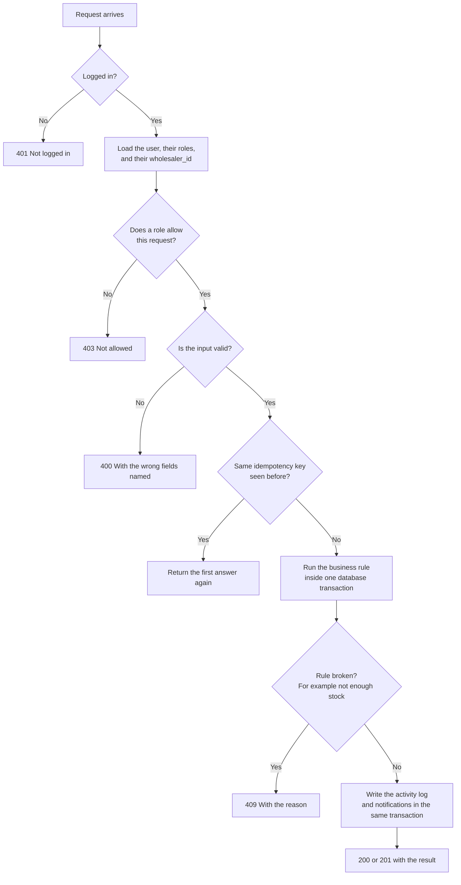
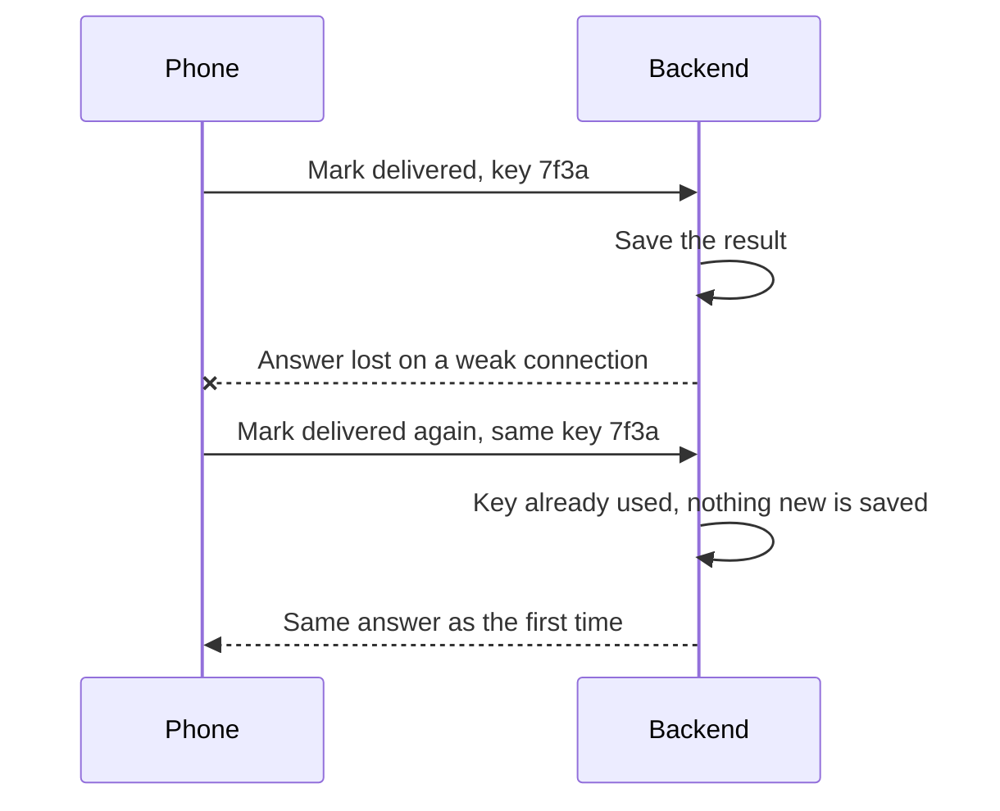
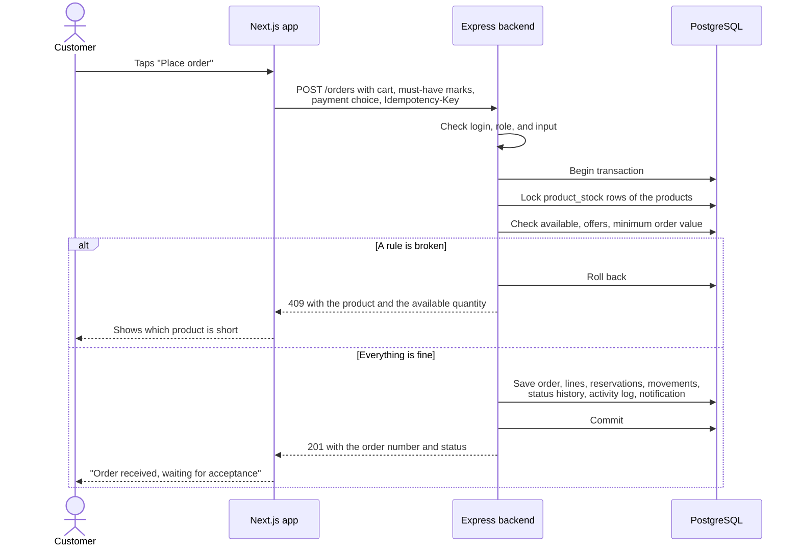

# API design

The **API** is the list of requests the frontend (Next.js) sends to the backend (Express) (C-23). Every button that saves or loads something in the app calls one of these requests.

This document is the second part of the technical design. It builds on the [Database design](01-database-design.md). Labels such as (C-25) point to [Decisions](../02-decisions.md), and labels such as (CUS-07) point to the [User stories](../user-stories/).

## How to read this document

A request has a **method** and a **path**:

| Method | Meaning | Example |
|---|---|---|
| GET | Read something. Changes nothing | `GET /api/v1/orders` lists orders |
| POST | Create something, or do an action | `POST /api/v1/orders/{id}/accept` accepts an order |
| PATCH | Change some fields of something | `PATCH /api/v1/products/{id}` edits a product |
| PUT | Replace a whole list | `PUT /api/v1/settings/working-hours` saves the full week |
| DELETE | Remove something. Used only for things that are not history, such as a planned trip | `DELETE /api/v1/trips/{id}` |

`{id}` in a path is the uuid of one row. Every path starts with `/api/v1`. The `v1` lets us release a changed version later without breaking older apps. In the tables below, `/api/v1` is left out to keep them short.

Who can call each request is shown with these letters:

| Letter | Role |
|---|---|
| O | Owner |
| S | Sales |
| K | Stock manager |
| M | Delivery manager |
| A | Accountant |
| D | Delivery person |
| C | Customer |

The owner can call every employee request (C-22), so "O" is written only where the owner is the only one allowed.

## The path of one request

Every request goes through the same steps inside the backend. Each step can stop the request with a clear error.



The `wholesaler_id` always comes from the logged-in user, **never** from the request. So a user cannot ask for another wholesaler's data even by changing the request by hand (C-52).

## Rules for every request

### Data format

| Thing | Format | Example |
|---|---|---|
| Body | JSON | `{"reason": "Out of stock"}` |
| Money | Text with two decimals, so no precision is lost | `"125.50"` |
| Quantity | Whole number | `12` |
| Date | Year-month-day | `"2026-11-19"` |
| Date and time | ISO format with time zone | `"2026-11-19T09:30:00+02:00"` |
| Language | The app sends `Accept-Language: ar` or `en`. Error messages come back in that language | (C-51) |

### Lists

Every list request accepts `page` and `limit` (at most 100), plus the filters named in the tables below. The answer always has the same shape:

```json
{ "items": [ ... ], "page": 1, "limit": 20, "total": 134 }
```

### Pressing twice (idempotency)

Every POST that creates or changes something important carries an `Idempotency-Key` header. It is a random code made by the app when the button is pressed. If the same request arrives twice, because of a double tap or a weak connection, the backend does the work once and returns the same answer both times (CUS-07, DEL-04). This matters most for the delivery person's phone.



### Errors

Every error has the same shape, so the app can show it the same way everywhere:

```json
{
  "error": {
    "code": "NOT_ENOUGH_STOCK",
    "message": "Only 30 units of Panadol 500 mg are available",
    "details": { "product_id": "…", "available": 30 }
  }
}
```

| HTTP code | Error code | When |
|---|---|---|
| 400 | VALIDATION_FAILED | A field is missing or wrong. `details` names each field |
| 401 | NOT_LOGGED_IN | No session, or the session ended |
| 401 | PASSWORD_CHANGE_REQUIRED | First login. Only the change-password request works (C-29) |
| 403 | NOT_ALLOWED | The user's roles do not allow this request (C-64) |
| 404 | NOT_FOUND | The row does not exist, **or it belongs to another wholesaler**. We never say which, so nobody can guess other wholesalers' ids |
| 409 | NOT_ENOUGH_STOCK | Ordering more than available, bonus units included (C-54) |
| 409 | STATUS_CHANGED | The action no longer fits, for example accepting an order that the customer just cancelled. The app reloads and shows the new status |
| 409 | BELOW_MINIMUM_ORDER | The order is below the minimum order value (C-76) |
| 409 | RULE_BROKEN | Any other business rule. `message` explains it, for example "A quantity can only be reduced" (C-38) |
| 500 | SERVER_ERROR | A bug. The user sees a general message, and the details go to the developer's log |

A reason is required for every reject, cancel, reduce, adjust, and correct action (C-10). A missing reason is a 400 error.

---

## 1. Login and account

Built in phase 1.

| Method | Path | Who | What it does | Story |
|---|---|---|---|---|
| POST | /auth/login | Everyone | Logs in with `login_code`, phone, and password (C-72, C-86) | CUS-01 |
| POST | /auth/logout | Everyone | Ends the session | |
| POST | /auth/change-password | Everyone | Sets a new password. Required at first login (C-29, C-48) | CUS-01 |
| POST | /auth/forgot-password | Everyone | Creates a reset request for the owner or sales (C-87) | CUS-02 |
| GET | /me | Everyone | Who I am, my roles, my wholesaler, and its open or closed status | |

Planned for later, not in the first version: `POST /auth/reset-code` and `POST /auth/reset-with-code` for reset by SMS code (C-92).

## 2. Settings and working hours

| Method | Path | Who | What it does | Story |
|---|---|---|---|---|
| GET | /settings | O | Reads all settings | OWN-02 |
| PATCH | /settings | O | Changes one or more settings (C-40) | OWN-02 |
| GET | /settings/working-hours | Everyone | The week's open days and times | CUS-14 |
| PUT | /settings/working-hours | O | Saves the whole week (C-37) | OWN-02 |
| GET | /settings/closed-days | O | The closed days, newest first | OWN-02 |
| POST | /settings/closed-days | O | Marks a day as closed, including "closed today" | OWN-02 |
| DELETE | /settings/closed-days/{id} | O | Removes a closed day that was set by mistake | OWN-02 |
| GET | /open-status | Everyone | "Open now" or "Closed now, opens at 9:00" (C-37) | CUS-14 |

## 3. Employees and customers

| Method | Path | Who | What it does | Story |
|---|---|---|---|---|
| GET | /employees | O | Lists employees with their roles | OWN-01 |
| POST | /employees | O | Creates an employee with name, phone, temporary password, and roles (C-29, C-31) | OWN-01 |
| PATCH | /employees/{id} | O | Changes name or roles | OWN-01 |
| GET | /employees/{id} | O | One employee with roles | OWN-01 |
| POST | /employees/{id}/deactivate | O | Stops the employee from logging in, and logs them out at once | OWN-01 |
| POST | /employees/{id}/activate | O | Lets a deactivated employee log in again | OWN-01 |
| POST | /employees/{id}/reset-password | O | Sets a new temporary password | OWN-01 |
| GET | /customers | O, S, A, M | Lists customers. M sees only name, address, and phone | SAL-03 |
| POST | /customers | O, S | Creates a customer. The answer has the first-login details to send by WhatsApp (C-73) | OWN-03, SAL-01 |
| GET | /customers/{id} | O, S, A | One customer, with balance and overdue amount | SAL-03 |
| PATCH | /customers/{id} | O, S | Changes name, contact, phone, or address | OWN-03 |
| PATCH | /customers/{id}/credit | O | Changes "credit allowed" and the credit period (C-26) | OWN-04 |
| POST | /customers/{id}/deactivate | O | Stops the customer from logging in and ordering | OWN-05 |
| POST | /customers/{id}/activate | O | Lets a deactivated customer log in again | OWN-05 |
| POST | /customers/{id}/reset-password | O, S | Sets a temporary password, to send by WhatsApp (C-87) | CUS-02 |
| GET | /password-reset-requests | O, S | Customers waiting for a new password (C-87) | CUS-02 |
| GET | /customers/{id}/statement | O, S, A | Invoices, payments, returns, and refunds with a running balance | ACC-06 |
| GET | /my/profile | C | The customer's own details and balance | CUS-11 |

## 4. Catalog

Built in phase 2.

| Method | Path | Who | What it does | Story |
|---|---|---|---|---|
| GET | /categories, /brands, /dosage-forms | Everyone | The lists used on the product form and in filters | CUS-03 |
| POST | /categories, /brands, /dosage-forms | O, K | Adds an item to a list (C-74) | |
| PATCH | /categories/{id}, /brands/{id}, /dosage-forms/{id} | O, K | Renames or switches off an item | |
| GET | /products | Everyone | Search and filter by name, barcode, active ingredient, category, brand, type. Customers see only active products, "in stock" or "out of stock", and no cost price (C-56) | CUS-03 |
| GET | /products/{id} | Everyone | One product with its type fields, extra fields, and active offer. What is shown depends on the role | CUS-04 |
| POST | /products | O, K | Creates a product with its type fields and extra fields (C-66, C-71) | OWN-06 |
| PATCH | /products/{id} | O, K | Edits a product. Prices cannot be changed here | OWN-06 |
| PATCH | /products/{id}/price | O | Changes the selling price. Saved in the price history (C-64) | OWN-07 |
| POST | /products/{id}/deactivate | O, K | Hides the product from customers | OWN-06 |
| POST | /products/{id}/activate | O, K | Shows the product to customers again | OWN-06 |
| GET | /products/{id}/price-history | O, K, A | Every change of selling and cost price | OWN-07 |
| GET | /extra-fields | O, K | The owner's extra fields | OWN-15 |
| POST | /extra-fields | O | Adds an extra field. Refused above the limit of 20 (C-71) | OWN-15 |
| PATCH | /extra-fields/{id} | O | Changes or switches off an extra field | OWN-15 |
| GET | /offers | Everyone | Active offers. Employees also see planned and ended ones | CUS-04 |
| POST | /offers | O | Creates a discount or bonus offer. Refused if the product already has an active offer (C-41) | OWN-13 |
| POST | /offers/{id}/stop | O | Ends an offer now | OWN-13 |

## 5. Stock

| Method | Path | Who | What it does | Story |
|---|---|---|---|---|
| GET | /stock | O, K, S | On hand, reserved, and available per product. S sees available only | |
| GET | /products/{id}/batches | O, K | The batches of a product, with expiry and the four quantities | |
| GET | /products/{id}/movements | O, K | The stock history of a product (C-09) | |
| POST | /stock/adjustments | O, K | Corrects stock after a count, with a reason. Alerts the owner (C-10, C-30) | STK-14 |
| POST | /stock/damaged | O, K | Moves stock to damaged or lost, with a reason | STK-15 |
| GET | /stock/near-expiry | O, K | Batches that expire within the near-expiry period, and expired batches (C-45) | STK-16 |

## 6. Suppliers

Built in phase 3.

| Method | Path | Who | What it does | Story |
|---|---|---|---|---|
| GET, POST | /suppliers | O, K, A (A reads only) | Lists or creates suppliers | |
| GET, PATCH | /suppliers/{id} | O, K | Reads or edits a supplier, with their balance | ACC-10 |
| POST | /receipts | O, K | Starts a receipt as a draft | STK-01 |
| PATCH | /receipts/{id} | O, K | Edits a draft: lines, batches, expiry dates, supplier invoice number and total (C-43) | STK-01, STK-02 |
| POST | /receipts/{id}/confirm | O, K | Confirms it. Adds stock, updates cost prices, and increases the supplier balance in one transaction (C-75) | STK-01 |
| GET | /receipts | O, K, A | Lists receipts | |
| POST | /supplier-returns | O, K | Records a supplier return with its lines and reason. If approval is on, the stock is held and the owner is asked. If it is off, it is confirmed at once and the owner gets an alert (C-65) | STK-19 |
| POST | /supplier-returns/{id}/approve | O | Approves and confirms it | OWN-14 |
| POST | /supplier-returns/{id}/reject | O | Rejects it with a reason. The held stock goes back | OWN-14 |
| GET | /supplier-returns | O, K, A | Lists supplier returns | |
| POST | /supplier-payments | O, A | Records a payment to a supplier | ACC-09 |
| POST | /supplier-payments/{id}/cancel | O, A | Cancels a wrong payment, with a reason | |

## 7. Ordering and acceptance

Built in phase 4.

**The cart is kept on the customer's phone,** in the browser's storage, so it is still there when the app is closed (CUS-05). The backend sees the cart only when the customer asks for a preview or places the order. This is why the database has no cart table.

| Method | Path | Who | What it does | Story |
|---|---|---|---|---|
| POST | /orders/preview | C, S | Calculates prices, discounts, bonus units, total, and stock for a cart, without saving anything | CUS-05 |
| POST | /orders | C, S | Places the order: checks stock, reserves it, and saves the order in one transaction (C-25). Works while the warehouse is closed (C-37) | CUS-07, SAL-02 |
| GET | /orders | Employees, C | Lists orders, filtered by status, customer, and date. A customer sees only their own | CUS-09, OWN-08 |
| GET | /orders/{id} | Employees, C | One order, with its lines, quantity changes, and status history | CUS-09 |
| POST | /orders/{id}/accept | O, K | Accepts the order. Can include reductions per line, each with a reason (C-38). A reduced must-have line makes it "waiting for customer" (C-39) | STK-04, STK-18 |
| POST | /orders/{id}/reject | O, K | Rejects with a reason the customer sees (C-24) | STK-05 |
| POST | /orders/{id}/answer | C | The customer answers a change: `accept_change` or `cancel` (C-39) | CUS-15 |
| POST | /orders/{id}/cancel | O, K, C | Cancels with a reason. The customer only before preparation (C-57) | CUS-10, STK-17, OWN-08 |

### The backend never trusts the cart

The cart comes from the customer's phone, so anyone could change it before it is sent. The backend therefore accepts only **choices** from the cart and works out every **number** itself, from the database.

| Sent by the app | What the backend does with it |
|---|---|
| Product ids | Checks each product exists, belongs to this wholesaler, and is active |
| Quantities | Checks each is a whole number above zero |
| Must-have marks | Accepted as the customer's choice (C-39) |
| Payment choice | Checks "credit" only if this customer has credit allowed (C-26) |
| Prices, discounts, bonus units, totals | **Not accepted.** If the app sends them, they are ignored |

The backend then calculates, from the database:

- the price of each product at this moment (C-06);
- the active offer, and the discount or bonus units it gives (C-41);
- the line totals and the order total;
- whether the order reaches the minimum order value (C-76);
- whether enough stock is available, bonus units included (C-54).

It also checks the customer account is active (OWN-05) and, for a sales employee, that the customer belongs to the same wholesaler (C-32).

The same rule is used for every request in this document, not only the cart. For example, a payment's invoice total, a return's credit, and a stock quantity are always read from the database, never taken from the request.

The body of **accept** with a reduction looks like this:

```json
{
  "changes": [
    { "order_line_id": "…", "new_quantity": 6, "reason": "not_found", "note": "" }
  ]
}
```

### Placing an order, step by step



## 8. Preparation

Built in phase 5.

| Method | Path | Who | What it does | Story |
|---|---|---|---|---|
| POST | /orders/{id}/start-preparing | O, K | Opens the order for preparation. Refused if another stock manager is already preparing it (C-77) | STK-07 |
| GET | /orders/{id}/preparation | O, K | Each line with its picks and the batches to pick from, soonest expiry first, with the recommended quantities (C-14). Expired batches and units promised to other ready orders are left out | STK-07 |
| PUT | /orders/{id}/lines/{lineId}/picks | O, K | Saves which batches were picked for a line. Expired batches are refused (C-55) | STK-08, STK-09 |
| POST | /orders/{id}/lines/{lineId}/reduce | O, K | Reduces a line during preparation, with a reason (C-38, C-39) | STK-10 |
| POST | /orders/{id}/confirm-preparation | O, K | Makes the order Ready. Refused while it waits for the customer | STK-11 |
| POST | /orders/{id}/release-preparing | O, K | Lets another stock manager take over the order | |

## 9. Delivery

Built in phase 6.

| Method | Path | Who | What it does | Story |
|---|---|---|---|---|
| GET | /ready-orders | O, M | Ready orders that are not in a trip yet | DM-01 |
| GET | /delivery-people | O, M | Active employees with the delivery role | DM-02 |
| GET | /trip-stops/goods-to-return | O, K, M | Failed stops whose goods are not confirmed back yet | STK-12 |
| GET | /trips | O, M, A | Lists trips with their status and stops | DM-04 |
| GET | /my/trips | D | The delivery person's own trips (C-64) | DEL-01 |
| POST | /trips | O, M | Creates a trip from Ready orders and assigns a delivery person (C-28) | DM-02 |
| PATCH | /trips/{id} | O, M | Changes orders, stop order, or delivery person before the trip starts | DM-03 |
| DELETE | /trips/{id} | O, M | Deletes a trip that has not started | DM-03 |
| POST | /trips/{id}/start | D | Starts the trip. Stock leaves the warehouse (C-25) | DEL-02 |
| PATCH | /trips/{id}/stop-order | D | Changes the order of stops during the trip (C-81) | DEL-03 |
| POST | /trip-stops/{id}/deliver | D | Marks delivered. Can include refused items with a reason, which creates a door return (C-47) | DEL-04, DEL-07 |
| POST | /trip-stops/{id}/payments | D | Records the payment collected, waiting for the accountant (C-27) | DEL-05 |
| POST | /trip-stops/{id}/fail | D | Reports a failed delivery with a reason (C-21) | DEL-06 |
| POST | /trip-stops/{id}/goods-back | O, K | Confirms the goods from a failed stop or refused items are back (C-61) | STK-12 |
| POST | /trip-stops/{id}/paper-received | O, M | Ticks "signed paper received" (C-44) | DM-06 |
| GET | /trip-stops/missing-papers | O, M | Delivered orders without a signed paper | DM-06 |
| POST | /trips/{id}/cash-handover | O, A | Records the cash received from the delivery person, with a note if it differs | ACC-03 |

## 10. Invoices and payments

Built in phase 7. Invoices are not created by a request. The backend creates them inside the accept, confirm-preparation, or deliver request, depending on the invoice timing setting (C-58).

| Method | Path | Who | What it does | Story |
|---|---|---|---|---|
| GET | /invoices | O, A, S, C | Lists invoices, filtered by customer, status, overdue, and date. A customer sees only their own | ACC-01, CUS-11 |
| GET | /invoices/{id} | O, A, S, C | One invoice with its lines and payments | ACC-01 |
| GET | /invoices/{id}/print | O, A, S, C | A printable page in Arabic or English (C-79) | ACC-07 |
| GET | /invoices?overdue=1 | O, A | Overdue credit invoices, with the days late (C-33) | ACC-08 |
| GET | /customer-balances | O, A, S | Balances per customer, with overdue amounts (C-33) | OWN-12 |
| GET | /my/statement | C | The customer's own statement | CUS-11 |
| POST | /payments | O, A | Records a payment made to the office. Confirmed at once | ACC-04, ACC-05 |
| GET | /payments | O, A, C | Lists payments, for example those waiting for confirmation | ACC-02, CUS-12 |
| POST | /payments/{id}/confirm | O, A | Confirms that the money arrived (C-27) | ACC-02 |
| POST | /payments/{id}/reject | O, A | Rejects with a reason. Alerts the owner | ACC-02 |
| POST | /payments/{id}/cancel | O, A | Cancels a confirmed payment recorded by mistake, with a reason | ACC-12 |

## 11. Customer returns and refunds

Built in phase 8.

| Method | Path | Who | What it does | Story |
|---|---|---|---|---|
| POST | /returns | O, S, K | Starts a return from an order, with lines and a reason (C-62) | SAL-05 |
| GET | /returns | Employees, C | Lists returns. A customer sees only their own | CUS-13 |
| GET | /returns/{id} | Employees, C | One return with its lines and credit | CUS-13 |
| POST | /returns/{id}/check | O, K | Sets each line as sellable or damaged and completes the return. Stock and credit are applied (C-60) | STK-13 |
| POST | /returns/{id}/cancel | O, K | Cancels a return whose goods never arrived | |
| POST | /returns/{id}/left-over | O, A | For a paid invoice, chooses money back or keep as credit (C-69) | ACC-13 |
| POST | /returns/{id}/refund | O, A | Records the money paid back. Alerts the owner | ACC-13 |

## 12. Dashboard, activity, reports, and notifications

Built in phase 9. Notifications are used from phase 1.

| Method | Path | Who | What it does | Story |
|---|---|---|---|---|
| GET | /dashboard | Employees | The numbers for the home screen. Each role sees only its part | OWN-09 |
| GET | /activity | O | The activity screen, filtered by employee, date, and type (C-30) | OWN-10 |
| GET | /reports/sales | O | Sales by period, product, or customer | OWN-12 |
| GET | /reports/stock-value | O, K | Current stock value | OWN-12 |
| GET | /reports/customer-balances | O, A | Balances, with overdue amounts shown separately | OWN-12 |
| GET | /reports/supplier-balances | O, A | What is owed to each supplier | OWN-12 |
| GET | /reports/near-expiry | O, K | Stock close to expiry | OWN-12 |
| GET | /notifications | Everyone | My notifications, newest first | OWN-11, CUS-16 |
| POST | /notifications/{id}/read | Everyone | Marks one as read | |
| POST | /notifications/read-all | Everyone | Marks all as read | |

## 13. Platform administration

These are used by us, the platform team, not by wholesalers. In the first version they are command-line scripts on the server, so only people with server access can run them: `platform:create-wholesaler` and `platform:reset-owner-password`. A web screen with its own login can replace them later.

| Method | Path | What it does |
|---|---|---|
| POST | /platform/wholesalers | Creates a wholesaler workspace, its settings with defaults, and its owner account |
| POST | /platform/wholesalers/{id}/deactivate | Stops a wholesaler from using the platform |

---

## Background jobs

Some work is not started by a person. These jobs run inside the backend on a timer.

| Job | When | What it does | Decision |
|---|---|---|---|
| Expiry check | Every night | Moves the sellable quantity of batches that expired into "expired" | C-55 |
| Waiting orders check | Every 5 minutes | Counts working hours for orders waiting for acceptance or for the customer, and alerts the owner once after 5 hours | C-35, C-39 |
| Totals check | Every night | Compares the stored totals (stock, invoice paid amounts) with the documents behind them, and warns the developer if they differ | C-88 |
| Notification sender | All the time | Sends notifications that are waiting. Today this is only inside the app | C-46 |

## How the app learns about new things

When a new order arrives, the stock manager should see it without pressing refresh. In the first version, the app **asks the backend every 30 seconds** for new notifications and list changes. This is simple and works on weak phone connections.

Live updates (WebSockets) can be added later without changing any request in this document.

## Totals

| Area | Requests |
|---|---|
| Login and account | 5 |
| Settings and working hours | 7 |
| Employees and customers | 15 |
| Catalog | 15 |
| Stock | 6 |
| Suppliers | 13 |
| Ordering and acceptance | 8 |
| Preparation | 6 |
| Delivery | 14 |
| Invoices and payments | 9 |
| Returns and refunds | 7 |
| Dashboard, reports, notifications | 10 |
| Platform administration | 2 |

About **117 requests**. Each one belongs to one build phase, so they are built a few at a time.

## What comes after this

1. **Project structure** — how the Next.js and Express code is organized into folders and modules.
2. **Security** — how sessions work, how passwords are stored, how roles are checked, and how wholesalers are kept apart.

After these two, the technical design is complete, and building phase 1 can start.
