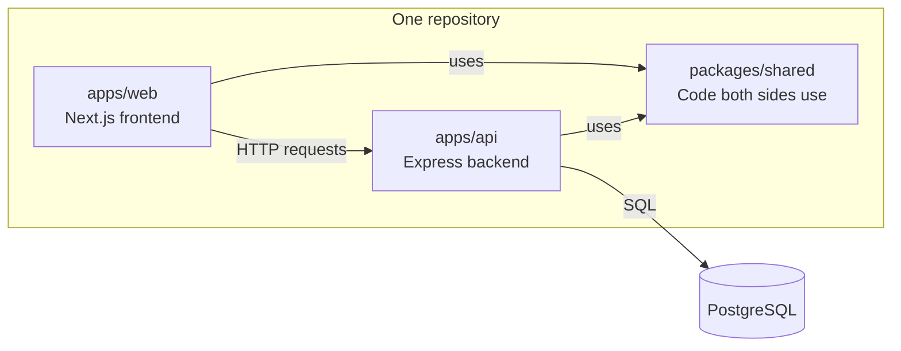
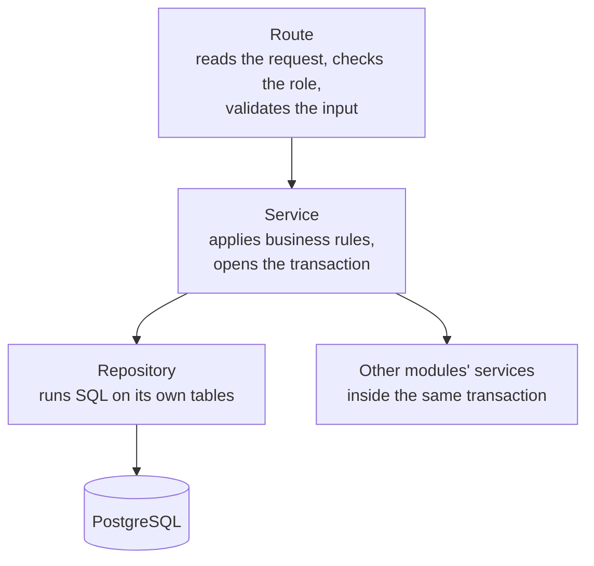
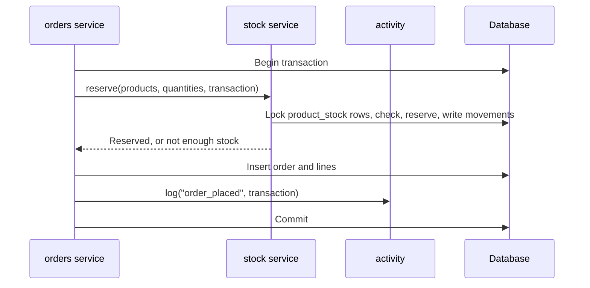
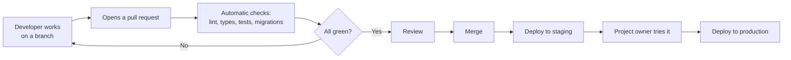

# Project structure

This document shows how the code is organized: which folders exist, what goes in each one, and which tools we use. It is the third part of the technical design, after the [Database design](01-database-design.md) and the [API design](02-api-design.md).

Labels such as (C-23) point to [Decisions](../02-decisions.md).

## One repository, three parts

All code lives in one repository, called a **monorepo**. It has three parts:



| Part | What it is |
|---|---|
| apps/web | Everything the user sees: pages, buttons, forms, in Arabic and English |
| apps/api | Every business rule, every database query, and the background jobs |
| packages/shared | Things both sides must agree on: input rules, status names, role names, error codes, money helpers |

**Why one repository?** When we add a field to a request, the frontend and the backend change in the same commit. The shared input rules mean a form and the backend check the same thing in the same way. The frontend checks only to show helpful messages quickly. The backend always checks again, because it never trusts the client (see the [API design](02-api-design.md)).

## Tools

| Need | Tool | Why |
|---|---|---|
| Language | TypeScript, on both sides (C-53) | Mistakes in names and types are found before the code runs |
| Package manager | pnpm, with workspaces | Handles the three parts in one repository and installs fast |
| Frontend | Next.js with the App Router (C-23) | Agreed framework. Server pages load fast on phones |
| Styling | Tailwind CSS | Simple, and has built-in right-to-left support for Arabic |
| Arabic and English | next-intl | Translations and right-to-left layout per language (C-51) |
| Backend | Express (C-23) | Agreed framework |
| Database | PostgreSQL (C-53) | Strict transactions, row locks, row level security |
| Database queries | Kysely | Writes type-checked SQL. It gives full control over locks and transactions, which stock needs |
| Database changes | Migration files in plain SQL | Every change to a table is a numbered file, saved in the repository and run in order |
| Input rules | Zod | One rule file is used by the form and by the backend |
| Unit and API tests | Vitest, with a real PostgreSQL in Docker | Stock and money rules are tested against a real database, not a fake one |
| End-to-end tests | Playwright | Clicks through the real app in a browser, including on a phone screen size |
| Local database | Docker Compose | Every developer runs the same PostgreSQL version with one command |
| Checks on every push | GitHub Actions | Runs lint, type check, tests, and migrations before code is merged |

These are listed as assumption C-89 in [Decisions](../02-decisions.md).

## The folders

```text
cosmo/
├── apps/
│   ├── web/                     Next.js frontend
│   │   ├── app/[locale]/        Pages, per language (ar, en)
│   │   │   ├── (auth)/          Login, change password, forgot password
│   │   │   ├── (customer)/      Catalog, cart, orders, invoices, returns
│   │   │   └── (staff)/         Screens for every employee role
│   │   ├── features/            One folder per module, with its forms and lists
│   │   ├── components/          Shared buttons, tables, dialogs
│   │   ├── lib/api/             The only place that sends requests to the backend
│   │   └── messages/            Arabic and English texts
│   │
│   └── api/                     Express backend
│       ├── src/
│       │   ├── core/            Things every module uses
│       │   ├── modules/         One folder per business module
│       │   ├── jobs/            Background jobs
│       │   └── server.ts        Starts the app
│       ├── migrations/          Numbered SQL files that create and change tables
│       └── tests/               API tests against a real database
│
├── packages/
│   └── shared/
│       ├── schemas/             Zod input rules per request
│       ├── enums/               Status names, role names, error codes
│       └── money/               Exact money calculations
│
├── docs/                        These planning documents
├── docker-compose.yml           Local PostgreSQL
└── .github/workflows/           Automatic checks
```

## The backend in detail

### Core

`core/` holds the pieces that every request uses. They match the steps in "The path of one request" in the [API design](02-api-design.md).

| Folder | What it does |
|---|---|
| core/db | Opens the database connection and runs a function inside one transaction |
| core/auth | Reads the session, loads the user, their roles, and their wholesaler |
| core/tenancy | Tells PostgreSQL the current wholesaler, so row level security works |
| core/permissions | The role table from the user stories (C-64), and the check each route uses |
| core/validation | Checks the request body against the shared Zod rules |
| core/idempotency | Handles the `Idempotency-Key` header |
| core/errors | The error shape and the error codes |
| core/activity | Writes the activity log |
| core/notifications | Creates notifications and their deliveries (C-46) |
| core/working-hours | Counts working hours, used by the 5-hour rule (C-35, C-37) |
| core/config | Reads settings such as the database address from environment variables |

### Modules

Each business area is one **module**. Each module is built in the phase shown.

| Module | What it covers | Phase |
|---|---|---|
| auth | Login, logout, passwords | 1 |
| settings | Settings, working hours, closed days | 1 |
| people | Employees, roles, customers | 1 |
| catalog | Products, lists, extra fields, offers, search | 2 |
| stock | Batches, stock summaries, movements, adjustments | 2 |
| suppliers | Suppliers, receipts, supplier returns, supplier payments | 3 |
| orders | Placing, accepting, changing, cancelling | 4 |
| preparation | Batch recommendation, picking, confirming | 5 |
| delivery | Trips, stops, signed papers, cash handover | 6 |
| billing | Invoices, payments, statements | 7 |
| returns | Customer returns and refunds | 8 |
| reports | Dashboard, activity screen, reports | 9 |
| platform | Creating wholesaler workspaces | 1 |

### Inside one module

Every module has the same files, so a developer always knows where to look.

```text
modules/orders/
├── orders.routes.ts       The paths, and which roles may call them
├── orders.service.ts      The business rules, inside a transaction
├── orders.repository.ts   The SQL queries for the module's own tables
├── orders.rules.ts        Small pure functions, such as "can this order be cancelled?"
└── orders.test.ts         Tests
```

The three layers have strict jobs:



| Layer | Allowed to | Not allowed to |
|---|---|---|
| Route | Read HTTP, call one service function | Contain business rules or SQL |
| Service | Apply rules, call its repository, call other modules' services | Read HTTP details |
| Repository | Run SQL on its own module's tables | Touch another module's tables |

### How modules work together

A module never writes into another module's tables. It asks that module's service, and passes the same transaction along.

Example: placing an order needs stock.



This keeps every stock rule in one place, the stock module. Orders, preparation, delivery, suppliers, and returns all change stock only through it. If a stock rule changes, only one module changes.

## The frontend in detail

### Three areas of screens

| Area | Who | Main screens |
|---|---|---|
| (auth) | Everyone | Login, change password, forgot password |
| (customer) | Customers | Catalog, product, cart, orders, order answer, invoices, payments, returns, notifications |
| (staff) | Employees | A home screen per role, then the screens of that role (C-64) |

After login, each person lands on the home screen that fits their roles. A person with several roles (C-31) sees the menu items of all their roles.

### Rules for the frontend

- **One place for requests.** Only `lib/api/` talks to the backend. Pages never call the backend directly. This keeps the error handling and the `Idempotency-Key` in one place.
- **Phone first.** Every screen is designed for a phone, then widened for a computer (C-51).
- **Right to left.** Arabic pages are right to left. The layout uses "start" and "end", never "left" and "right", so it flips correctly.
- **Weak connection.** For the delivery person, a button that fails because of the network is retried with the same `Idempotency-Key`, so it never counts twice. A clear "not sent yet" mark shows until it succeeds.
- **The cart** is saved in the browser's storage, so it survives closing the app.

## Environments

| Environment | Who uses it | Data |
|---|---|---|
| Local | A developer on their computer | Test data |
| Staging | The project owner, to try a phase before approving it | Test data that looks real |
| Production | Real wholesalers | Real data, backed up every day |

Hosting is decided before the pilot (stage 4 of the [Master plan](../01-master-plan.md)).

## How code gets in



## What a phase looks like in code

Phase 1 (foundation) creates:

- the monorepo and the tools above;
- the `core/` folder with all its parts;
- the modules `auth`, `settings`, `people`, and `platform`;
- the migrations for area 1 of the database and the activity and notification tables;
- the login, change password, employees, customers, and settings screens.

Each later phase adds its module, its migrations, and its screens, and does not need to change `core/`.
