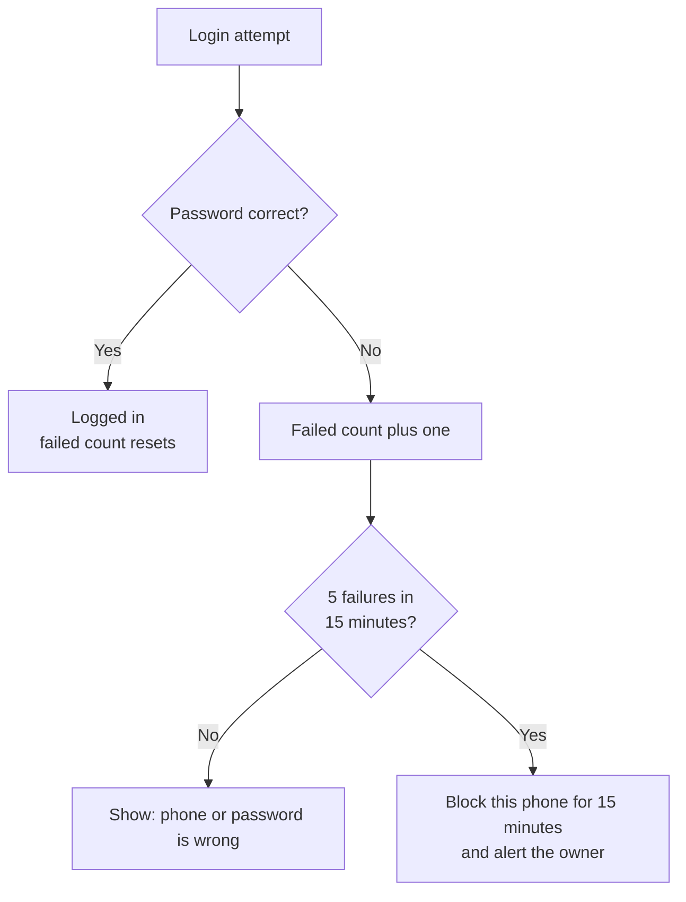
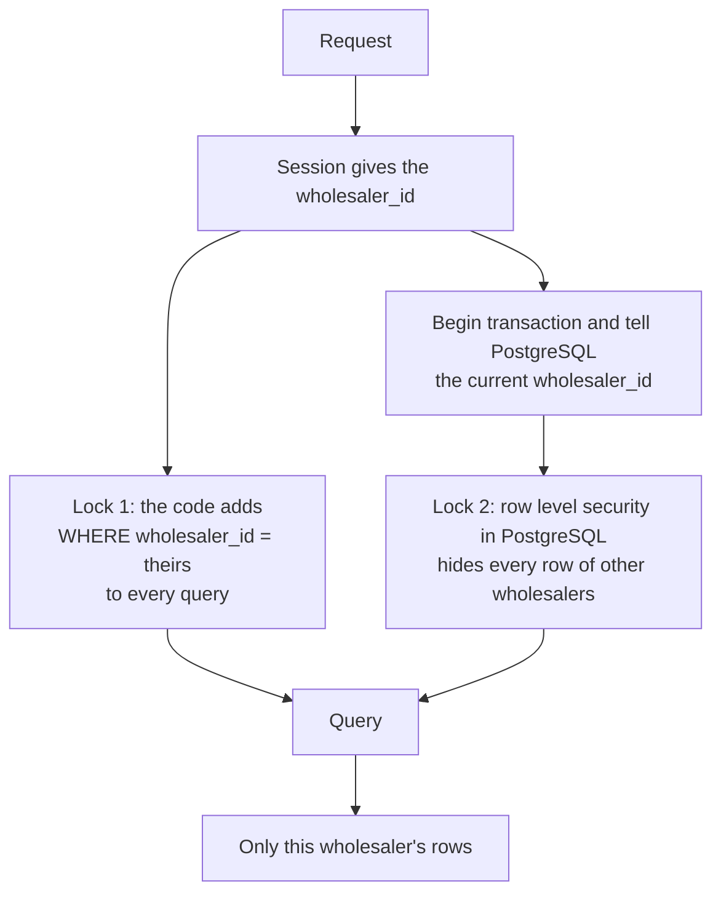

# Security

This document explains how the app protects its data: who can log in, what each person can see and do, and how one wholesaler is kept apart from another. It is the last part of the technical design.

Labels such as (C-52) point to [Decisions](../02-decisions.md).

## What we protect, and from what

| What could go wrong | How the plan stops it |
|---|---|
| A wholesaler sees another wholesaler's data | Every query filters by the user's wholesaler, and PostgreSQL row level security blocks it a second time |
| A customer sees another customer's orders or invoices | Customer requests always filter by the logged-in customer |
| An employee does something their role does not allow | Every route checks the role table (C-64) |
| Someone changes a price or total on their phone | The backend calculates every number itself ([API design](02-api-design.md)) |
| Someone guesses a password | Slow password hashing, and login attempts are limited |
| A stolen phone stays logged in | Sessions can be ended at once, for example when the owner deactivates the employee |
| Someone hides what they did | The activity log cannot be changed or deleted, even by the app |
| Data is lost | Daily backups, with a restore that is tested |
| A bug shows wrong stock or money | Database checks refuse negative stock and over-payment. A nightly totals check warns the developer (C-88) |

## 1. Logging in

### Passwords

- A password has **at least 8 characters**.
- It is stored only as a **hash** made with **argon2id**. A hash is a one-way scramble: the app can check a password against it, but nobody can turn it back into the password. argon2id is deliberately slow, so guessing many passwords takes too long.
- First passwords and reset passwords are random and temporary. The person must change them at the next login (C-29, C-48, C-87).
- Changing a password ends all other sessions of that person.

### Too many wrong passwords

- The message never says whether the phone number or the password was wrong. This stops people from finding out which phone numbers have accounts.
- There is also a limit per internet address, so one computer cannot try many phone numbers.

### Sessions

After login, the backend creates a **session**: a long random code stored in the `sessions` table, and sent to the browser in a cookie.

| Cookie setting | What it does |
|---|---|
| HttpOnly | JavaScript in the page cannot read the cookie, so a script injected by an attacker cannot steal it |
| Secure | The cookie is sent only over HTTPS |
| SameSite=Lax | The cookie is not sent when another website tries to submit a form to our app |

**Why sessions in the database, and not tokens such as JWT?** A session in the database can be ended at once. When the owner deactivates an employee or a customer, their sessions are deleted, and the next request fails (OWN-01, OWN-05). A token keeps working until it expires. This is assumption C-90.

How long a session lasts without use:

| Who | Ends after | Why |
|---|---|---|
| Customer | 30 days | A pharmacy uses its own phone, and logging in often is annoying |
| Employee | 12 hours | Covers one working day. Shared warehouse devices are common |
| Platform administrator | 1 hour, and a second factor is needed | This account can create wholesalers |

This is assumption C-91.

### Forgotten passwords

- **Customer:** taps "forgot password". The owner or a sales employee sets a temporary password and sends it by WhatsApp to the phone number on file (C-87).
- **Employee:** the owner sets a temporary password (OWN-01).
- **Owner:** the platform team sets a temporary password after calling the owner to check who they are (C-87).

### Planned for later: reset by SMS code (C-92)

Not built in the first version. The design keeps room for it, so adding it later changes nothing that already exists:

| Part | What is added later |
|---|---|
| Notifications | A new channel `sms` in `notification_deliveries` (C-46) |
| Database | A `login_codes` table: user, hash of the code, expiry, tries |
| API | `POST /auth/reset-code` sends a code. `POST /auth/reset-with-code` checks it and sets the new password |
| Rules | 6 digits, expires after 10 minutes, at most 5 tries per code, at most 3 codes per hour per phone, the same answer whether the phone exists or not |

The employee reset stays as a backup for customers who changed their phone number.

## 2. Keeping wholesalers apart (C-52)

There are two locks. If one fails because of a bug, the other still holds.

- The `wholesaler_id` comes only from the session, never from the request.
- The database user that the app uses is **not** an administrator, so it cannot switch row level security off.
- A row of another wholesaler always answers **404 Not found**, never 403. So nobody can learn that the row exists.
- Automatic tests try to read and change data of a second wholesaler on every request, and must always fail.

## 3. Roles and permissions (C-64)

Two checks run on every request:

| Check | Question | Example |
|---|---|---|
| Role check | Does one of the user's roles allow this request? | A delivery person cannot call "change price" |
| Data check | Is this particular row theirs to see? | A delivery person sees only their own trips. A customer sees only their own orders |

- The role table lives in one file in `core/permissions`, copied from the table in the [User stories](../user-stories/README.md). Every route names the permission it needs.
- The frontend hides buttons a person cannot use, but this is only for comfort. The backend check is the real one.
- A person with several roles (C-31) has the permissions of all of them together.
- Owner-only actions, such as price changes, credit changes, and settings, check for the owner role by name.

## 4. Requests and input

| Risk | Protection |
|---|---|
| Wrong or harmful input | Every request body is checked against its Zod rule. Unknown fields are removed |
| SQL injection: input that is run as part of a database command | All queries use parameters through Kysely. Input is never glued into SQL text |
| Script injection (XSS): input shown on a page runs as code | React escapes all text by default. Raw HTML is never inserted. A Content Security Policy header blocks scripts from other sites |
| Forged requests from another website (CSRF) | SameSite cookies, and every request that changes something must come from our own website address |
| Too many requests | Limits per user and per internet address, stricter on login |
| Large uploads | Only product images are uploaded. Maximum 2 MB, only JPEG, PNG, or WebP. The image is re-saved by the backend, which removes anything hidden in the file |

## 5. Protecting stored data

| What | How |
|---|---|
| Traffic | HTTPS only, with HSTS so browsers never fall back to plain HTTP |
| Passwords | argon2id hashes only |
| Secrets, such as the database password | Environment variables on the server. Never in the repository |
| Activity log | The app's database user can add and read rows, but cannot change or delete them (C-30) |
| Money and stock | Database checks refuse negative stock, over-payment, and quantity increases (C-38) |
| Logs for the developer | Never contain passwords, session codes, or full phone numbers. Phone numbers are shown as `010****5678` |

## 6. Backups

- A full backup of the database every day, kept for 30 days.
- Continuous backup of every change, so the database can be restored to any minute of the last 7 days.
- Backups are stored in a different place from the database.
- A restore is tested once a month on a separate server. A backup that was never restored is not trusted.

## 7. Personal data

The app stores personal data of customers and employees: names, phone numbers, and addresses. Egypt has a personal data protection law (Law 151 of 2020).

- Each wholesaler owns its customers' data. Other wholesalers cannot see it.
- We store only what the app needs. There are no national ID numbers or other sensitive fields.
- Before the pilot, the legal duties should be checked with a lawyer, for example where the server may be located and what the wholesaler must tell customers.

## 8. Keeping the code safe

- Every pull request runs the automatic checks, including the tests that try to read another wholesaler's data.
- Dependencies are checked for known security problems every week, and updated.
- No one pushes directly to the main branch. Every change is reviewed.

## Decisions from this document

| ID | Decision |
|---|---|
| C-89 | The tools in the [Project structure](03-project-structure.md) |
| C-90 | Sessions stored in the database, in an HttpOnly cookie, not JWT tokens |
| C-91 | Session lengths: customers 30 days, employees 12 hours, platform administrators 1 hour with a second factor |
| C-92 | SMS reset codes are planned for later |

## Database change

Security adds one table to area 1 of the [Database design](01-database-design.md), **sessions**, and two columns to **users**: `failed_logins` and `locked_until`. Both are already shown there.
