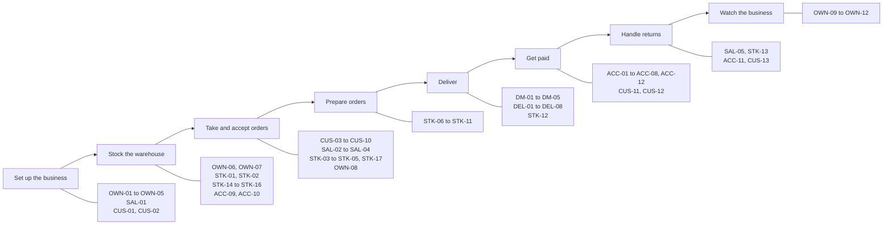

# User stories

A user story describes one thing a person needs to do, in their own words:

> As a **role**, I want to **do something**, so that **I get a benefit**.

Under each story are **acceptance checks**. A story is finished only when every check passes.

## Files

| File | Role | Prefix |
|---|---|---|
| [customer.md](customer.md) | Pharmacy or store | CUS |
| [owner.md](owner.md) | Owner of the wholesale business | OWN |
| [sales.md](sales.md) | Sales employee | SAL |
| [stock-manager.md](stock-manager.md) | Stock manager | STK |
| [delivery-manager.md](delivery-manager.md) | Delivery manager | DM |
| [delivery.md](delivery.md) | Delivery person | DEL |
| [accountant.md](accountant.md) | Accountant | ACC |

## Who can do what (A-23)

The owner can do everything. Every other role sees only what its job needs. One employee can hold more than one role (C-31).

| Area | Owner | Sales | Stock manager | Delivery manager | Accountant | Delivery | Customer |
|---|---|---|---|---|---|---|---|
| Employees and settings | Yes | | | | | | |
| Customers | Yes | Add and view | | View address and phone | View | | Own profile |
| Credit switch and credit period | Yes | | | | View | | |
| Products and prices | Yes | View | Products yes, prices view | | View | | View catalog |
| Stock and batches | Yes | View available | Yes | | | | In stock or not |
| Suppliers and receiving | Yes | | Yes | | View | | |
| Accept or reject orders | Yes | | Yes | | | | |
| Orders | Yes | Create and view | View and cancel | View ready orders | View | | Own orders |
| Order preparation | Yes | | Yes | | | | |
| Delivery trips | Yes | | | Yes | View | Own trips | |
| Record payment at delivery | Yes | | | | | Yes | |
| Confirm payments, invoices, balances | Yes | View | | | Yes | | Own invoices |
| Supplier payments | Yes | | | | Yes | | |
| Returns | Yes | Start | Check goods | | Credit | | View own |
| Activity screen and alerts | Yes | | | | | | |
| Reports | Yes | | Stock reports | | Money reports | | |

## Story map

The top row is the journey. The stories under each step are what make that step possible.

