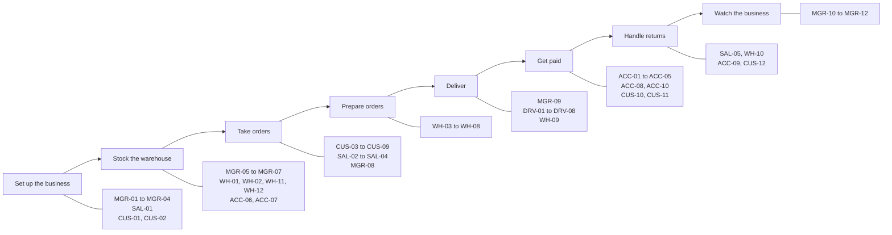

# User stories

A user story describes one thing a person needs to do, in their own words:

> As a **role**, I want to **do something**, so that **I get a benefit**.

Under each story are **acceptance checks**. A story is finished only when every check passes.

## Files

| File | Role | Prefix |
|---|---|---|
| [customer.md](customer.md) | Pharmacy or store | CUS |
| [owner-and-manager.md](owner-and-manager.md) | Owner and manager | MGR |
| [sales.md](sales.md) | Sales employee | SAL |
| [warehouse.md](warehouse.md) | Warehouse employee | WH |
| [accountant.md](accountant.md) | Accountant | ACC |
| [driver.md](driver.md) | Delivery driver | DRV |

## Who can do what — first proposal (O-07)

This table is a proposal. It needs review before it is final.

| Area | Owner | Manager | Sales | Warehouse | Accountant | Driver | Customer |
|---|---|---|---|---|---|---|---|
| Settings and employees | Yes | View | | | | | |
| Customers | Yes | Yes | Yes | | View | | Own profile |
| Products and prices | Yes | Yes | View | View | View | | View catalog |
| Stock and batches | Yes | Yes | View | Yes | View | | In stock or not |
| Stock adjustments | Yes | Yes | | Request | | | |
| Suppliers and receiving | Yes | Yes | | Yes | Yes | | |
| Orders | Yes | Yes | Create and view | View | View | | Own orders |
| Preparation tasks | Yes | Yes | | Yes | | | |
| Delivery trips | Yes | Yes | | Create | | Own trips | |
| Invoices and payments | Yes | View | View | | Yes | Record cash | Own invoices |
| Returns | Yes | Yes | Create | Check goods | Yes | | View own |
| Reports and activity history | Yes | Yes | | | Financial | | |

## Story map

The top row is the journey. The stories under each step are what make that step possible.

