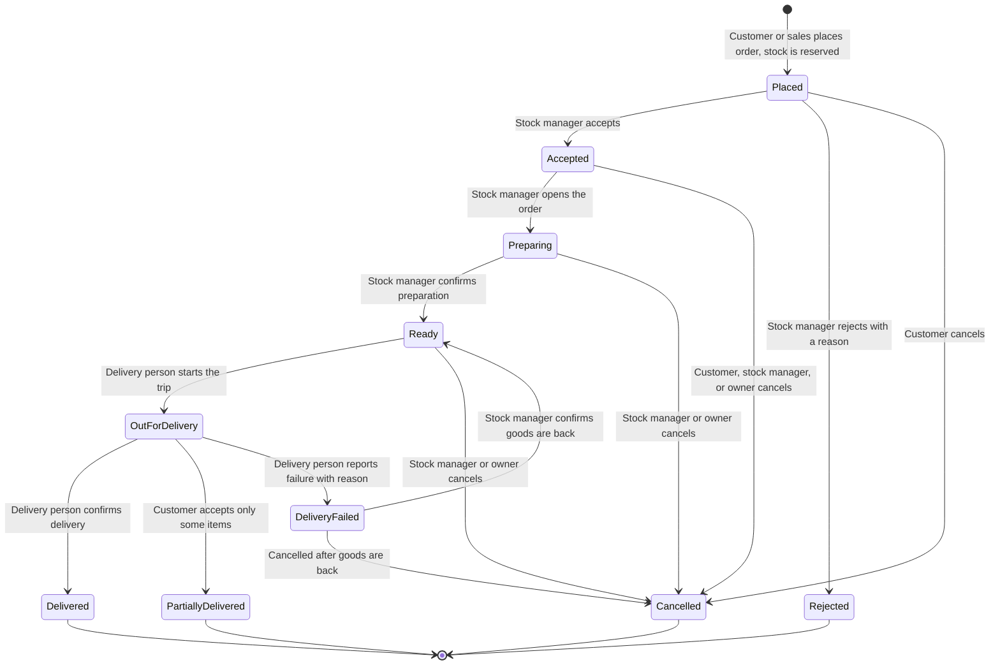
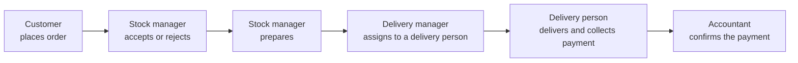
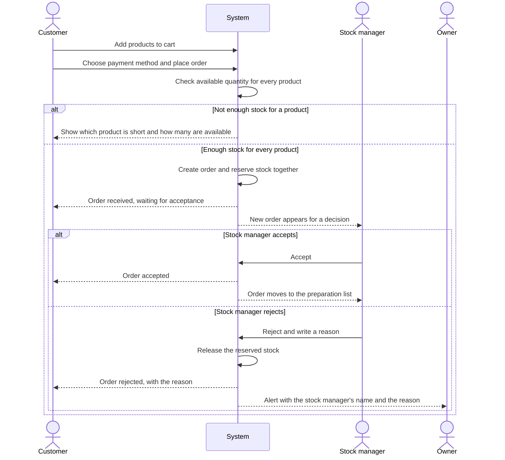
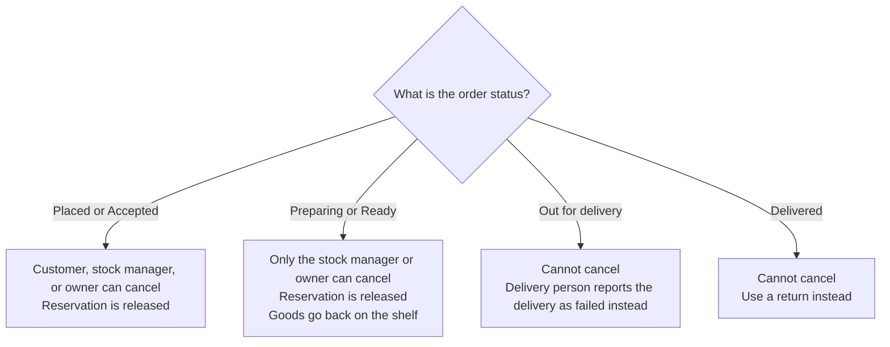

# Order lifecycle

This is the most important workflow. It shows every status an order can have and what moves it to the next one.

Labels in brackets, such as (C-24), point to [Decisions](../02-decisions.md).

## Order statuses

| Status | Meaning | Who causes it |
|---|---|---|
| Placed | The order is waiting for acceptance. Its stock is already reserved | Customer or sales (C-25) |
| Accepted | The wholesaler agreed to fulfil the order | Stock manager or owner (C-24) |
| Rejected | The wholesaler refused the order, with a reason the customer sees | Stock manager or owner (C-24) |
| Preparing | The stock manager is picking the order | The system, when the order is opened |
| Ready | The order is packed and waiting for a trip | Stock manager confirms preparation |
| Out for delivery | The goods have left the warehouse | Delivery person starts the trip |
| Delivered | The customer received everything | Delivery person |
| Partially delivered | The customer received some items | Delivery person (O-10) |
| Delivery failed | The delivery did not happen | Delivery person, with a reason |
| Cancelled | The order will not be fulfilled | Customer, stock manager, or owner (A-06) |

People press a button only for real decisions and real-world actions: placing, accepting or rejecting, confirming preparation, starting the trip, and reporting the delivery result.

## Who handles the order at each step

## What happens to stock at each step

Example: a product has 100 units, and customer A orders 70.

| Step | On hand | Reserved | Available | Decision |
|---|---|---|---|---|
| Before the order | 100 | 0 | 100 | |
| Customer A places an order for 70 | 100 | 70 | 30 | C-25 |
| Customer B tries to order 50 | 100 | 70 | 30 | Refused. Only 30 are available (A-07) |
| Stock manager accepts A's order | 100 | 70 | 30 | No change |
| Preparation confirmed | 100 | 70 | 30 | Batches are now chosen |
| Delivery person starts the trip | 30 | 0 | 30 | C-25 |
| Delivered | 30 | 0 | 30 | |

On hand stays at 100 until the goods leave, because the boxes are still on the shelf. Available drops at once, so two customers can never be promised the same stock.

Other cases:

| Case | Effect on stock |
|---|---|
| Order rejected | Reserved decreases by 70. Available returns to 100 (C-12) |
| Order cancelled before the trip starts | Reserved decreases by 70. Available returns to 100 (C-12) |
| Only 60 of 70 are prepared | Reserved decreases by 10 at confirmation. The order continues with 60 (A-08) |
| Delivery failed, goods are back | On hand increases by 70. If the order will be delivered again, reserved increases by 70 too (A-19) |

## Placing and accepting an order

Creating the order and reserving the stock happen as one action. Either both succeed or neither does. If two customers order the last units at the same moment, only one order succeeds.

## Cancellation rules (A-06)

A cancellation by an employee needs a reason and sends an alert to the owner (C-30).

If an invoice already exists when an order is cancelled, the invoice is cancelled too. This can only happen when invoice timing is set to "on accepted" or "on prepared" (A-05).

## Still open

- **O-11** — What happens if nobody accepts an order for a long time? The stock stays reserved while it waits. Options: show a warning on the owner's dashboard after some hours, or cancel the order automatically after a set time.
