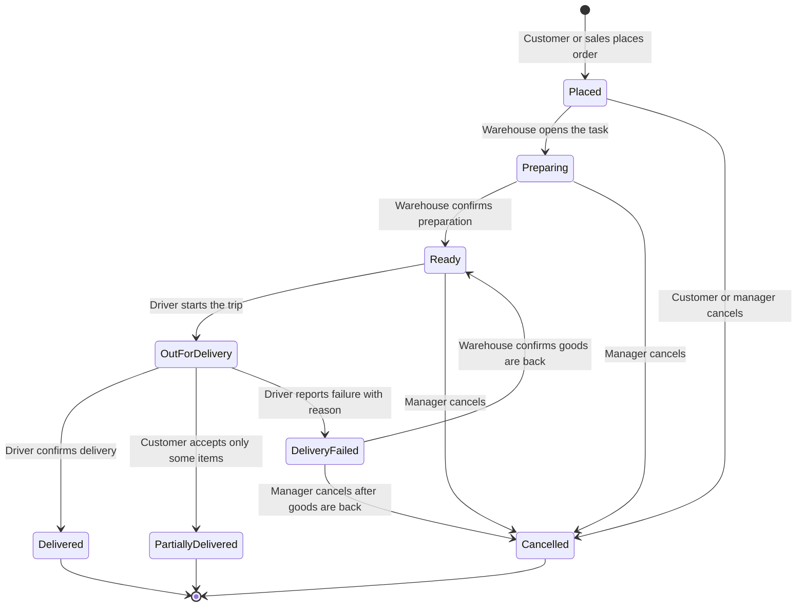
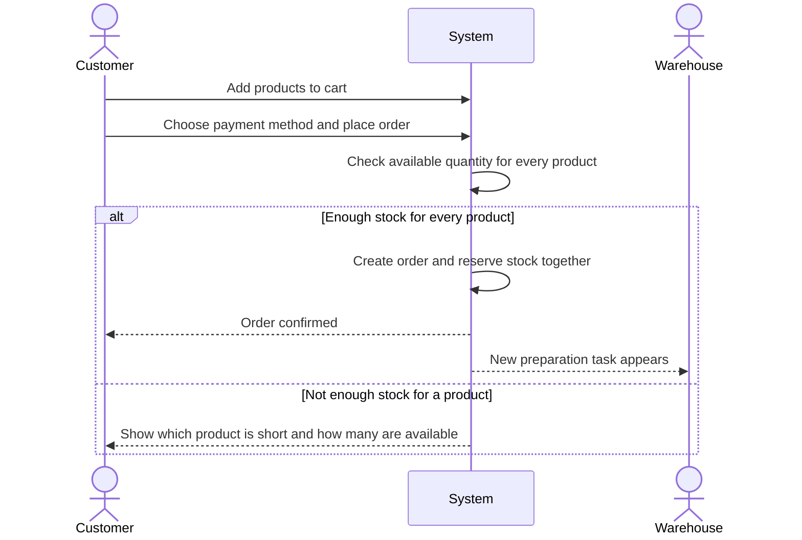
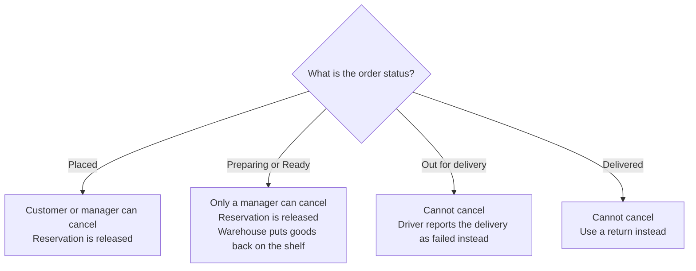

# Order lifecycle

This is the most important workflow. It shows every status an order can have and what moves it to the next one.

Labels in brackets, such as (A-06), point to [Decisions](../02-decisions.md).

## Order statuses

| Status | Meaning | Who or what causes it |
|---|---|---|
| Placed | The order exists and its stock is reserved | The system, right after the order is placed (A-03) |
| Preparing | A warehouse employee is picking the order | The system, when the employee opens the task |
| Ready | The order is packed and waiting for a trip | Warehouse employee confirms preparation |
| Out for delivery | The goods have left the warehouse | Driver starts the trip |
| Delivered | The customer received everything | Driver |
| Partially delivered | The customer received some items | Driver (O-10) |
| Delivery failed | The delivery did not happen | Driver, with a reason |
| Cancelled | The order will not be fulfilled | Customer or manager (A-06) |

People only press a button for real-world actions: placing, confirming preparation, starting the trip, and reporting the delivery result. The system sets every other status.

## What happens to stock at each step

Example: a product has 100 units, and a customer orders 70.

| Step | On hand | Reserved | Available | Decision |
|---|---|---|---|---|
| Before the order | 100 | 0 | 100 | |
| Order placed | 100 | 70 | 30 | C-11 |
| Preparation confirmed | 100 | 70 | 30 | Batches are now chosen |
| Driver starts the trip | 30 | 0 | 30 | A-04 |
| Delivered | 30 | 0 | 30 | |

Other cases:

| Case | Effect on stock |
|---|---|
| Cancelled before the trip starts | Reserved decreases by 70. Available returns to 100 (C-12) |
| Warehouse prepares only 60 of 70 | Reserved decreases by 10 at confirmation. The order continues with 60 (A-08) |
| Delivery failed, goods are back | On hand increases by 70. If the order will be delivered again, reserved increases by 70 too (A-19) |

## Placing an order

Creating the order and reserving the stock happen as one action. Either both succeed or neither does. If two customers order the last units at the same moment, only one order succeeds.

## Cancellation rules (A-06)

If an invoice already exists when an order is cancelled, the invoice is cancelled too. This can only happen when invoice timing is set to "on order placed" or "on prepared" (A-05).
