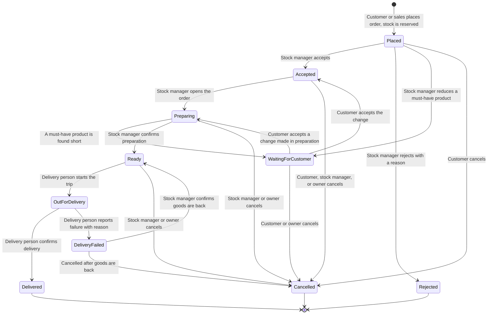
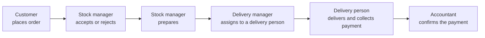
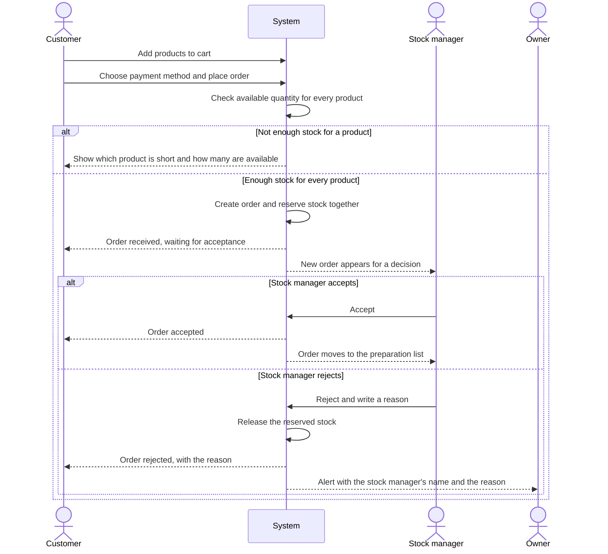
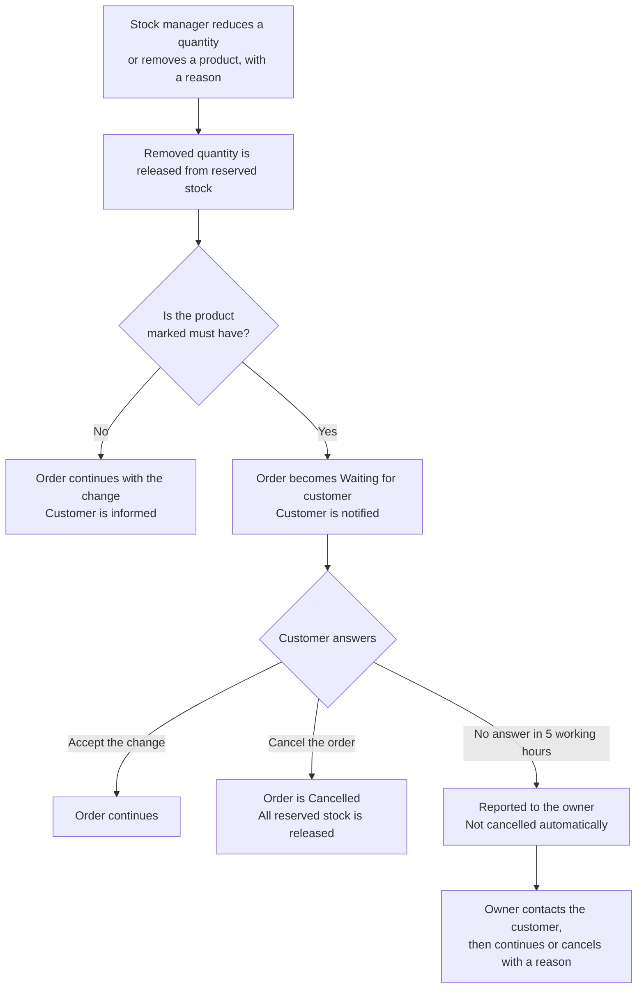
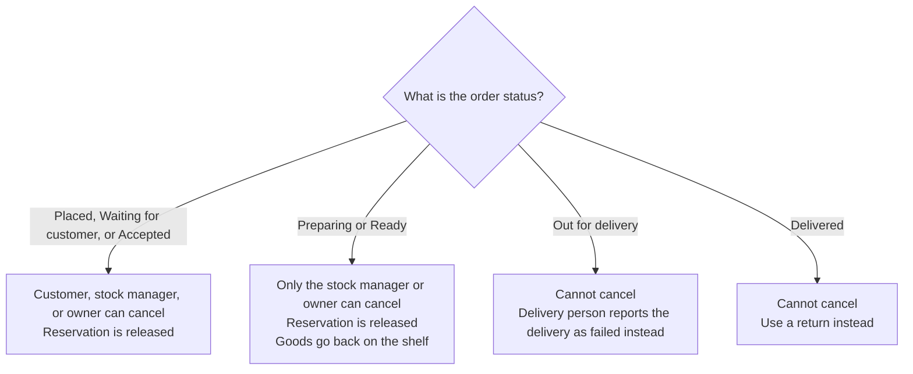

# Order lifecycle

This is the most important workflow. It shows every status an order can have and what moves it to the next one.

Labels in brackets, such as (C-24), point to [Decisions](../02-decisions.md).

## Order statuses

| Status | Meaning | Who causes it |
|---|---|---|
| Placed | The order is waiting for acceptance. Its stock is already reserved | Customer or sales (C-25) |
| Accepted | The wholesaler agreed to fulfil the order | Stock manager or owner (C-24) |
| Rejected | The wholesaler refused the order, with a reason the customer sees | Stock manager or owner (C-24) |
| Waiting for customer | A must-have product was reduced or removed. The customer must accept the change or cancel | Stock manager (C-38, C-39) |
| Preparing | The stock manager is picking the order | The system, when the order is opened |
| Ready | The order is packed and waiting for a trip | Stock manager confirms preparation |
| Out for delivery | The goods have left the warehouse | Delivery person starts the trip |
| Delivered | The customer received the order. Items refused at the door become a return (C-47) | Delivery person |
| Delivery failed | The delivery did not happen | Delivery person, with a reason |
| Cancelled | The order will not be fulfilled | Customer, stock manager, or owner (A-06) |

People press a button only for real decisions and real-world actions: placing, accepting or rejecting, answering a change, confirming preparation, starting the trip, and reporting the delivery result.

## Who handles the order at each step

## What happens to stock at each step

Example: a product has 100 units, and customer A orders 70.

| Step | On hand | Reserved | Available | Decision |
|---|---|---|---|---|
| Before the order | 100 | 0 | 100 | |
| Customer A places an order for 70 | 100 | 70 | 30 | C-25 |
| Customer B tries to order 50 | 100 | 70 | 30 | Refused. Only 30 are available (A-07) |
| Stock manager accepts A's order | 100 | 70 | 30 | No change |
| Preparation confirmed | 100 | 70 | 30 | Batches are now chosen |
| Delivery person starts the trip | 30 | 0 | 30 | C-25 |
| Delivered | 30 | 0 | 30 | |

On hand stays at 100 until the goods leave, because the boxes are still on the shelf. Available drops at once, so two customers can never be promised the same stock.

Other cases:

| Case | Effect on stock |
|---|---|
| Order rejected | Reserved decreases by 70. Available returns to 100 (C-12) |
| Order cancelled before the trip starts | Reserved decreases by 70. Available returns to 100 (C-12) |
| The stock manager reduces 70 to 60, at acceptance or in preparation | Reserved decreases by 10 at once. The other 60 stay reserved, also while the order waits for the customer (C-38, C-39) |
| The product has a "buy 10, get 1 free" offer and the customer orders 70 | 77 units are reserved: 70 paid and 7 free (C-41) |
| Delivery failed, goods are back | On hand increases by 70. If the order will be delivered again, reserved increases by 70 too (A-19) |

## Placing and accepting an order

Creating the order and reserving the stock happen as one action. Either both succeed or neither does. If two customers order the last units at the same moment, only one order succeeds.

## Changing quantities (C-38, C-39)

Sometimes the stock manager cannot send everything the customer ordered. They do not have to reject the whole order. They can reduce a quantity or remove a product, with a reason. They can never increase a quantity.

In the cart, the customer marks the products the order is really about as **must have**. One button, "ask me about any change", marks every product.

| Rule | Decision |
|---|---|
| The same rule applies at acceptance and during preparation | C-38 |
| The stock manager sees the must-have marks when reviewing and preparing the order | C-39 |
| The customer sees the old quantity, the new quantity, and the reason | C-38 |
| If every product is removed, the order is rejected or cancelled with a reason | C-24, A-06 |
| An order that is Waiting for customer keeps its remaining stock reserved | C-39 |

Reasons for a reduction: stock not found on the shelf, stock damaged, stock expired, other (with a note).

## Offers: discounts and bonus units (C-41)

| Offer | Example | Effect on the order |
|---|---|---|
| Discount | 5% off | The order line shows the normal price, the discount, and the price after discount |
| Bonus units | Buy 10, get 1 free | An order for 20 gets 2 free units. The free units are reserved, prepared, and delivered like the others |

- Only the owner creates offers. An offer is the same for every customer and can have a start and end date.
- The order keeps the offer that was active when it was placed, even if the offer ends later.
- Free units also need available stock. If there is not enough, the customer is told how many can be ordered (A-07).
- If a quantity is reduced, the free units are calculated again for the new quantity.

## Working hours (C-37)

The owner sets the open days and the opening and closing times, and has a "closed today" switch for holidays.

- The customer sees "Open now" or "Closed now, opens at 9:00". This comes from the schedule, not from who is logged in.
- The customer can place an order while the warehouse is closed. Stock is reserved as usual, and the customer sees "we will review your order when the warehouse opens".

## Cancellation rules (A-06)

A cancellation by an employee or the owner needs a reason. The customer gets a notification with the reason, and the owner gets an alert (C-30, C-35).

If an invoice already exists when an order is cancelled, the invoice is cancelled too. This can only happen when invoice timing is set to "on accepted" or "on prepared" (A-05).

## Orders that wait too long (C-35)

Stock stays reserved while an order waits for acceptance. If an order waits more than 5 working hours, the owner sees it on the dashboard and gets an alert. Only hours inside the working hours are counted (C-37), so an order placed at night is not reported while the warehouse is closed.

The order is never cancelled automatically, because a cancelled order is bad for the pharmacy or store. The owner can accept it, ask the stock manager to decide, or cancel it with a reason. The customer is notified of a cancellation and sees the reason.

The same 5 working hours apply to an order that is Waiting for customer (C-39).
