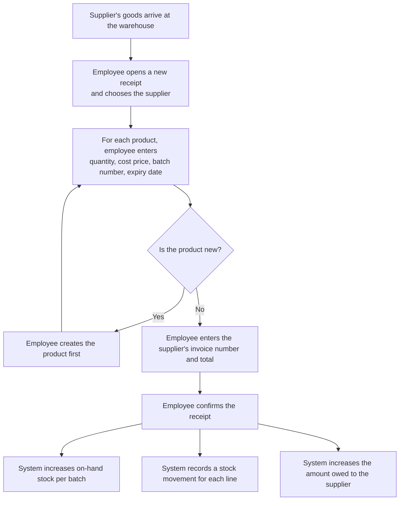
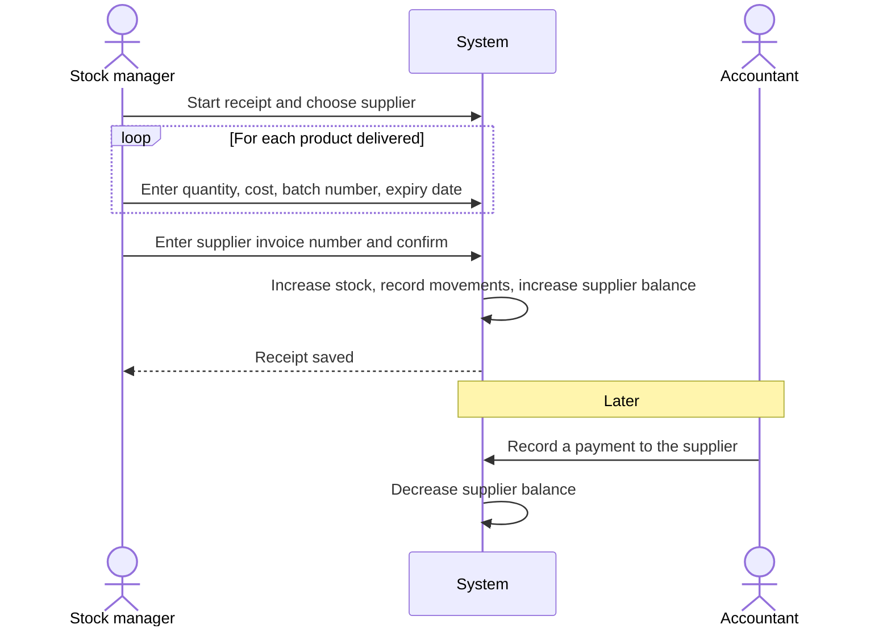

# Receiving goods from a supplier

There is no purchase order (C-04). The wholesaler orders from suppliers outside the app, by phone or WhatsApp. The app records only what actually arrived. The supplier's invoice comes with the goods, so both are recorded in one step (C-43).

## The flow

## Step by step

## Rules

| Rule | Decision |
|---|---|
| A confirmed receipt cannot be edited. A mistake is fixed with a stock adjustment that has a reason | C-09, C-10 |
| Batch number and expiry date are required for products that have batch tracking switched on | C-13 |
| An expiry date in the past is rejected | C-55 |
| The same batch number received again for the same product is added to the existing batch | |
| The supplier's invoice number and total are entered on the same receipt as the goods | C-43 |
| A new cost price on a receipt updates the product's cost price. Old prices stay in the history | C-75 |
| Supplier payments can be partial | |
| Goods sent back to a supplier are recorded as a [supplier return](09-supplier-returns.md) | C-42 |

