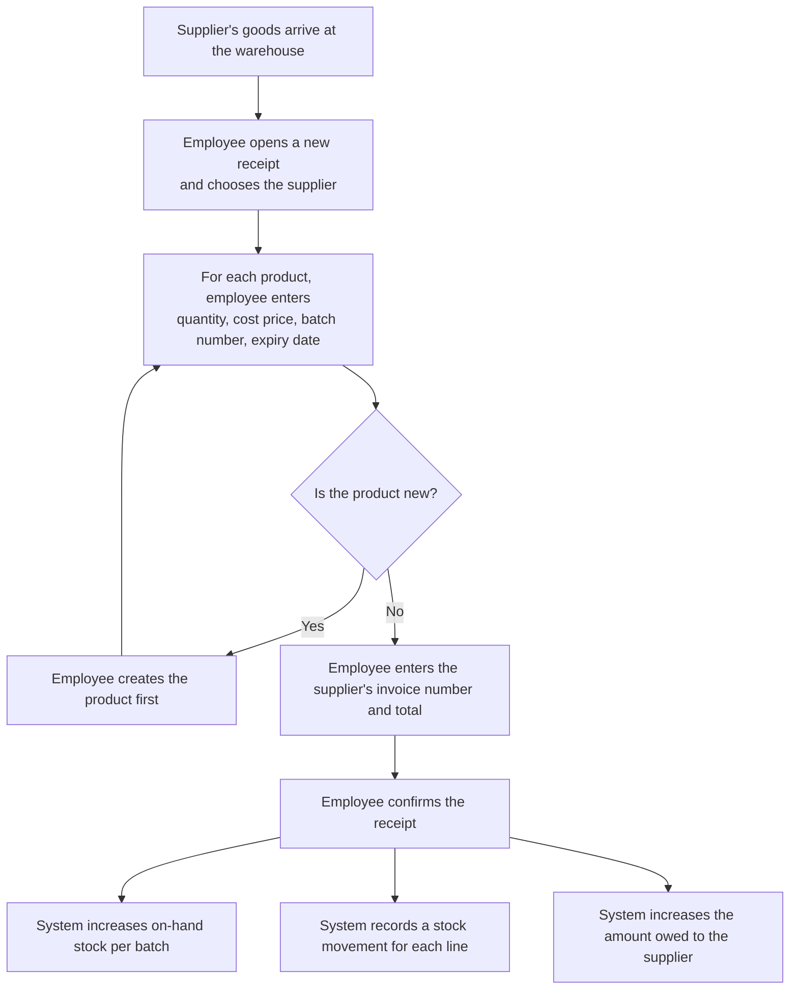
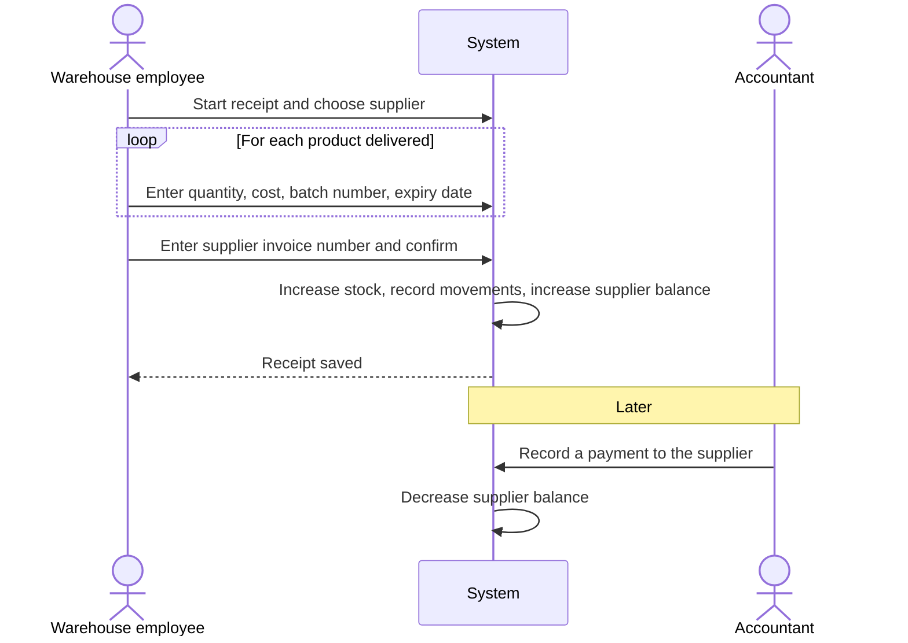

# Receiving goods from a supplier

There is no purchase order (C-04). The wholesaler orders from suppliers outside the app, by phone or WhatsApp. The app records only what actually arrived.

## The flow

## Step by step

## Rules

| Rule | Decision |
|---|---|
| A confirmed receipt cannot be edited. A mistake is fixed with a stock adjustment that has a reason | C-09, C-10 |
| Batch number and expiry date are required for products that have batch tracking switched on | C-13 |
| An expiry date in the past is rejected | A-17 |
| The same batch number received again for the same product is added to the existing batch | |
| Supplier payments can be partial | |

## Still open

- **O-03** — Can the supplier's invoice arrive later than the goods? If yes, receiving and the purchase invoice become two separate steps.
- **O-02** — Can goods be sent back to a supplier?
