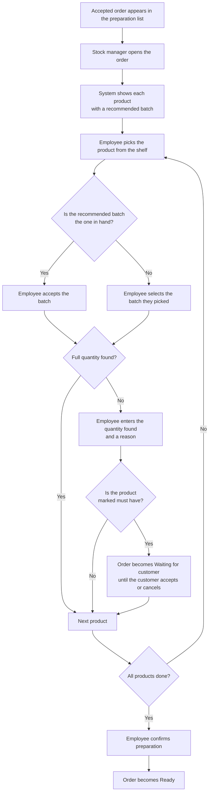
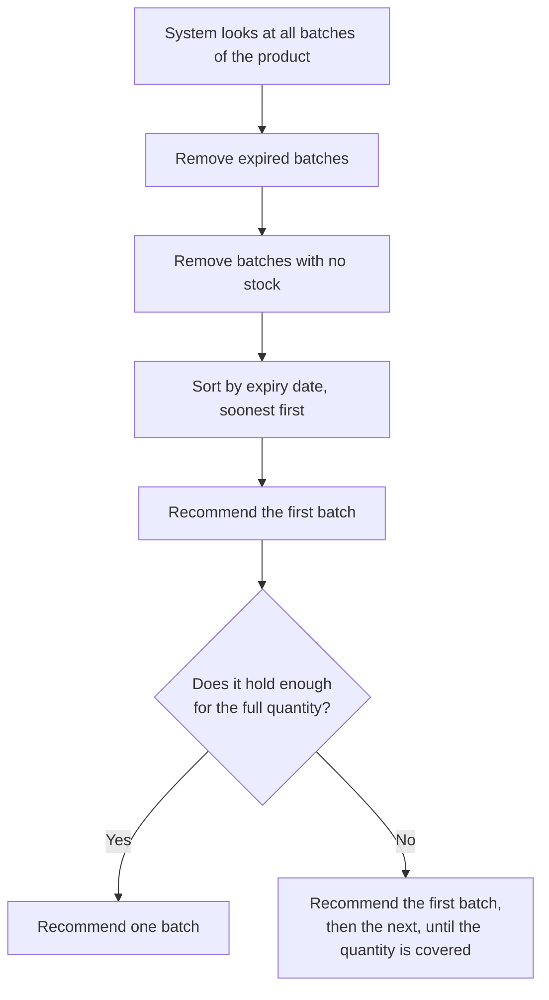

# Order preparation

The stock manager prepares orders that have been accepted (C-24, C-34). They work from a simple list, do the physical work, and confirm it.

## The flow

## Batch recommendation (C-14, C-55)

The system only recommends. The employee always makes the final choice, because the employee is the one holding the physical box. An expired batch cannot be selected at all.

## Rules

| Rule | Decision |
|---|---|
| Only accepted orders appear in the preparation list | C-24 |
| Opening an order moves it to Preparing automatically | |
| Only one stock manager prepares an order at a time | C-77 |
| One order line can be filled from more than one batch | |
| A barcode scan can select the product, where a scanner or phone camera is available | |
| If less than the ordered quantity is found, the employee enters a reason. The extra reservation is released, and the customer is informed | C-38 |
| If the short product is marked must have, the order waits for the customer's answer before it can be confirmed | C-39 |
| Bonus units are picked together with the paid units | C-41 |
| If nothing at all can be prepared, the stock manager cancels the order with a reason | C-57 |
| Batches that expire within the near-expiry period show a warning. The default is six months | C-55, C-45 |
| On-hand stock does not change at preparation. It changes when the trip starts | C-25 |

## Reasons for preparing less than ordered

- Stock not found on the shelf
- Stock damaged
- Stock expired
- Other (with a note)

A "not found" or "damaged" reason should also lead to a stock adjustment, so the numbers in the system match the shelf again.
