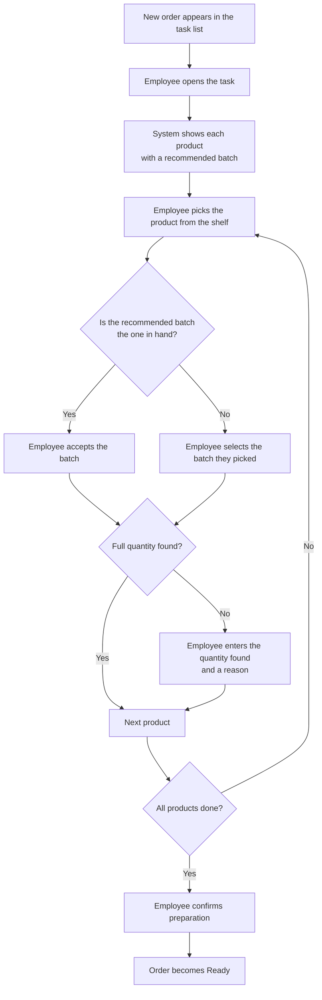
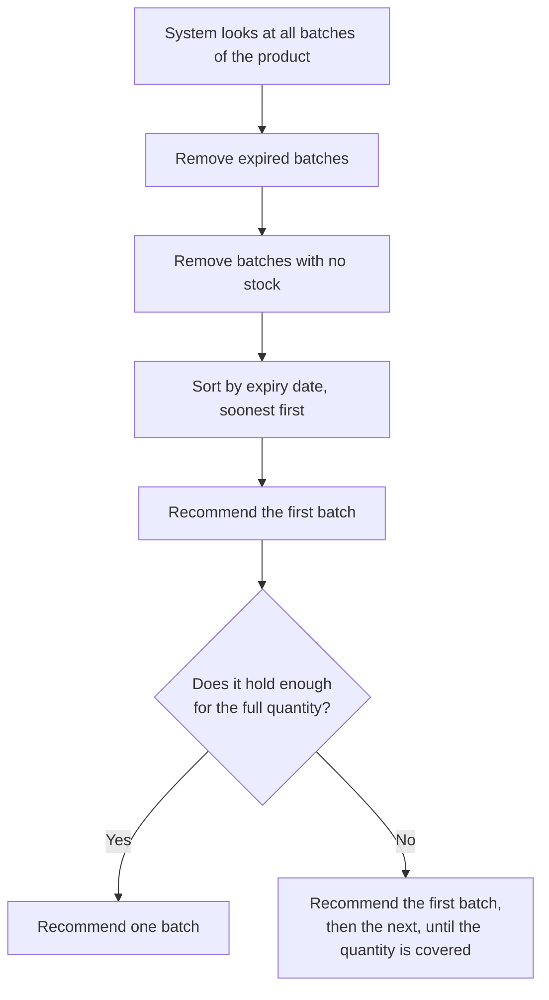

# Warehouse preparation

The warehouse employee works from a list of tasks. They do not manage order statuses. They do the physical work and confirm it.

## The flow

## Batch recommendation (C-14, A-17)

The system only recommends. The employee always makes the final choice, because the employee is the one holding the physical box. An expired batch cannot be selected at all.

## Rules

| Rule | Decision |
|---|---|
| Opening a task moves the order to Preparing automatically | A-03 |
| One order line can be filled from more than one batch | |
| A barcode scan can select the product, where a scanner or phone camera is available | |
| If less than the ordered quantity is found, the employee enters a reason. The extra reservation is released | A-08 |
| If nothing at all can be prepared, the employee reports it and a manager cancels the order | A-06 |
| Batches close to expiry show a warning | A-17, O-06 |
| On-hand stock does not change at preparation. It changes when the trip starts | A-04 |

## Reasons for preparing less than ordered

- Stock not found on the shelf
- Stock damaged
- Stock expired
- Other (with a note)

A "not found" or "damaged" reason should also lead to a stock adjustment, so the numbers in the system match the shelf again.
