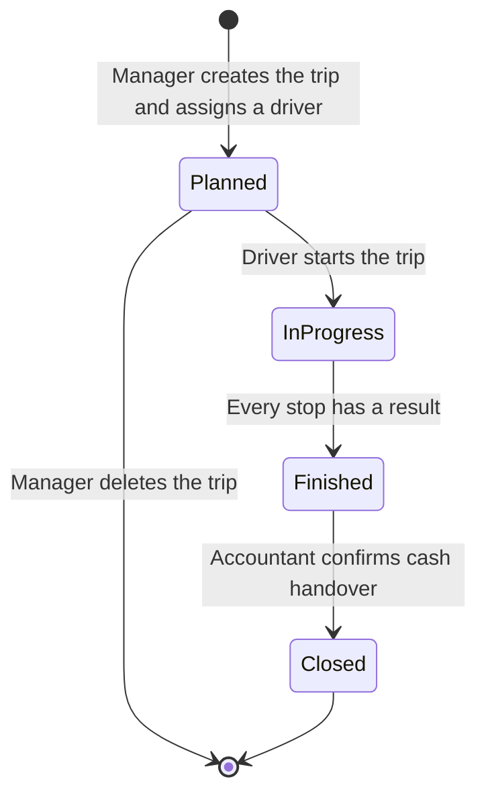
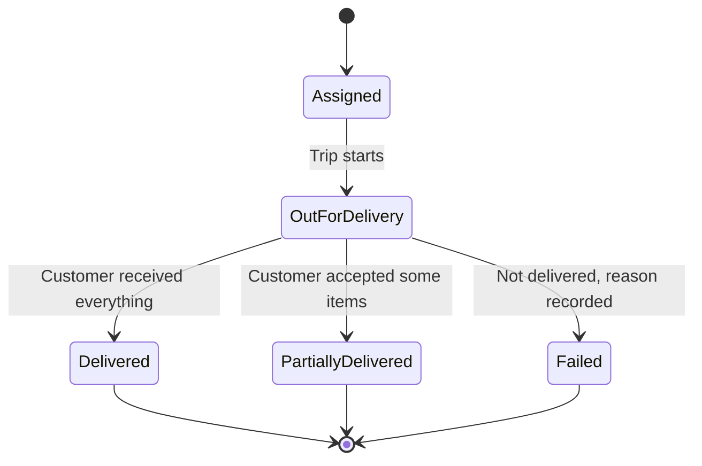
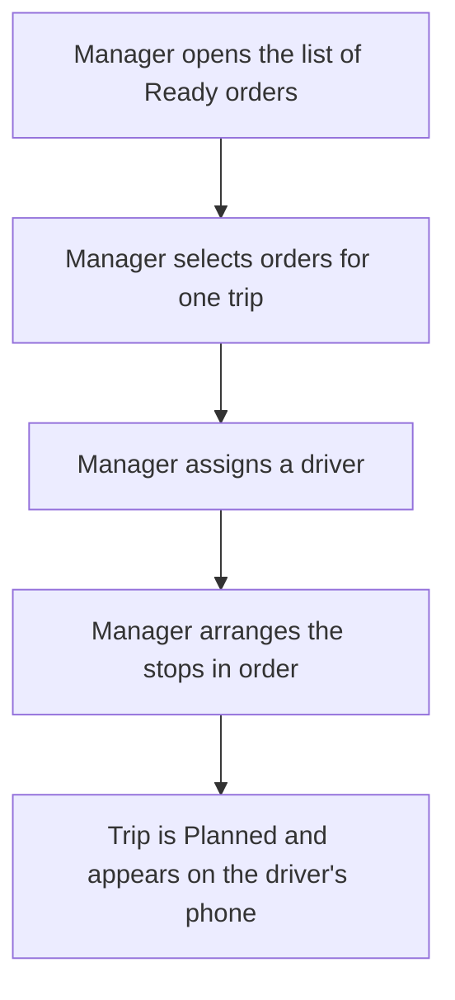
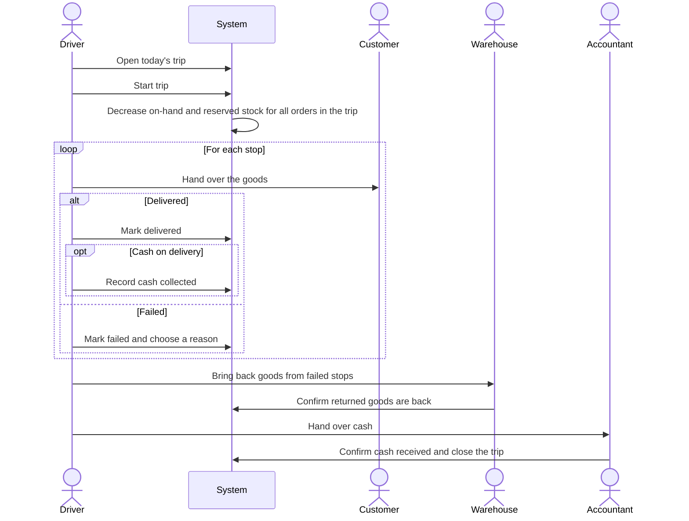

# Delivery

## Trip statuses

## Stop results

Each stop is one customer's order inside the trip.

## Planning a trip (A-21)

## The driver's day

## Rules

| Rule | Decision |
|---|---|
| Only Ready orders can be added to a trip | |
| An order can be in only one active trip | |
| Stock leaves the warehouse when the trip starts | A-04 |
| A failed stop needs a reason: customer not available, address problem, customer refused, other | C-21 |
| Goods from a failed stop go back to stock only after the warehouse confirms they are back | A-19 |
| After a failed stop, the order returns to Ready for another trip, or a manager cancels it | A-19 |
| The driver sees only their own trips | |
| The driver records cash collected. The accountant confirms the handover | A-16 |
| No GPS, no live tracking, no automatic route | |

## Still open

- **O-04** — Does the driver capture a signature or a photo as proof of delivery?
- **O-10** — When a customer refuses some items at the door, is it recorded as a partial delivery or as a return?
