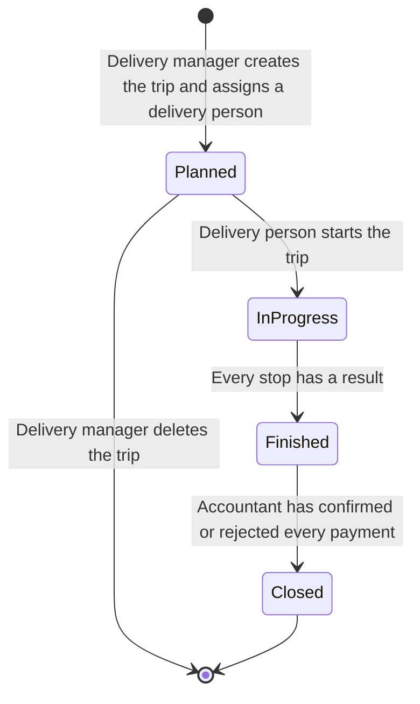
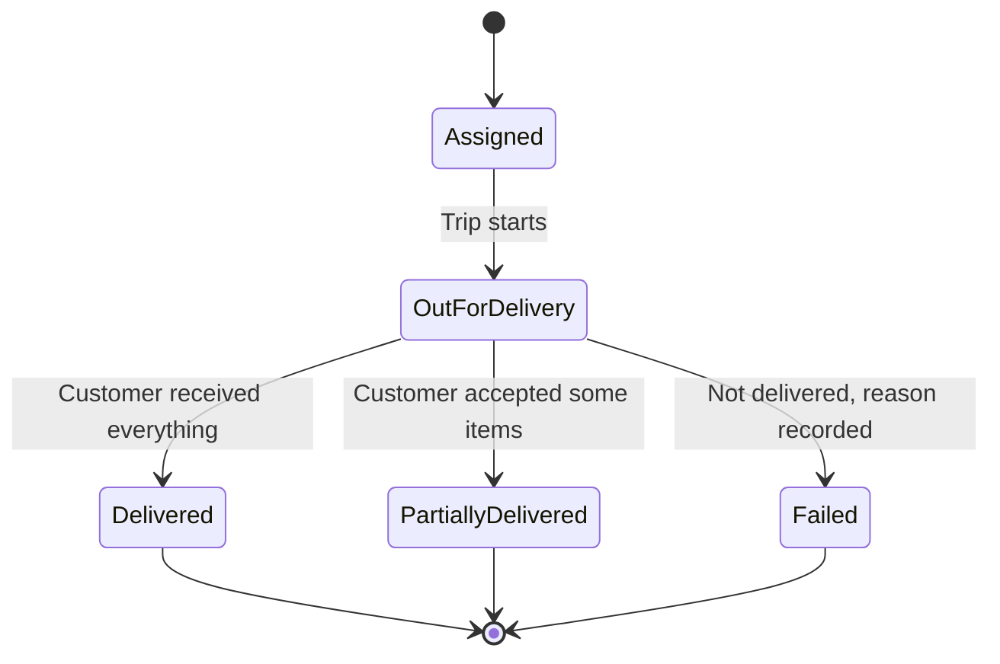
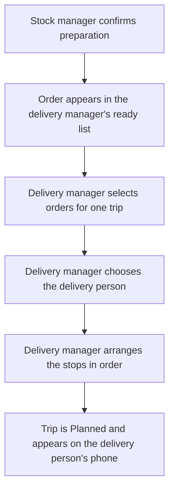
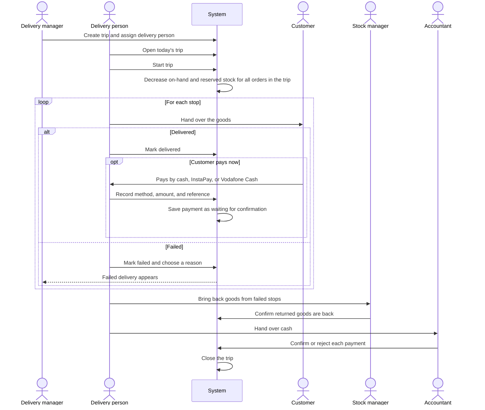

# Delivery

The delivery manager assigns ready orders to delivery people, so there is always one named person responsible for each order (C-28).

## Trip statuses

## Stop results

Each stop is one customer's order inside the trip.

## Planning a trip

## The delivery day

## Rules

| Rule | Decision |
|---|---|
| Only Ready orders can be added to a trip | |
| An order can be in only one active trip | |
| Every trip has exactly one delivery person | C-28 |
| Stock leaves the warehouse when the trip starts | C-25 |
| A failed stop needs a reason: customer not available, address problem, customer refused, other | C-21 |
| Goods from a failed stop go back to stock only after the stock manager confirms they are back | A-19 |
| After a failed stop, the order returns to Ready for another trip, or it is cancelled | A-19 |
| The delivery person sees only their own trips | A-23 |
| A payment recorded by the delivery person waits for the accountant. It does not count as paid yet | C-27 |
| A credit order has nothing to collect at the door | C-26 |
| No GPS, no live tracking, no automatic route | |

## Still open

- **O-04** — Does the delivery person capture a signature or a photo as proof of delivery?
- **O-10** — When a customer refuses some items at the door, is it recorded as a partial delivery or as a return?
