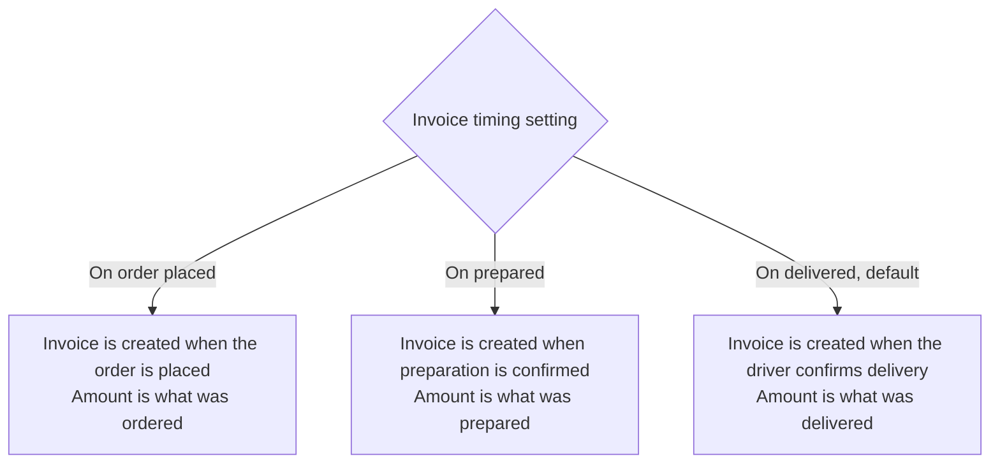
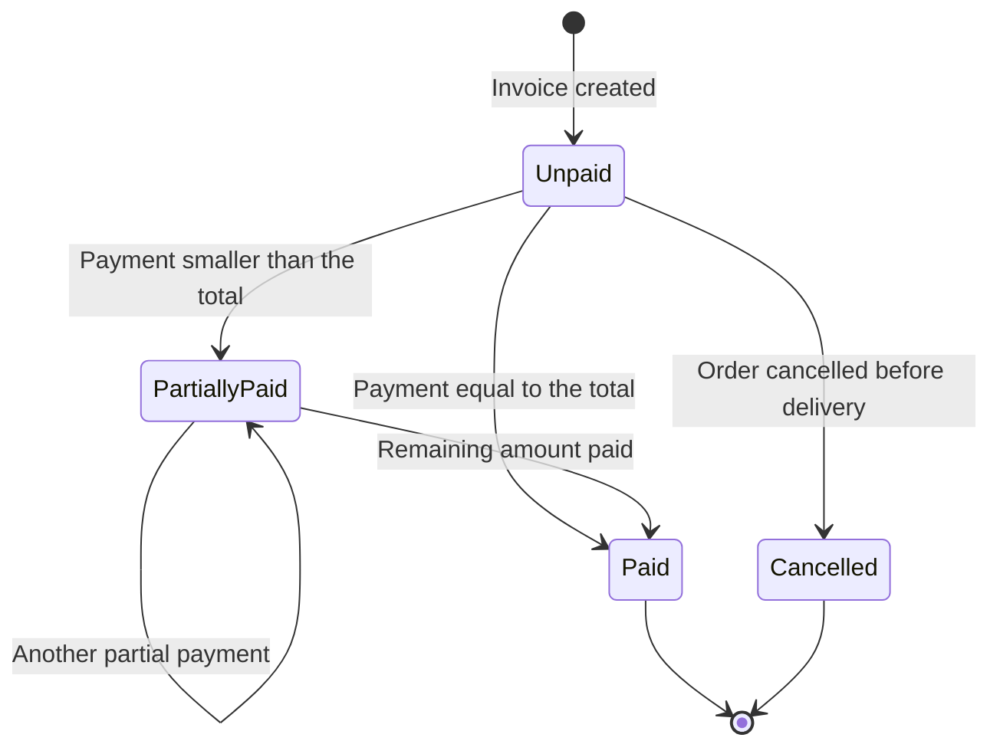
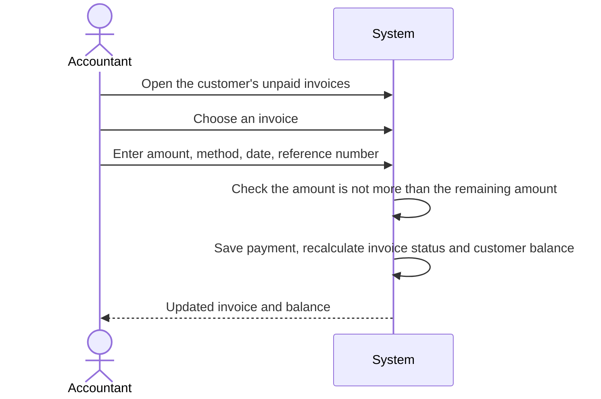
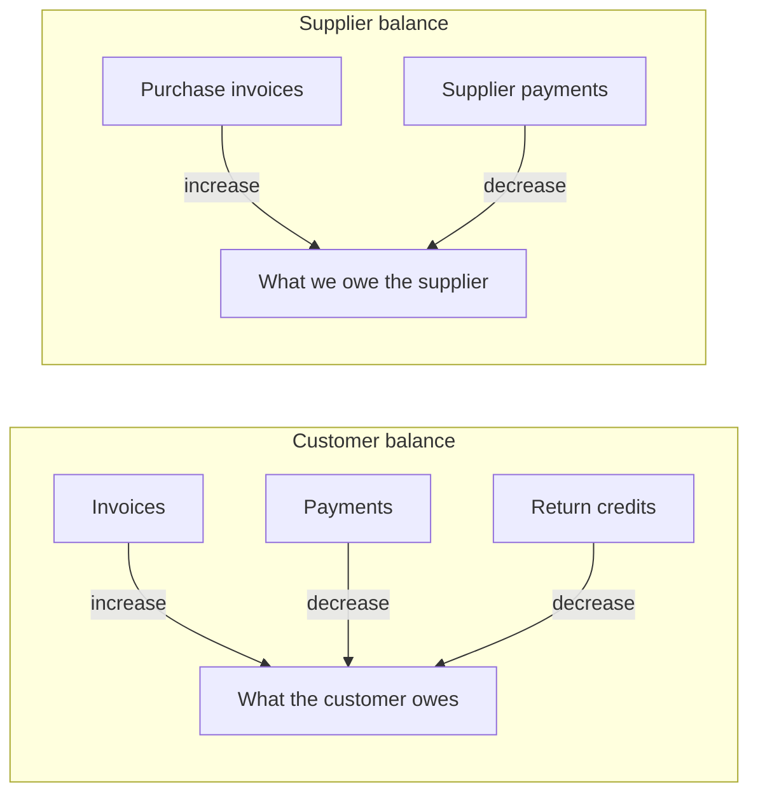

# Invoices and payments

## When the invoice is created (A-05)

The wholesaler chooses one of three moments in the settings. The default is "on delivered".

| Timing | Good | Bad |
|---|---|---|
| On order placed | The customer sees the amount immediately | Any change later (short stock, cancellation, failed delivery) means the invoice must be corrected or cancelled |
| On prepared | The invoice can be printed and sent with the goods | A failed delivery still needs the invoice to be cancelled |
| On delivered | The invoice always matches what the customer has | No printed invoice travels with the goods. A delivery note is used instead |

## Invoice statuses

The status is calculated from the payments. Nobody sets it by hand.

## Recording a customer payment

## Payment methods (C-16, A-14)

| Method | When the money arrives | Who records it |
|---|---|---|
| Cash on delivery | At the door | Driver records the cash. Accountant confirms the handover (A-16) |
| InstaPay | Before or after delivery | Accountant, with the reference number |
| Vodafone Cash | Before or after delivery | Accountant, with the reference number |
| Credit | Later | Accountant, when the customer pays. Only for customers with "credit allowed" (A-14) |
| Other | Any time | Accountant, with a note |

## Balances

A balance is never typed in. It is always calculated from the documents behind it, so it can be explained line by line.

## Rules

| Rule | Decision |
|---|---|
| Each payment belongs to one invoice | A-15 |
| A payment cannot be larger than the remaining amount of the invoice | |
| A saved payment cannot be edited. A wrong payment is cancelled with a reason and recorded again | C-10 |
| Invoices can be printed | |
| Invoices keep the price from the moment the order was placed, even if the product price changes later | |
| No tax integration and no payment gateway | C-15, C-18 |

## Still open

- **O-01** — Discounts and bonus units would change invoice lines.
- **O-09** — Cash refunds for returns.
