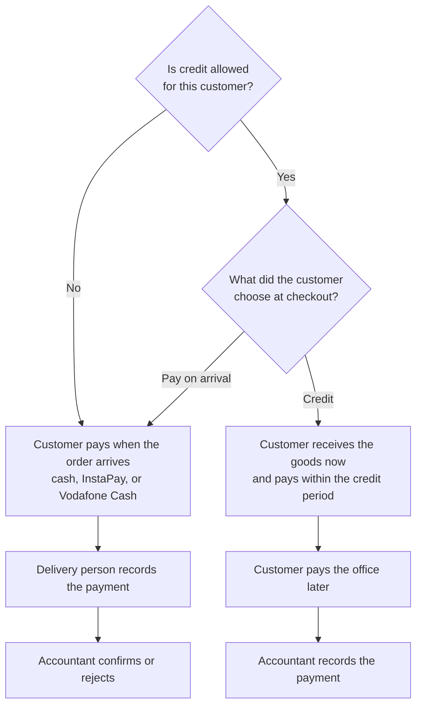
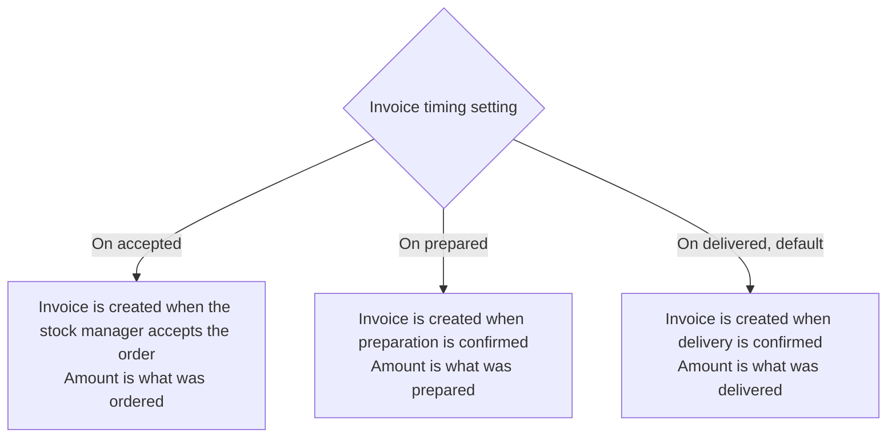
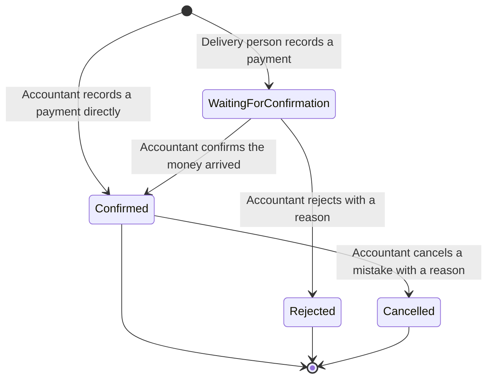
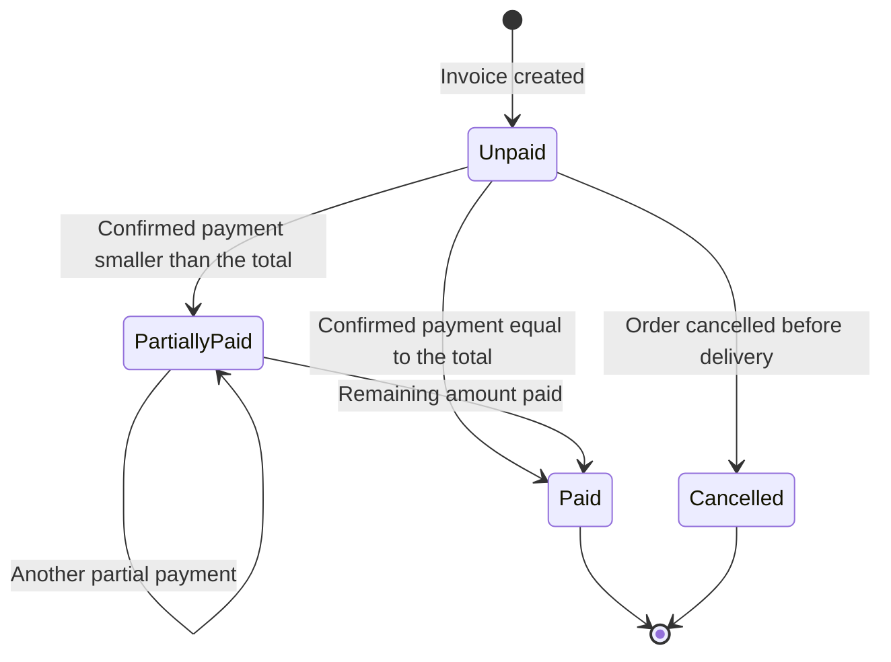
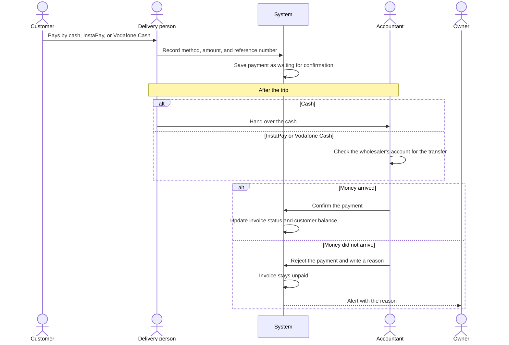
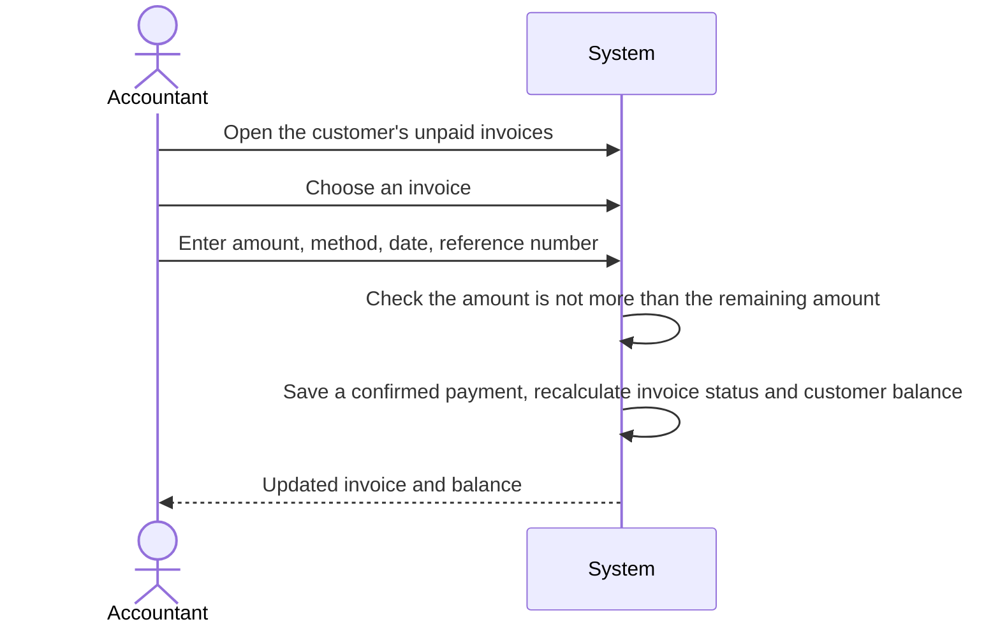
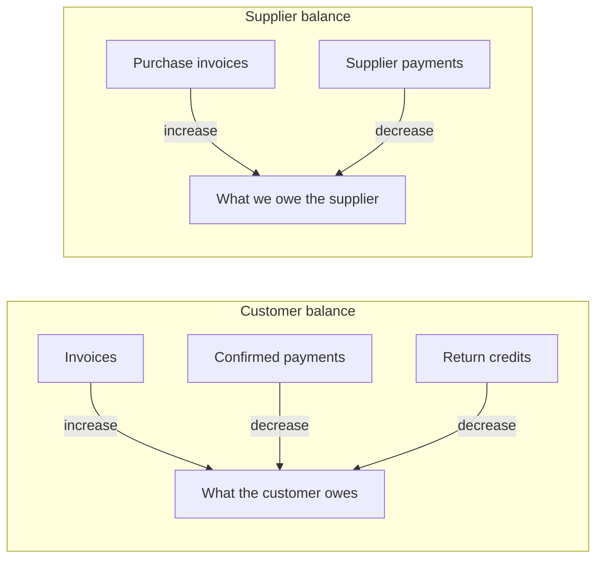

# Invoices and payments

## Two ways a customer pays (C-26)

| | Pay on arrival | Credit |
|---|---|---|
| Who can use it | Every customer | Only customers with "credit allowed" |
| When the money is paid | At the door | Later, before the due date |
| Who records it | Delivery person, then the accountant confirms | Accountant |
| Due date | The delivery day | Invoice date plus the customer's credit period (C-36) |

The credit period is set per customer. The default is one month, and the owner can change the default and each customer's period, for example to 15 days (C-26).

## When the invoice is created (C-58)

The owner chooses one of three moments in the settings. The default is "on delivered".

| Timing | Good | Bad |
|---|---|---|
| On accepted | The customer sees the amount early | Any change later (short stock, cancellation, failed delivery) means the invoice must be corrected or cancelled |
| On prepared | The invoice can be printed and sent with the goods | A failed delivery still needs the invoice to be cancelled |
| On delivered | The invoice always matches what the customer has | No printed invoice travels with the goods. A delivery note is used instead |

## Offers on the invoice (C-41)

| Offer | What the invoice shows |
|---|---|
| Discount | The normal price, the discount, and the price after discount for the line |
| Bonus units | The paid units at the normal price, and the free units as a separate line at price zero |

The invoice total is the amount after discounts.

## Items refused at the door (C-47)

The invoice covers the whole delivered order. The refused items are recorded as a return, and the return credit is taken off at once. The delivery person collects the invoice total minus that credit, so the customer pays only for what they kept.

## Payment statuses (C-27)

Only a **confirmed** payment changes the invoice status and the customer's balance.

## Invoice statuses

The status is calculated from the confirmed payments. Nobody sets it by hand.

An unpaid or partially paid credit invoice that is past its due date is shown as **overdue**. Overdue is a warning, not a status change, and it does not block the customer (C-33).

## Payment collected at delivery

## Payment made to the office

## Balances

A balance is never typed in. It is always calculated from the documents behind it, so it can be explained line by line.

## Rules

| Rule | Decision |
|---|---|
| Each payment belongs to one invoice | C-59 |
| A payment cannot be larger than the remaining amount of the invoice | |
| A payment from a delivery person counts only after the accountant confirms it | C-27 |
| A rejected payment needs a reason and alerts the owner | C-27, C-30 |
| A saved payment cannot be edited. A wrong payment is cancelled with a reason and recorded again | C-10 |
| The due date of a credit invoice is the invoice date plus the customer's credit period | C-26, C-36 |
| Overdue invoices are shown to the owner and accountant. Nothing is blocked automatically | C-33 |
| Invoices can be printed | |
| Invoices keep the price from the moment the order was placed, even if the product price changes later | |
| No tax integration and no payment gateway | C-15, C-18 |

## Still open

- **O-09** — Cash refunds for returns.
