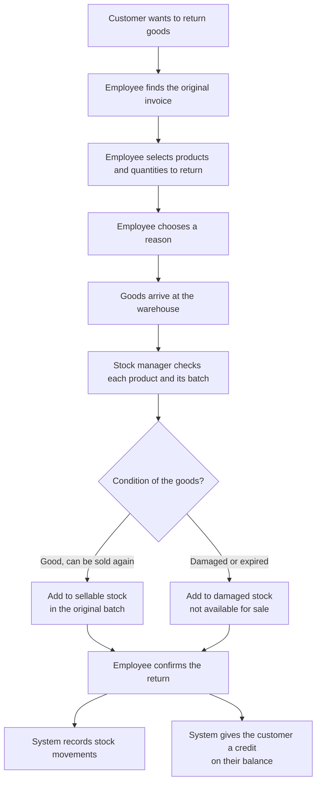
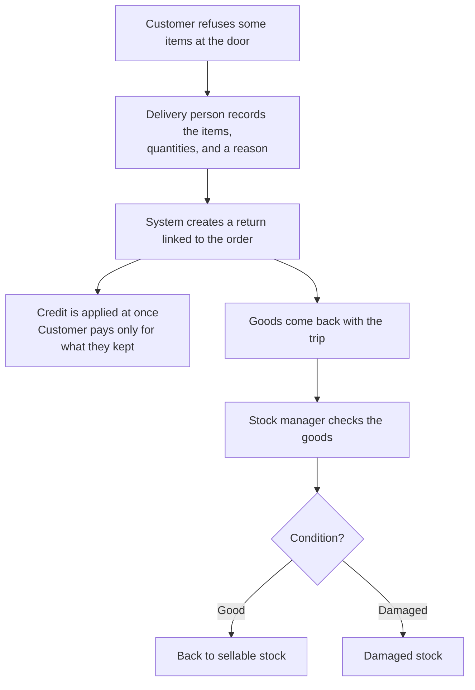
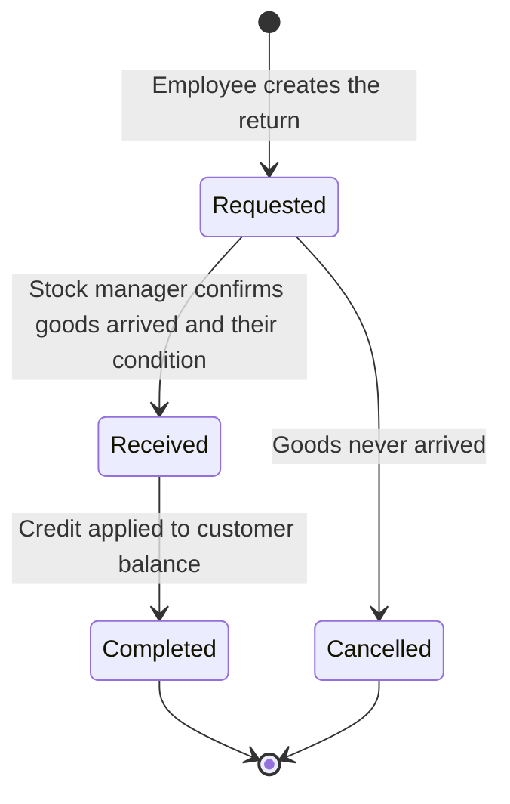
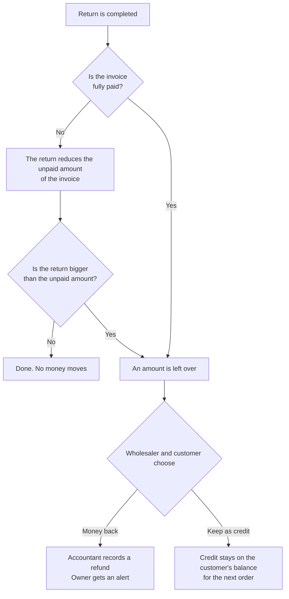

# Customer returns

A return is its own document, linked to the original invoice (C-19). It corrects both the stock and the customer's balance.

## The flow

## Items refused at the door (C-47)

When a customer refuses some items during delivery, it is the same kind of return, started by the delivery person.

The credit is applied at the door because the customer never kept the goods. The stock is corrected later, when the stock manager has the goods in hand.

## Return statuses

A return for items refused at the door follows the same statuses. The only difference is that its credit is applied when it is created, not at the end.

## Credit or money back (C-69)

Example: an invoice of 1,000 is paid 600. The customer returns goods worth 500. The unpaid 400 is cleared first. The other 100 is refunded or kept as a credit.

## Return reasons

- Customer no longer needs the product
- Damaged product
- Wrong product
- Wrong quantity
- Expired product
- Refused at the door
- Other (with a note)

## Rules

| Rule | Decision |
|---|---|
| A return must point to an original invoice | C-19 |
| The returned quantity cannot be more than the quantity on the invoice, minus earlier returns | |
| The stock manager decides the condition: sellable or damaged | C-60 |
| Sellable goods go back into their original batch, with its original expiry date | |
| Damaged goods are recorded but never become available for sale | C-60 |
| The customer gets a credit equal to the invoice price of the returned goods | C-60 |
| An employee creates the return. The customer can view it | C-62 |
| A return reduces the unpaid part of its invoice first. Only what is left over can be refunded | C-69 |
| Only the accountant records a refund, by cash, InstaPay, or Vodafone Cash | C-69 |
| Items refused at the door are a return created by the delivery person, with a reason | C-47 |
| For goods bought with a bonus offer, the credit per unit is the amount paid for the line divided by all its units, including the free ones | C-63 |

## Still to decide

- Is there a time limit for returns, for example 14 days after delivery?

Returns to a supplier are a different flow. See [Supplier returns](09-supplier-returns.md).
