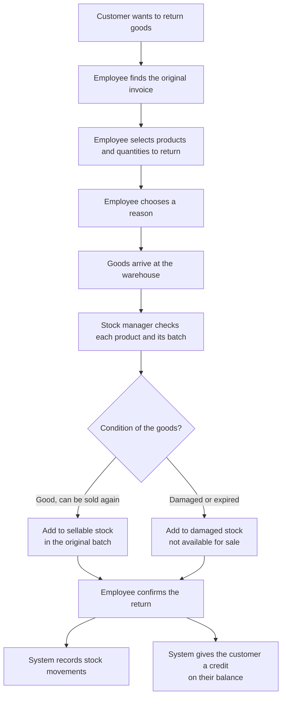
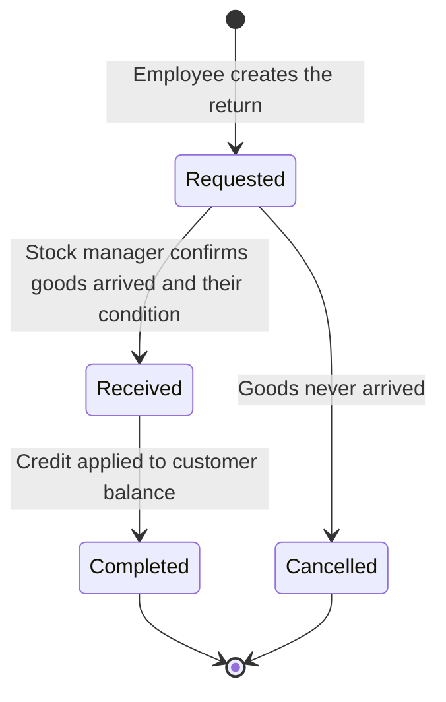

# Customer returns

A return is its own document, linked to the original invoice (C-19). It corrects both the stock and the customer's balance.

## The flow

## Return statuses

## Return reasons

- Customer no longer needs the product
- Damaged product
- Wrong product
- Wrong quantity
- Expired product
- Other (with a note)

## Rules

| Rule | Decision |
|---|---|
| A return must point to an original invoice | C-19 |
| The returned quantity cannot be more than the quantity on the invoice, minus earlier returns | |
| The stock manager decides the condition: sellable or damaged | A-09 |
| Sellable goods go back into their original batch, with its original expiry date | |
| Damaged goods are recorded but never become available for sale | A-09 |
| The customer gets a credit equal to the invoice price of the returned goods | A-09 |
| An employee creates the return. The customer can view it | A-22 |

## Still open

- **O-09** — Can the customer get cash back, or only a credit?
- **O-10** — Items refused at the door: partial delivery or return?
- **O-02** — Sending damaged or expired goods back to the supplier.
- Is there a time limit for returns, for example 14 days after delivery?
