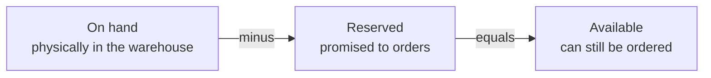
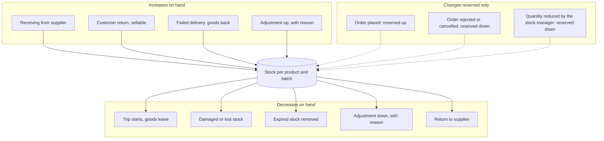
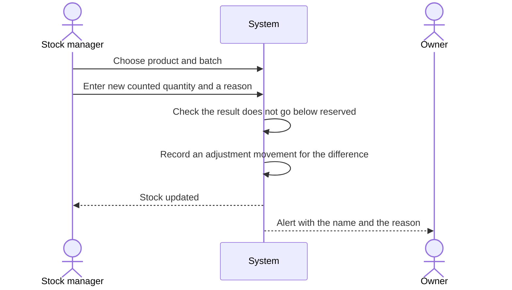

# Inventory movements

Stock is never edited directly (C-09). Every change is a recorded movement with a type, a quantity, a batch, a date, and the employee who did it. The stock numbers are the sum of the movements.

## The three numbers

## Everything that changes stock

| Movement | On hand | Reserved | Started by |
|---|---|---|---|
| Receiving from supplier | Up | | Stock manager confirms a receipt |
| Order placed | | Up | System |
| Order rejected or cancelled | | Down | System |
| Quantity reduced at acceptance or preparation | | Down | System, when the stock manager saves the change (C-38) |
| Trip starts | Down | Down | System, when the delivery person starts |
| Failed delivery, goods back | Up | Up if the order will be delivered again | Stock manager confirms |
| Customer return or items refused at the door, sellable | Up | | Stock manager confirms |
| Return to supplier | Down | | Stock manager confirms (C-42) |
| Customer return, damaged | Recorded as damaged, not sellable | | Stock manager confirms |
| Damaged, lost, or expired | Down | | Stock manager, with a reason |
| Manual adjustment | Up or down | | Stock manager, with a reason. The owner gets an alert |

## Reservation and batches

A reservation is made against the product, not against a specific batch. The batch is chosen later by the stock manager during preparation (C-14). This keeps ordering fast and leaves the physical choice to the person holding the box.

## Rules that must always be true

- On hand is never negative.
- Reserved is never more than on hand.
- Available is never negative.
- Every movement can be traced to a document (receipt, order, trip, return, supplier return, or adjustment) and an employee.
- Expired batches are not counted in available stock (A-17).

## Manual adjustment (C-10)

