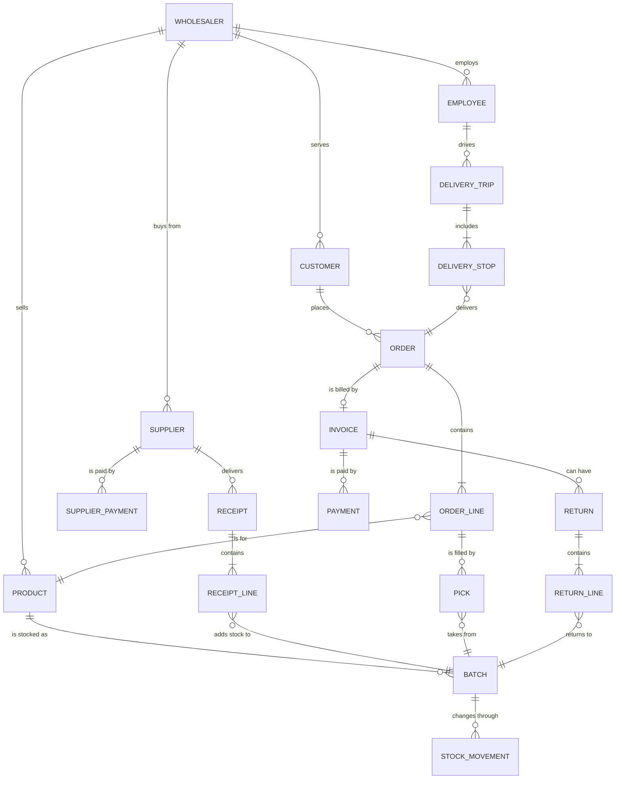

# Data map

This is a business-level map of the things the app stores and how they connect. It is not a database design. Exact tables and fields are decided in the technical design stage.

## How to read it

- `||--o{` means one to many. For example, one customer has many orders.
- `||--o|` means one to zero or one.
- `||--|{` means one to one or more.

## The map

## What each thing is

| Thing | Meaning |
|---|---|
| Wholesaler | One business workspace. All other data belongs to exactly one wholesaler (A-12) |
| Employee | A person who works for the wholesaler, with one role |
| Customer | A pharmacy or store with a login |
| Supplier | A company the wholesaler buys from. No login |
| Product | An item in the catalog with one selling price |
| Batch | One lot of a product with a batch number, expiry date, and its own stock |
| Stock movement | One recorded change to a batch's stock |
| Receipt | One delivery from a supplier, with the supplier's invoice details |
| Receipt line | One product and batch inside a receipt |
| Supplier payment | Money paid to a supplier |
| Order | A customer's request for products |
| Order line | One product and quantity inside an order |
| Pick | The batch and quantity a warehouse employee actually took for an order line |
| Delivery trip | One driver's outing |
| Delivery stop | One order inside a trip, with its result |
| Invoice | The bill for an order |
| Payment | Money received from a customer for an invoice |
| Return | Goods a customer sent back, linked to an invoice |
| Return line | One product, batch, quantity, and condition inside a return |

## Questions this map answers

- Which pharmacies received a specific batch? Batch → Pick → Order line → Order → Customer. This matters when a product is recalled.
- Why does a customer owe this amount? Customer → Orders → Invoices → Payments and Returns.
- Why is the stock of a product what it is? Product → Batches → Stock movements.

## What could change this map

| Decision | Effect on the map |
|---|---|
| O-01 Discounts and bonus units | Order lines and invoice lines need extra fields |
| O-02 Supplier returns | A new "supplier return" thing linked to supplier and batch |
| O-03 Purchase invoice arrives later | Receipt and purchase invoice become two separate things |
| A-15 Payment per invoice | If payments can cover several invoices, a new link between payment and invoice is needed |
| A-12 Tenancy | If a customer can buy from several wholesalers, customer is no longer owned by one wholesaler |
