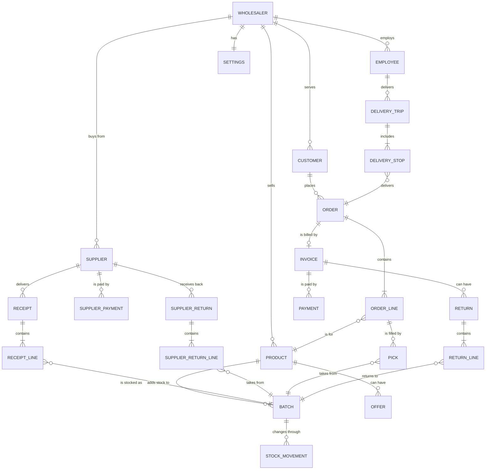

# Data map

This is a business-level map of the things the app stores and how they connect. It is not a database design. Exact tables and fields are decided in the technical design stage.

## How to read it

- `||--o{` means one to many. For example, one customer has many orders.
- `||--o|` means one to zero or one.
- `||--|{` means one to one or more.

## The map

## What each thing is

| Thing | Meaning |
|---|---|
| Wholesaler | One business workspace. All other data belongs to exactly one wholesaler (C-52) |
| Employee | A person who works for the wholesaler, with one or more roles (C-31) |
| Customer | A pharmacy or store with a login, a credit switch, and a credit period (C-26) |
| Supplier | A company the wholesaler buys from. No login |
| Product | An item in the catalog with one selling price |
| Batch | One lot of a product with a batch number, expiry date, and its own stock |
| Stock movement | One recorded change to a batch's stock |
| Receipt | One delivery from a supplier, with the supplier's invoice details |
| Receipt line | One product and batch inside a receipt |
| Supplier payment | Money paid to a supplier |
| Supplier return | Goods sent back to a supplier, with a reason. It reduces stock and the amount owed (C-42) |
| Offer | A discount or a bonus-units rule on a product, with optional dates (C-41) |
| Settings | The wholesaler's working hours, default credit period, invoice timing, near-expiry period, and supplier return approval (C-40, C-65) |
| Order | A customer's request for products, accepted or rejected by the stock manager (C-24) |
| Order line | One product inside an order, with the ordered quantity, the current quantity, the must-have mark, and any discount or bonus units (C-39, C-41) |
| Pick | The batch and quantity the stock manager actually took for an order line |
| Delivery trip | One delivery person's outing |
| Delivery stop | One order inside a trip, with its result and whether the signed paper was received (C-44) |
| Invoice | The bill for an order |
| Payment | Money received from a customer for an invoice. It counts only after the accountant confirms it (C-27) |
| Return | Goods a customer sent back or refused at the door, linked to an invoice (C-47) |
| Return line | One product, batch, quantity, and condition inside a return |

## Questions this map answers

- Which pharmacies received a specific batch? Batch → Pick → Order line → Order → Customer. This matters when a product is recalled.
- Why does a customer owe this amount? Customer → Orders → Invoices → Payments and Returns.
- Why is the stock of a product what it is? Product → Batches → Stock movements.

## What could change this map

| Decision | Effect on the map |
|---|---|
| O-09 Cash refunds | A refund would be a new kind of payment going out to the customer |
| C-59 Payment per invoice | If payments can cover several invoices, a new link between payment and invoice is needed |
| C-52 Tenancy | If a customer can buy from several wholesalers, customer is no longer owned by one wholesaler |
