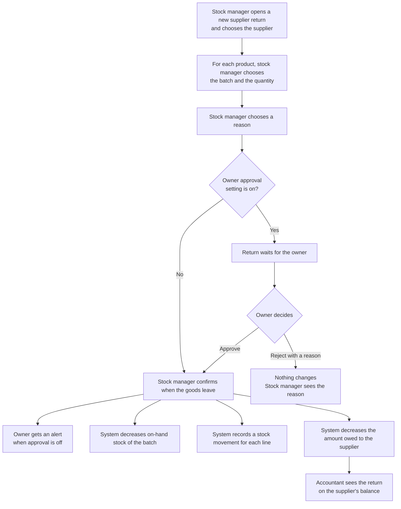
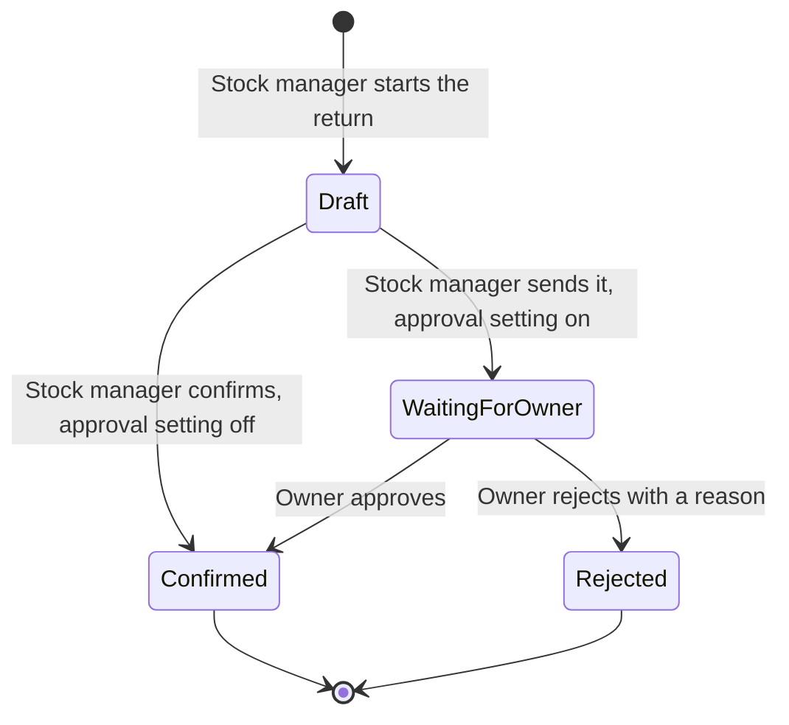

# Supplier returns

The wholesaler can send goods back to a supplier, for example expired or damaged goods (C-42). The return corrects both the stock and the amount owed to the supplier.

## The flow

## Statuses

Stock and the supplier's balance change only when the return is Confirmed.

## Return reasons

- Expired
- Close to expiry
- Damaged
- Wrong product delivered
- Other (with a note)

## Rules

| Rule | Decision |
|---|---|
| A reason is required | C-42 |
| The quantity cannot be more than the on-hand stock of the batch that is not reserved | C-08 |
| Expired and damaged stock can be returned, even though it cannot be sold | C-55 |
| The value of the return is the cost price from the receipt of that batch | |
| The supplier's balance decreases by that value | C-42 |
| If the supplier sends new goods in exchange, they are recorded as a normal receipt | C-42 |
| A confirmed supplier return cannot be edited | C-09 |
| The owner chooses in the settings whether a supplier return needs approval. The default is no approval, with an alert to the owner | C-65 |
| While a return waits for the owner, its quantity cannot be sold or reserved | C-65 |
