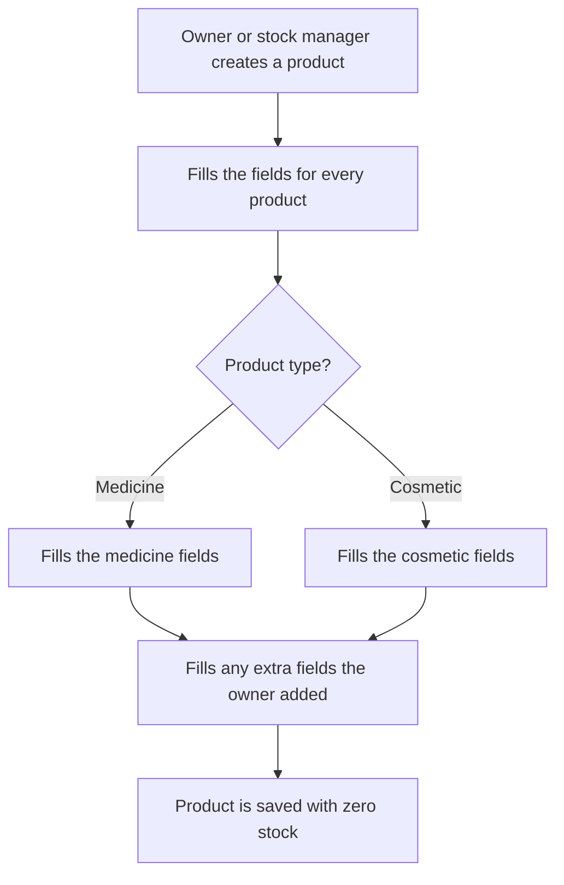
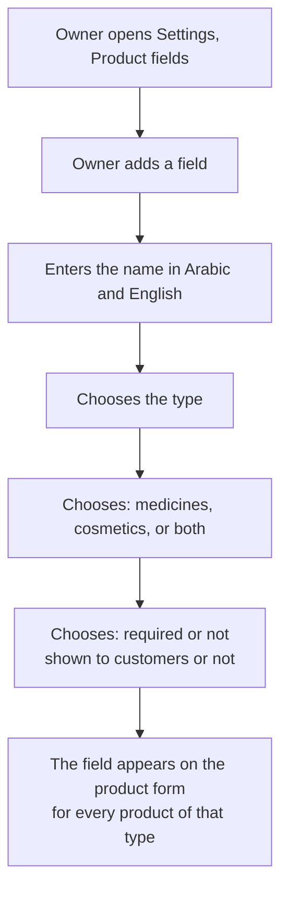

# Product fields

This is the list of fields a product has (C-66). The owner chooses the product type first, and the form shows only the fields for that type.

## Fields for every product

| Field | Required | Shown to customers | Note |
|---|---|---|---|
| Name in Arabic | Yes | Yes | |
| Name in English | Yes | Yes | |
| Product type | Yes | Yes | Medicine or cosmetic |
| Barcode | No | No | Some local products have none |
| Brand or manufacturer | Yes | Yes | |
| Category | Yes | Yes | For example "pain relief" or "hair care" |
| Selling unit | Yes | Yes | For example "box" (C-50) |
| Pack size | Yes | Yes | As written on the pack, for example "20 tablets" or "200 ml" |
| Cost price | Yes | No | Only the owner and accountant see it |
| Selling price | Yes | Yes | Only the owner can change it (C-64) |
| Image | No | Yes | |
| Description | No | Yes | |
| Batch and expiry tracking | Yes | No | On or off (C-13) |
| Active | Yes | No | Inactive products are hidden from customers |

## Extra fields for medicines

| Field | Required | Shown to customers | Note |
|---|---|---|---|
| Active ingredient | Yes | Yes | The scientific name. Customers can search by it |
| Strength | Yes | Yes | For example "500 mg" |
| Dosage form | Yes | Yes | Tablet, capsule, syrup, injection, cream, drops, and so on |
| Storage | Yes | Yes | Room temperature, or fridge (2 to 8 °C) |
| Public price | No | Yes | The price printed on the pack, shown next to the selling price |
| Registration number | No | No | The Egyptian Drug Authority number |
| Needs a prescription | No | Yes | Yes or no |

## Extra fields for cosmetics

| Field | Required | Shown to customers | Note |
|---|---|---|---|
| Shade or colour | No | Yes | Name and number, for makeup and hair dye |
| Suitable for | No | Yes | Skin type or hair type |
| Period after opening | No | Yes | For example "12 months" |

## Extra fields added by the owner (C-71)

The fixed fields above cover what most wholesalers need. When an owner needs more, for example "country of origin" or "importer", they add the field themselves in the settings. No developer is needed.

| Setting of an extra field | Choices |
|---|---|
| Name | In Arabic and English |
| Type | Text, number, yes or no, date, or a choice from a list the owner writes |
| Applies to | Medicines, cosmetics, or both |
| Required | Yes or no |
| Shown to customers | Yes or no |

Rules for extra fields:

- Up to 20 extra fields per wholesaler. This keeps the product form short and clear. The limit can be raised later if real wholesalers need more.
- An extra field only stores and shows information. It never changes stock, prices, offers, or order rules.
- A new required field does not block old products. They are asked for the value the next time someone edits them.
- A field is never deleted, only switched off. Its old values stay in the history.
- Each wholesaler has its own extra fields. Other wholesalers do not see them (C-52).

## Rules

| Rule | Decision |
|---|---|
| Each shade or size is its own product, with its own barcode, price, and stock | C-67 |
| A product with storage "fridge" shows a "keep cold" mark on preparation and delivery screens | C-68 |
| Controlled medicines that need special records are not in the first version | C-70 |
| Categories, brands, and dosage forms are chosen from lists, so the catalog stays clean and searchable. The owner and stock manager manage the lists | C-74 |
| The public price is optional | C-84 |
| The owner can add up to 20 extra fields of their own | C-71 |

